# Food Safety & Restaurant Inspection Analytics

Our first data-science project. We took four years of Chicago food inspections, cleaned them, stored them in a data warehouse, answered the city's questions with SQL, trained three simple models, and stored the same data in two more kinds of warehouse (distributed and real-time) to compare them.

Group project · Department of Computer Engineering · Guide: **Mrs. Shubhangi Kale** · Source code: <https://github.com/r11shi/eda>

| PRN | Name | Parts |
|---|---|---|
| 202502040037 | Rushikesh Maddewad | D, E, J, setup, dashboard, demo |
| 202502040010 | Omkar Patil | A |
| 202502040013 | Aryan Tandale | B, C, F |
| 202502040035 | Vishwaraj Savairam | G, H, I |

This is **the study guide**: read it from top to bottom once and you will know what was done in every part, in what order, how, and with what result. Every part is written the same way:

- **Goal**, **input → output**, the files.
- **The steps in detail**: a short tutorial of exactly what happens to the data.
- **The diagram, explained**: how to read the picture, box by box.
- **The code**: the important lines, explained line by line.
- **What came out**: real screenshots from our run, and how to read each one.
- **See it yourself**: what to open or run.
- **In one sentence**: the summary to remember.

The two companion documents are **Doubts & Answers** (every question mam may ask, answered) and **Team Script** (who says what in the presentation).

---

## Contents

1. [The project in one picture](#the-project-in-one-picture)
2. [Words you need](#words-you-need)
3. [Setting up: open everything](#setting-up-open-everything)
4. [What is in each folder](#what-is-in-each-folder)
5. [Part A · Clean and explore the data](#part-a--clean-and-explore-the-data)
6. [Part B · Design the warehouse](#part-b--design-the-warehouse)
7. [Part C · Load and check the warehouse (ETL)](#part-c--load-and-check-the-warehouse-etl)
8. [Part F · Business questions, OLAP and the dashboard](#part-f--business-questions-olap-and-the-dashboard)
9. [The analytics table: the bridge to the models](#the-analytics-table-the-bridge-to-the-models)
10. [Part G · Regression](#part-g--regression)
11. [Part H · Association rules](#part-h--association-rules)
12. [Part I · Decision tree](#part-i--decision-tree)
13. [Part D · Distributed warehouse (Citus)](#part-d--distributed-warehouse-citus)
14. [Part E · Real-time warehouse](#part-e--real-time-warehouse)
15. [Part J · Comparing the three warehouses](#part-j--comparing-the-three-warehouses)
16. [Results at a glance](#results-at-a-glance)
17. [How we show each part in the presentation](#how-we-show-each-part-in-the-presentation)

---

## The project in one picture


> **How to read it:** follow the arrows from left to right. The **raw CSV** (73,630 rows from the city) is **cleaned** in Python, waits in a **staging table**, and is loaded into the **batch warehouse** (blue): PostgreSQL with a star schema. Everything else reads that warehouse: **SQL & OLAP** answer the 10 business questions, the **dashboard** shows them, and the **3 models** learn from it. The two **dashed** lines are copies of the same data into the two other warehouses the brief asks for: **distributed** (Citus, green) and **real-time** (Kafka → Spark → ClickHouse → Grafana, orange).  
> **Why we made it:** every question about the project belongs to one box in this picture.

The order we built it in, and the order of this guide:

| Step | Part | What | Tool |
|---|---|---|---|
| 1 | A | understand and clean the data, explore it with charts | Python, pandas, Jupyter |
| 2 | B | design the warehouse tables (star schema) | PostgreSQL |
| 3 | C | load the data into the warehouse and check it (ETL) | Python + SQL |
| 4 | F | answer the 10 business questions, OLAP, dashboard | SQL, Plotly |
| 5 | – | build one flat table for the models | SQL |
| 6 | G, H, I | regression, association rules, decision tree | scikit-learn, mlxtend |
| 7 | D | the same warehouse on 3 nodes | Citus |
| 8 | E | the same data as a live stream | Kafka, Spark, ClickHouse, Grafana |
| 9 | J | compare the three warehouses | – |

---

## Words you need

| Word | In plain English |
|---|---|
| **Profiling** | Looking at every column before changing anything: what values, how many missing, what looks wrong. |
| **Data cleaning / curation** | Fixing problems with written rules, and recording how many rows each rule changed. |
| **Derived attribute** | A new column we calculate from existing ones (for example violation count from the violations text). |
| **EDA** | Exploratory data analysis: summaries and charts to understand the data. |
| **Data warehouse** | A database built for asking questions about many records at once (analysis), not for running an app. |
| **Fact table** | The table of events with numbers you can add up. Ours: one row per completed inspection. |
| **Dimension table** | A lookup table that describes the facts: when, where, which place, what kind, what result. |
| **Grain** | What exactly one row of the fact table means. |
| **Surrogate key** | A simple integer the warehouse gives each dimension row (1, 2, 3 …) and uses in joins. |
| **Natural key** | The id that comes from the source, for example the licence number. |
| **Star schema** | One fact table in the middle, dimension tables around it, like a star. |
| **Snowflake schema** | A star whose dimension tables are split into smaller tables (for example facility → facility type → facility group). |
| **Fact constellation** | Two or more fact tables sharing the same dimension tables. |
| **ETL** | Extract (read) → Transform (clean, find keys) → Load (insert). |
| **Staging** | A landing table where new data waits before entering the warehouse. |
| **Initial / incremental load** | The first big load / later loads of only the new data. |
| **Index** | A lookup structure, like a book index, that makes searches on a column fast. |
| **OLAP** | Looking at the same numbers at different levels and from different angles. |
| **Window function (LAG)** | SQL that looks at the previous row of the same group, for example the previous inspection of the same restaurant. |
| **Train / validation / test** | Learn on old data / tune settings on newer data / check once on the newest data. |
| **One-hot encoding** | Turning a word column into several 0/1 columns, one per value, so a model can use it. |
| **Overfitting** | A model that memorises its training data and does badly on new data. |
| **Shard** | One piece of a table that has been split across database nodes. |
| **Stream** | Data processed event by event as it arrives, instead of in big batches. |

---

## Setting up: open everything

Everything runs inside **Ubuntu on Windows (WSL)**. Double-click **`Start_Project.cmd`** in the project folder and wait for "Everything is running" (about 3 minutes). Then open these:

| What | Link or place | Login | Used for |
|---|---|---|---|
| Notebooks (JupyterLab) | <http://localhost:8888/lab/tree/notebooks> | none | Parts A, G, H, I |
| Notebook 01, cleaning | <http://localhost:8888/lab/tree/notebooks/01_data_curation.ipynb> | | Part A |
| Notebook 02, EDA | <http://localhost:8888/lab/tree/notebooks/02_eda.ipynb> | | Part A |
| Notebook 07, regression | <http://localhost:8888/lab/tree/notebooks/07_regression.ipynb> | | Part G |
| Notebook 08, association rules | <http://localhost:8888/lab/tree/notebooks/08_association_mining.ipynb> | | Part H |
| Notebook 09, decision tree | <http://localhost:8888/lab/tree/notebooks/09_decision_tree.ipynb> | | Part I |
| The warehouse (pgAdmin) | server `localhost`, port `5432`, database `foodsafety` | `foodsafety` / `foodsafety` | Parts B, C, F |
| Demo queries | `sql/demo_queries.sql`, opened in pgAdmin | | Parts B, C, F |
| Citus cluster (pgAdmin) | server `localhost`, port `5440`, database `foodsafety_citus` | `postgres`, no password | Part D |
| Grafana, real-time | <http://localhost:3000/d/food-safety-rt> | none | Part E |
| ClickHouse, real-time data | <http://localhost:8123/play> | none | Part E |
| Dashboard | double-click `dashboard/food_safety_dashboard.html` | none | Part F |
| One part at a time | double-click `Project_Menu.cmd` | | every part |

Every notebook cell now has a grey note above it: **In plain words** (what the cell does) and **Look for** (what to check in its output). Read the note, then the output.

`Project_Menu.cmd` runs or shows one part at a time and prints every command it uses:

```
    0  Are the servers running?
    1  Part A  clean the data + EDA charts         6  Part G  regression
    2  Part B  build the star schema and load it   7  Part H  association rules
    3  Part C  the 5 checks, 10 questions, indexes 8  Part I  decision tree
    4  Part F  OLAP queries + the dashboard        9  Part D  Citus distributed test
    5  The analytics table the models read        10  Part E  real-time replay
   SHOW ONLY (changes nothing):  11 data files   12 warehouse tables   13 Citus cluster   14 real-time data
```

---

## What is in each folder

```
run_all.py               runs Parts A, B, C, F, G, H, I in order (10 minutes)
Start_Project.cmd        starts every server        Project_Menu.cmd   one part at a time
Replay_Stream.cmd        live replay for Grafana
data/raw/                the original Chicago file (73,630 rows, zipped)
data/curated/            the cleaned file made by notebook 01
notebooks/               01 cleaning · 02 EDA · 07 regression · 08 association rules · 09 decision tree
etl/                     Python scripts that load and query the warehouse
   curation.py              the cleaning rules (Part A)
   run_etl.py               loads the warehouse (Part C)
   model_comparison.py      star vs snowflake vs constellation (Part B)
   run_queries.py           the business questions + index test (Parts C, F)
   run_olap.py              the OLAP operations (Part F)
   distributed_*.py         the Citus experiment (Part D)
sql/                     01 tables · 02 load procedure · 03 indexes · 04 checks · 05 snowflake
                         06 business questions · 07 OLAP · 08 analytics table · demo_queries
dashboard/               the dashboard builder and the finished HTML page
streaming/               producer, Spark job, ClickHouse tables, Grafana dashboard (Part E)
scripts/                 setup, start and run scripts for WSL
results/                 every output table (CSV) the scripts write
docs/                    report, slides, images, screenshots, console logs, script, doubts
```

The database has six **schemas** (folders inside the database):

| Schema | Holds |
|---|---|
| `staging` | the waiting room (`inspection_stg`) and the record of every load (`load_audit`) |
| `dw` | **the warehouse**: 5 dimension tables and 2 fact tables |
| `snow` | the snowflake copy, built only to compare designs |
| `mart` | the one flat table the three models read |
| `bench` | bigger copies of the fact table, only for the Citus speed test |
| `results` | small result tables for the report |

---

## Part A · Clean and explore the data

**Goal:** turn the city's raw file into a clean, documented table that we can trust, and understand it with charts.
**Input → output:** `data/raw/food_inspections_2022_2025.csv` (73,630 rows, 17 columns) → `data/curated/inspections_curated.csv` (73,601 rows, 39 columns) + EDA charts.
**Owner:** Omkar · **Files:** `etl/curation.py` (the rules), `notebooks/01_data_curation.ipynb`, `notebooks/02_eda.ipynb`, `docs/data_quality_report.md` (the log)

### The steps in detail

1. **Get the data.** The City of Chicago publishes *Food Inspections* (dataset `4ijn-s7e5`). We downloaded every record from 1 January 2022 to 31 December 2025 through its API (`scripts/fetch_data.py`) and saved it zipped in `data/raw/` so the project also works offline. 17 columns: id, business name, licence, facility type, risk, address, city, state, ZIP, date, inspection type, result, violations text, latitude, longitude.
2. **Profile every column before touching it** (notebook 01, first cells). We counted missing values, listed the real values of each column and looked for problems. What we found:
   - **Results** include visits that are not inspections: *Out of Business* (5,304), *No Entry* (4,991), *Not Ready* (1,562), *Business Not Located* (19).
   - **Risk** has an invalid value *All* (38 rows) and 17 empty.
   - **City** is spelled *CHICAGO*, *Chicago*, *chicago*, *CCHICAGO* …
   - **Facility type** is typed by hand: **217** different spellings.
   - **Violations** is one long text, like `"34. FLOORS MUST BE CLEAN … | 35. WALLS …"`.
   - **Time of day** is always 00:00:00, so no hourly analysis is possible.
3. **Clean with written rules.** All rules are in `etl/curation.py`, the same file the ETL uses later. Every rule writes one line to a log: the problem, how many rows, what we did, why. The main rules:
   - removed **29** reports that were entered twice (same licence, date, type, result and text);
   - mapped invalid codes (risk *All*) to **Unknown** instead of deleting the row;
   - grouped the 217 facility types into **7 groups** with keyword rules (Restaurant & Food Service, Schools & Childcare, Retail Food & Grocery, …);
   - counted the **violation numbers** in the text to get a violation count;
   - a *Fail* with no violation text (552 rows) gets count **unknown**, not 0, because a fail always has at least one violation;
   - visits that never happened (**11,864**) are **kept** but marked `is_completed = False`, so they are never counted as inspections.
4. **Give each place an identity.** A place is identified by its **licence number**; when the licence is missing or 0, by its **name + address**. This becomes the place's natural key (`facility_nk`) in the warehouse.
5. **Derive new columns** the brief asks for, each with a documented formula: year, quarter, month, day of week, weekend flag, **season** (Dec-Feb winter …), **result group** (Pass / Conditional Pass / Fail / Not Completed), **risk group** (High / Medium / Low), **facility group**, **inspection type group**, **violation band** (None 0, Low 1-2, Medium 3-5, High 6-9, Very High 10+), **high-violation flag** (6 or more), and **area** of the city (the quadrant of Chicago's street grid around State & Madison: NorthWest, NorthEast, SouthWest, SouthEast).
6. **Reconcile.** Compare the counts before and after cleaning: 73,630 raw − 29 duplicates = 73,601 curated rows; 61,737 of them are completed inspections.
7. **Save** `data/curated/inspections_curated.csv`.
8. **Explore (EDA, notebook 02)** with five kinds of analysis the brief lists: numerical (mean, median, quartiles, skewness), categorical (frequencies and cross-tables with the result), temporal (year, quarter, month, week, weekday), geographic (ZIP codes and the map), and outcome (counts vs rates).

### The diagram, explained


> **How to read it:** three bars drawn to the same scale. Top: the 73,630 rows the city gave us. Middle: 73,601 after removing the 29 duplicates (the bars look equal because 29 is tiny). Bottom, blue: the 61,737 **completed** inspections, the rows that become facts in the warehouse. The gap between the middle and bottom bar is the 11,864 visits that never happened, which we keep in staging but never count.  
> **Why we made it:** to show at a glance that nothing disappeared without a reason.

### The code

Counting the violations in the text:

```python
def violation_codes(text):
    """'34. FLOORS ... | 35. WALLS ...'  ->  [34, 35]"""
    if not isinstance(text, str):            # no text at all (a clean pass, or a visit that did not happen)
        return []
    return [int(m.group(1))                  # the number at the start of each piece
            for part in text.split("|")      # one piece per violation
            for m in [re.match(r"^\s*(\d+)\.", part)] if m]
```

- `text.split("|")` cuts the long text into one piece per violation.
- `re.match(r"^\s*(\d+)\.", part)` finds the rule number at the start of a piece (`34.`).
- The **count** of numbers is the violation count; the numbers themselves are kept for the "most common violations" question.

Removing duplicate reports:

```python
key = ["license_number", "inspection_date", "inspection_type", "results", "violations"]
same_content = df[has_lic].duplicated(subset=key, keep="first")   # True for the 2nd, 3rd … copy
df = df.drop(index=same_content[same_content].index)              # 29 rows removed
```

- Two rows with the same licence, day, type, result and violation text are the same report entered twice.
- `keep="first"` keeps one copy and marks the others; we drop the marked ones.

Giving each place an identity:

```python
df["facility_nk"] = np.where(lic_ok, "L" + df["license_number"],                      # licence when we have one
                             "N|" + df["dba_name"].str.upper() + "|" + df["address"].str.upper())   # else name + address
```

### What came out


> **How to read it:** this is the printed output of notebook 01's profiling cells. First the size (73,630 rows, 17 columns) and date range. Then the value counts of **results** (notice Out of Business, No Entry, Not Ready: not real inspections), **risk** (notice *All* = invalid and *NaN* = missing), **state** and **city** (notice the spelling variants), and finally the number of different facility types (217).  
> **Why it matters:** each odd value here is the reason for one cleaning rule.

| Problem found | Rows | What we did | Why |
|---|---|---|---|
| Same report entered twice | 29 | removed | it is one inspection |
| Invalid risk value "All" | 38 | set to Unknown | the brief says don't drop useful rows |
| Facility type typed by hand | 217 spellings | 7 groups | so we can compare groups |
| Fail with no violation text | 552 | count = unknown | a fail always has violations |
| Visit never happened | 11,864 | kept, not counted | they are not inspections |
| Very high violation counts | 2,686 | kept and flagged | they are real |
| Licence missing or 0 | 213 | identified by name + address | so the place still has an identity |


> **How to read it:** top-left, a **histogram** of the violation count: tall bars on the left (0-5 violations) and a long tail to the right. Top-middle, **box plots** per result: the box is the middle 50% of inspections, the line inside is the median; the Fail box sits higher than Pass. Bottom-left, the box plot of all counts: the dots on the right are outliers. The other panels show inspections per place and per month.  
> **Why we made it:** to understand the number we later try to predict, and to see that extreme counts exist.

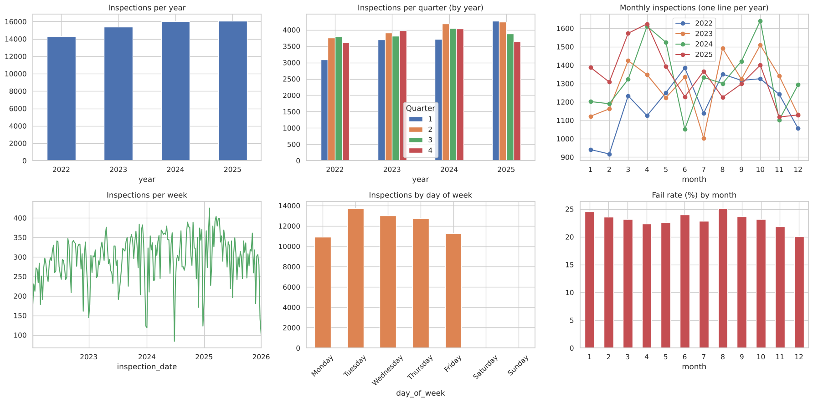

> **How to read it:** six small charts. Top row: inspections per year (slowly rising from 14,281 to 16,052), per quarter, and one line per year by month. Bottom row: inspections per week, per weekday (weekends almost empty: inspectors work Monday to Friday), and the fail rate per month (between about 20% and 25%, no strong season).  
> **Why we made it:** the brief asks for yearly, quarterly, monthly, weekly and day-of-week trends.

### See it yourself

Open notebook 01 and 02 (links above) and read the grey notes. Menu **1** re-runs both; menu **11** shows the raw and clean files. The raw file opens in Excel: `data/raw/food_inspections_2022_2025.csv`. The full cleaning log is `docs/data_quality_report.md`.

### In one sentence

*We profiled the raw file, fixed every problem with a written rule and a row count, added the columns the brief asks for, and got 61,737 completed inspections we can trust.*

---

## Part B · Design the warehouse

**Goal:** design tables that make every business question a short, fast SQL query.
**Input → output:** the cleaned columns → the table design (star schema) in PostgreSQL schema `dw`, plus a measured comparison with the snowflake design.
**Owner:** Aryan · **Files:** `sql/01_schema.sql`, `sql/05_snowflake_schema.sql`, `etl/model_comparison.py`

### The steps in detail

1. **Choose the grain.** One row of the fact table = **one completed inspection of one place on one date**. Visits that never happened are not facts.
2. **Choose the measures** (the numbers in each fact row): `violation_count`, `fail_count`, `pass_count`, `conditional_pass_count` (each 0 or 1), `high_violation_flag`, `inspection_count` (always 1). Because they are numbers, questions like "how many fails" become `SUM(fail_count)`.
3. **Choose the dimensions** (the descriptions), one table each:
   - `dim_date`: one row per calendar day from 2022 to 2026 (1,826 days), with year, quarter, month, weekday, weekend, season;
   - `dim_facility`: one row per place (17,084): name, licence, facility type and group, risk;
   - `dim_inspection_type`: 15 types (Canvass, Complaint, License, re-inspections …) and their group;
   - `dim_result`: Pass, Pass w/ Conditions, Fail;
   - `dim_location`: one row per ZIP + area (252).
4. **Give each dimension a surrogate key** (`facility_key = 1, 2, 3 …`). The fact table stores only these small integers.
5. **Add an Unknown row** with key **0** to every dimension. If a value is missing (for example no ZIP), the fact points to row 0 instead of being dropped.
6. **Decide how a changed place is handled.** If a restaurant changes its name or risk, we overwrite the old value (**Type 1** dimension): the warehouse shows the latest description.
7. **Build the snowflake version** (`snow` schema, 16 tables): facility split into facility → facility type → facility group, date into date → month, location into location → ZIP. Same keys, same data.
8. **Measure both** with the same two questions and with a facility-by-year question (`etl/model_comparison.py`): count joins, time each query 7 times, take the median.
9. **Add a second fact table**, `fact_facility_annual_inspection_performance`: one row per place per year (42,154 rows) with that year's inspections, fails, average violations and fail rate. Two fact tables sharing dimensions = a **fact constellation**.

### The diagram, explained

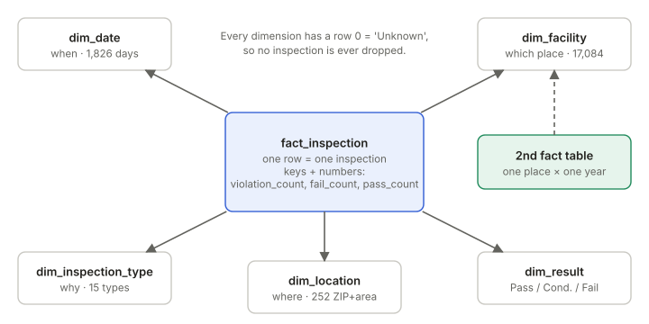

> **How to read it:** the blue box in the middle is the **fact table**: one row per inspection, holding only keys and numbers. Each arrow points to a **dimension** that the key looks up: **when** (dim_date), **which place** (dim_facility), **why** (dim_inspection_type), **result** (dim_result), **where** (dim_location). The small text under each name is what one row means and how many rows there are. The green box on the right is the **second fact table** (one place per year); its dashed arrow shows it shares dim_facility, which is what makes it a fact constellation.  
> **Why we made it:** a warehouse is designed on paper first; this is our design.


> **How to read it:** every table of the warehouse with its real columns. Blue = dimension tables, orange = fact tables. **PK** = primary key (the row's ID), **FK** = foreign key (an ID that points to a dimension). Each line goes from a key in a fact table to the dimension it points to. Both fact tables point to **DimFacility**, which is what makes this a fact constellation.  
> **Why we made it:** the exact structure of the database, the same one pgAdmin shows with *ERD For Schema*.

### The code

The fact table (`sql/01_schema.sql`):

```sql
CREATE TABLE dw.fact_inspection (
    inspection_key      bigserial PRIMARY KEY,                     -- the warehouse's own row number
    inspection_id       bigint NOT NULL UNIQUE,                    -- the city's id (degenerate dimension)
    date_key            int NOT NULL REFERENCES dw.dim_date,       -- e.g. 20220104 = 4 January 2022
    facility_key        int NOT NULL REFERENCES dw.dim_facility,   -- surrogate key of the place
    inspection_type_key int NOT NULL REFERENCES dw.dim_inspection_type,
    result_key          int NOT NULL REFERENCES dw.dim_result,
    location_key        int NOT NULL REFERENCES dw.dim_location,
    inspection_count    smallint NOT NULL DEFAULT 1,               -- measures from here on
    violation_count     smallint,                                  -- NULL = unknown
    fail_count smallint NOT NULL, pass_count smallint NOT NULL, conditional_pass_count smallint NOT NULL,
    high_violation_flag smallint NOT NULL,
    batch_id int NOT NULL                                          -- which load inserted this row
);
```

- `REFERENCES` makes the database refuse a key that does not exist in the dimension (**referential integrity**).
- `UNIQUE` on `inspection_id` makes it impossible to load the same inspection twice.

A typical star query: one join per dimension you need:

```sql
SELECT fa.facility_group, count(*) AS inspections, sum(f.fail_count) AS fails
FROM dw.fact_inspection f
JOIN dw.dim_facility fa USING (facility_key)
GROUP BY fa.facility_group;
```

### What came out

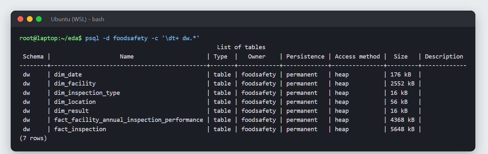

> **How to read it:** `\dt+ dw.*` lists every table in schema `dw` with its size. Five `dim_` tables and two `fact_` tables. The fact table is the biggest (about 5.6 MB for 61,737 rows); dim_result is tiny.  
> **Why it matters:** this is "the database" when mam asks to see it.


> **How to read it:** the first five fact rows. Every column is a number: `date_key 20220104` means 4 January 2022; `facility_key 6722` points to one restaurant in dim_facility; `result_key 3` is Pass w/ Conditions; `violation_count 3`; `fail_count 0`. No names or words.  
> **Why it matters:** this is what keeps the fact table small and fast; the words are stored once, in the dimensions.

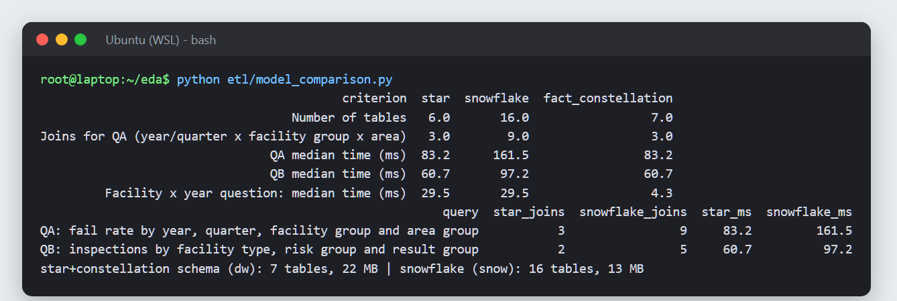

> **How to read it:** the first table compares the three designs. **Number of tables:** 6 (star), 16 (snowflake), 7 (constellation). **Joins for question QA:** 3 vs 9. **Median time:** the snowflake takes about twice as long. The last row: the facility-by-year question takes about 27 ms on the star but about 4 ms on the constellation, because the second fact table already holds one row per place per year.  
> **Why it matters:** these measurements are the reason we chose the star plus the second fact table.

### See it yourself

In pgAdmin open Warehouse → foodsafety → Schemas → `dw` → Tables. Right-click `dw` → **ERD For Schema** and pgAdmin draws the schema for you. In `sql/demo_queries.sql` run **D1** (the tables), **D2** (fact rows), **D3** (a dimension with its Unknown row 0). Menu **12** shows the same in a terminal.

### In one sentence

*One fact row is one completed inspection holding only keys and numbers; five dimensions hold the descriptions; a second yearly fact table makes it a fact constellation, which measured faster than the snowflake.*

---

## Part C · Load and check the warehouse (ETL)

**Goal:** fill the warehouse from the clean file, first all the old data, then only the new month, and prove nothing was lost or duplicated.
**Input → output:** `inspections_curated.csv` → the filled `dw` tables, the `staging.load_audit` record, 5 checks, indexes.
**Owner:** Aryan · **Files:** `etl/run_etl.py` (the driver), `sql/02_load_batch.sql` (the load procedure), `sql/03_indexes.sql`, `sql/04_validation.sql`, `etl/run_queries.py`

### The steps in detail

`python etl/run_etl.py all` does all of this:

1. **Create** the schemas and tables (`sql/01_schema.sql`) and the load procedure (`sql/02_load_batch.sql`), and fill `dim_date` with every day.
2. **Split the clean file in two:** January 2022 – November 2025 (72,130 rows) for the **initial load**; December 2025 (1,471 rows) held back for the **incremental load**, as the brief asks.
3. **Open a batch:** write a row in `staging.load_audit` (batch 1, its period) and get its `batch_id`.
4. **Extract / stage:** `COPY` the batch's rows into `staging.inspection_stg`, each row tagged with the batch id. `COPY` is PostgreSQL's fast bulk insert (72,130 rows in about 2 seconds).
5. **Transform + load:** `CALL dw.load_batch(1)` runs one SQL procedure, in one transaction:
   1. **quality rules:** mark rows with a missing id or date, a date outside the calendar, or an id already in the warehouse, with a `reject_reason`;
   2. **new dimension rows:** insert inspection types, results, locations and places not seen before (`ON CONFLICT DO NOTHING` skips ones that exist);
   3. **changed places:** overwrite name, type or risk when a newer inspection shows a change (Type 1);
   4. **facts:** for every completed, non-rejected row, look up the five surrogate keys and insert one fact row; a lookup that finds nothing gets key 0 (Unknown);
   5. **yearly fact:** rebuild the place-per-year rows for the years this batch touched;
   6. **audit:** write how many rows were staged, rejected, not completed and loaded.
6. **Index** the keys after the bulk load (`sql/03_indexes.sql`): 10 indexes, for example on `facility_key` and `date_key`. Building them after the load is faster than updating them row by row.
7. **Check** with the five queries of `sql/04_validation.sql`; each counts problems and must be 0.
8. **Repeat 3-7 for December 2025** as batch 2: the same procedure, no rebuild, only the new month.

Then `python etl/run_queries.py` runs the business questions 7 times each and records the median time, and runs three lookups with and without an index.

### The diagram, explained

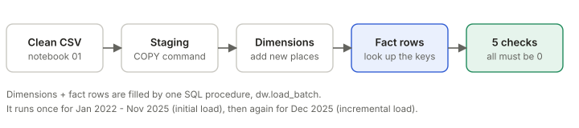

> **How to read it:** five boxes left to right, the journey of one batch. **Clean CSV** (from notebook 01) → **Staging** (bulk-copied with COPY) → **Dimensions** (new places added) → **Fact rows** (blue: keys looked up, rows inserted) → **5 checks** (green: all must be 0). The note underneath says that the middle two boxes are one SQL procedure, run once for the initial load and once more for December.  
> **Why we made it:** the same five steps work for every new month, which is what an incremental warehouse needs.

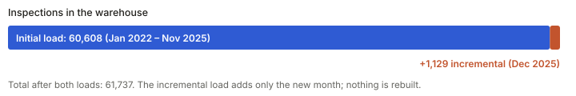

> **How to read it:** one long bar = all 61,737 inspections in the warehouse, to scale. The blue part is the initial load (60,608, Jan 2022 – Nov 2025); the small orange piece at the end is the incremental load (1,129, December 2025).  
> **Why we made it:** "incremental" means only that small piece is added; the blue part is not touched.

### The code

The heart of the load procedure (`sql/02_load_batch.sql`, shortened):

```sql
-- add places we have not seen before (natural key = licence, or name + address)
INSERT INTO dw.dim_facility (facility_nk, dba_name, facility_type, facility_group, risk_group, ...)
SELECT DISTINCT ON (s.facility_nk) s.facility_nk, s.dba_name, ...
FROM staging.inspection_stg s
WHERE s.batch_id = p_batch AND s.reject_reason IS NULL AND s.is_completed
ON CONFLICT (facility_nk) DO NOTHING;                 -- already known: skip

-- insert the facts, looking up each surrogate key (0 = Unknown if not found)
INSERT INTO dw.fact_inspection (inspection_id, date_key, facility_key, ..., fail_count, pass_count, batch_id)
SELECT s.inspection_id, d.date_key, coalesce(f.facility_key, 0), ...,
       (s.results = 'Fail')::int,                    -- 1 if fail, else 0
       (s.results = 'Pass')::int, p_batch
FROM staging.inspection_stg s
JOIN dw.dim_date d          ON d.full_date = s.inspection_date
LEFT JOIN dw.dim_facility f ON f.facility_nk = s.facility_nk     -- LEFT JOIN: keep the row even if not found
WHERE s.batch_id = p_batch AND s.reject_reason IS NULL AND s.is_completed;
```

- `DISTINCT ON (facility_nk)` keeps one row per place in the batch.
- `coalesce(f.facility_key, 0)` turns "not found" into the Unknown row.
- `(s.results = 'Fail')::int` turns true/false into 1/0, so fails can be summed.

The five checks (`sql/04_validation.sql`), each must return 0:

```sql
SELECT 'fact rows whose key is missing in its dimension', count(*) FROM dw.fact_inspection f
 WHERE NOT EXISTS (SELECT 1 FROM dw.dim_facility d WHERE d.facility_key = f.facility_key) OR ...
UNION ALL SELECT 'duplicate inspection ids in the fact table', count(*) - count(DISTINCT inspection_id) FROM dw.fact_inspection
UNION ALL SELECT 'cleaned completed rows in staging that did not reach the fact table', ...
UNION ALL SELECT 'total violations: staging minus fact', ...
UNION ALL SELECT 'inspections: yearly summary fact minus detail fact', ...;
```

### What came out

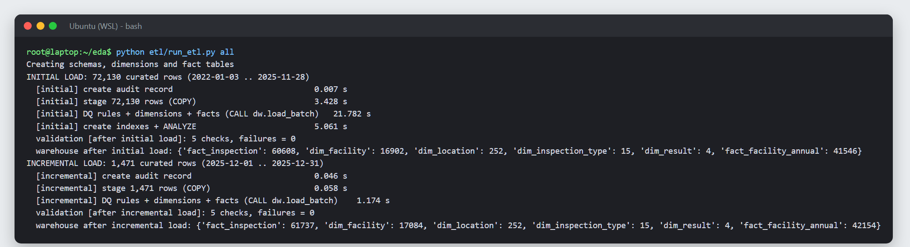

> **How to read it:** the console of `python etl/run_etl.py all`. **INITIAL LOAD:** 72,130 rows staged with COPY, the procedure ran in about 10-20 seconds, indexes built, "5 checks, failures = 0", and the table sizes: 60,608 facts, 16,902 places, 252 locations. **INCREMENTAL LOAD:** 1,471 rows staged, the procedure ran in under a second, checks 0, and now 61,737 facts and 17,084 places (182 new places in December).  
> **Why it matters:** the whole of Part C in one screen.

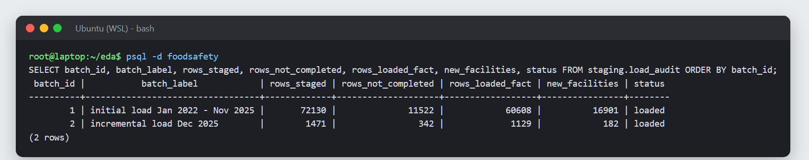

> **How to read it:** one row per batch. Batch 1 staged 72,130 rows, 11,522 were visits that never happened, 60,608 became facts, 16,901 new places. Batch 2: 1,471 staged, 342 not completed, 1,129 facts, 182 new places. Staged = not completed + loaded, so every row is accounted for.  
> **Why it matters:** the audit proves what each load did.


> **How to read it:** the SQL of the five checks, then the result: five lines, each with value 0.  
> **Why it matters:** proof that no key is broken, nothing is duplicated, nothing was left behind, and the totals agree.

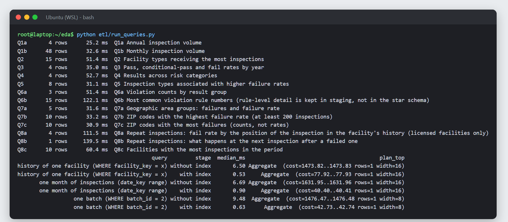

> **How to read it:** top: each business question (Q1a … Q8c), how many rows its answer has, and its median time in milliseconds (all well under 150 ms). Bottom: three lookups without and with an index: about 6-8 ms without, about 0.5-0.7 ms with, roughly 10× faster.  
> **Why it matters:** the brief asks for indexing and historical query performance.

### See it yourself

Menu **2** runs the whole load; menu **3** runs the checks and the questions. In pgAdmin open `sql/04_validation.sql` and press F5; in `demo_queries.sql` run **D4** (the load audit).

### In one sentence

*The clean file is bulk-copied into staging, one SQL procedure adds new places and inserts the facts with their keys, first for 2022 – Nov 2025 and then only December 2025, and five checks prove all is correct.*

---

## Part F · Business questions, OLAP and the dashboard

**Goal:** answer the brief's ten business questions, demonstrate every OLAP operation, and show the results to a non-technical user.
**Input → output:** the warehouse → answer tables (`results/analytical_query_results/`), `docs/olap_operations.md`, `dashboard/food_safety_dashboard.html`.
**Owners:** Aryan (queries), Rushi (dashboard) · **Files:** `sql/06_analytical_queries.sql`, `sql/07_olap_queries.sql`, `etl/run_olap.py`, `dashboard/build_dashboard.py`

### The steps in detail

1. **Write each business question as one SQL query** on the star schema (`sql/06_analytical_queries.sql`):
   1. monthly and annual volume → fact JOIN dim_date, GROUP BY year / month;
   2. facility types with the most inspections → JOIN dim_facility;
   3. pass, conditional and fail rates → SUM of the 0/1 measures;
   4. results by risk category; 5. inspection types with higher fail rates;
   6. violation counts and the most common violation rules;
   7. areas and ZIP codes with high fail counts **and** rates (two separate lists);
   8. repeat inspections: the fail rate of the 1st, 2nd, 3rd … inspection of a place, and what happens after a fail (window functions);
   9. frequent combinations → Part H; 10. predict violations and failure → Parts G and I.
2. **Demonstrate each OLAP operation** (`sql/07_olap_queries.sql`, run by `etl/run_olap.py`, which writes every query with its output and meaning to `docs/olap_operations.md`):
   - **roll-up** with `GROUP BY ROLLUP` (month → quarter → year → total);
   - **drill-down**: facility group → facility type → individual place;
   - **slice**: fix one dimension (`WHERE year = 2025`);
   - **dice**: fix several (`WHERE year = 2025 AND risk = 'High'`);
   - **pivot**: turn results into columns with `count(*) FILTER (WHERE …)`;
   - **CUBE**: every combination and every subtotal at once;
   - **GROUPING SETS**: only the subtotals you list.
3. **Build the dashboard** (`dashboard/build_dashboard.py`): Python runs SQL on the warehouse, Plotly draws the charts, and everything is written into one HTML file with six pages: Overview, Facilities & risk, Locations, Inspections, Data mining, Warehouses.

### The diagram, explained


> **How to read it:** left column, a **hierarchy**: Month → Quarter → Year. Going **up** the arrows is a **roll-up** (more summary), going down is a **drill-down** (more detail). Middle column: **Slice** keeps one value of one dimension (year = 2025); **Dice** keeps values of several dimensions (2025 and high risk); **Pivot** turns rows into columns. Right column: **Drill-down** through the facility hierarchy (group → type → one shop), **CUBE** (all subtotals at once) and **GROUPING SETS** (only the subtotals you choose).  
> **Why we made it:** one picture of every operation the syllabus asks for, each with our own example.

### The code

Roll-up:

```sql
SELECT coalesce(d.year::text, 'ALL') AS year,        -- 'ALL' marks a subtotal row
       coalesce('Q' || d.quarter, 'ALL') AS quarter,
       count(*) AS inspections,
       round(100.0 * sum(f.fail_count) / count(*), 1) AS fail_rate_pct
FROM dw.fact_inspection f JOIN dw.dim_date d USING (date_key)
WHERE d.year = 2025
GROUP BY ROLLUP (d.year, d.quarter);                  -- one row per quarter + the year total + the grand total
```

Dice (two dimensions fixed):

```sql
SELECT t.inspection_type_group, count(*) AS inspections,
       round(100.0 * sum(f.fail_count) / count(*), 1) AS fail_rate_pct
FROM dw.fact_inspection f
JOIN dw.dim_date d USING (date_key) JOIN dw.dim_facility fa USING (facility_key)
JOIN dw.dim_inspection_type t USING (inspection_type_key)
WHERE d.year = 2025 AND fa.risk_group = 'High'          -- slice = one condition; dice = several
GROUP BY 1 ORDER BY 2 DESC;
```

Pivot:

```sql
SELECT d.year,
       count(*) FILTER (WHERE r.result_group = 'Pass')             AS pass,         -- one column per result
       count(*) FILTER (WHERE r.result_group = 'Conditional Pass') AS conditional,
       count(*) FILTER (WHERE r.result_group = 'Fail')             AS fail
FROM dw.fact_inspection f JOIN dw.dim_date d USING (date_key) JOIN dw.dim_result r USING (result_key)
GROUP BY d.year ORDER BY d.year;
```

### What came out

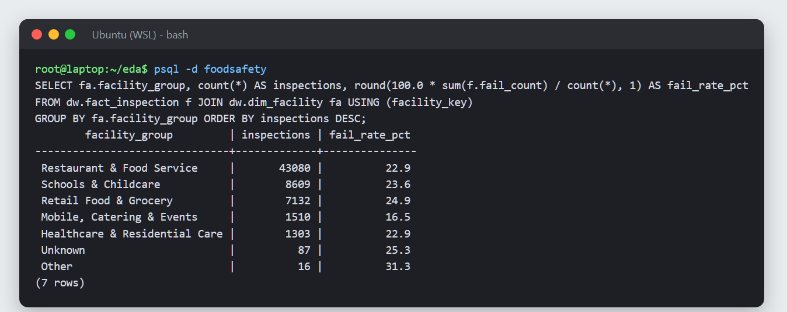

> **How to read it:** fail rate by facility group. Restaurants: 43,080 inspections (about 70% of all), fail rate 22.9%. Retail food & grocery has a higher rate (24.9%) on fewer inspections; mobile vendors and caterers the lowest (16.5%).  
> **Why it matters:** volume and rate tell different stories; the brief asks us to show both.


> **How to read it:** each quarter of each year with its inspections and fail rate, then a row where quarter = **ALL** (that year's total), and at the very end year = ALL (the grand total). Those ALL rows are the roll-up.  
> **Why it matters:** this is what "roll-up" looks like in a real result.

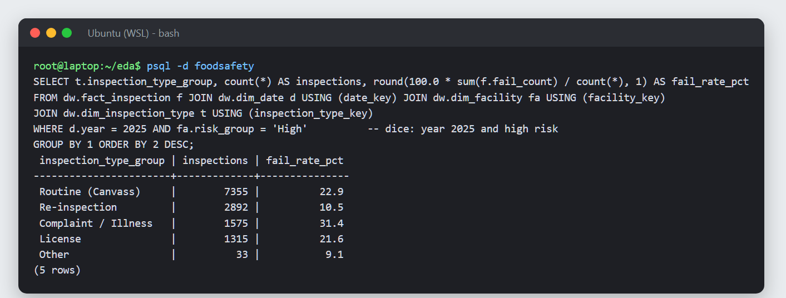

> **How to read it:** only 2025 and only high-risk places, grouped by inspection type. Complaint inspections still have the highest fail rate inside this slice.  
> **Why it matters:** a dice narrows the cube on two dimensions at once.

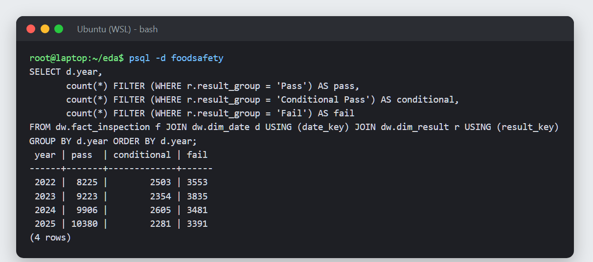

> **How to read it:** one row per year, one column per result. Passes rise from 8,225 to 10,380 while fails stay around 3,400-3,800.  
> **Why it matters:** the pivot puts the three results side by side for comparison.


> **How to read it:** one stacked bar per year, adding up to 100%: green pass, orange pass with conditions, red fail. The red part shrinks from 24.9% (2022) to 21.1% (2025).  
> **Why we made it:** business question 3: pass, conditional and fail rates over time.

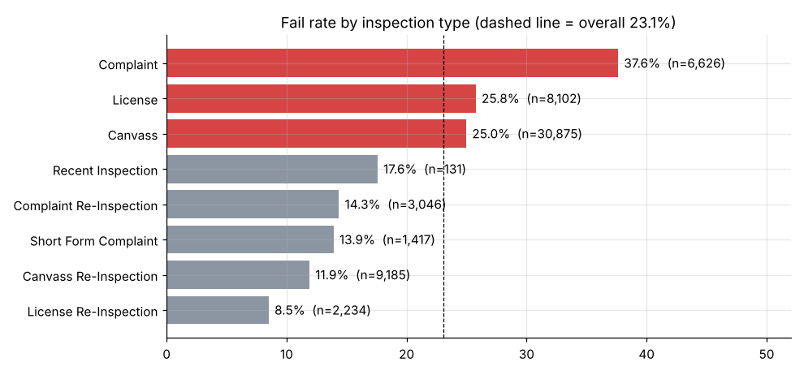

> **How to read it:** one bar per inspection type, its fail rate, and in brackets how many inspections. The dashed line is the overall average (23.1%). Red bars are above the average: complaint inspections (37.6%), licence and canvass. Grey bars are below: re-inspections fail least.  
> **Why we made it:** business question 5.

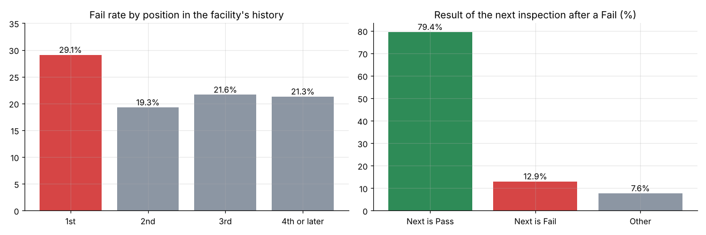

> **How to read it:** left, the fail rate by the position of an inspection in a place's history: the **1st** inspection fails most (29.1%). Right, the result of the **next** inspection after a fail: 79.4% pass, 12.9% fail again.  
> **Why we made it:** business question 8; it shows that follow-up visits work.


> **How to read it:** left, the ZIP codes with the highest fail **rate** (at least 200 inspections); right, the ZIP codes with the most **fails**. The two lists are different.  
> **Why we made it:** business question 7; a busy area is not automatically a bad area.

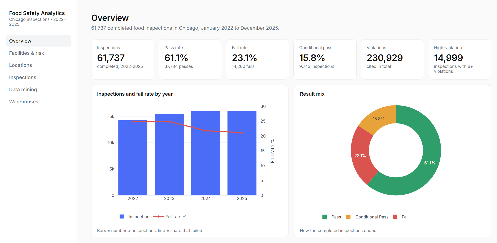

> **How to read it:** the dashboard's first page. Six key numbers across the top (61,737 inspections, 61.1% pass, 23.1% fail, 15.8% conditional, 230,929 violations, 14,999 high-violation inspections), then inspections and fail rate by year (bars and a line) and the result mix (donut). The side menu leads to the other five pages.  
> **Why we made it:** one place to show the results to someone who does not read SQL.

### See it yourself

In pgAdmin run `demo_queries.sql` **D6** (star query), **D7** (roll-up), **D8** (slice and dice), **D9** (pivot). Every OLAP query with its output and explanation is in `docs/olap_operations.md`. Double-click `dashboard/food_safety_dashboard.html`. Menu **4** re-runs all of this.

### In one sentence

*Every business question and every OLAP operation is a short SQL query on the star schema, and the dashboard shows the same numbers on six pages.*

---

## The analytics table: the bridge to the models

**Goal:** give the three models one flat table, built from the warehouse, in which every inspection also knows the previous inspection of the same place.
**Input → output:** the `dw` tables → `mart.food_inspection_analytics_mart` (61,737 rows, 29 columns).
**Owner:** Vishwaraj · **File:** `sql/08_analytics_mart.sql`

### The steps in detail

1. **Join** the fact table with all five dimensions, so every row has words again (facility type, inspection type, result, ZIP, area, month …).
2. **Sort each place's inspections by date** and use the window function **LAG** to copy values from the row before: the previous result, the previous violation count and the previous date.
3. **Compute** days since the previous inspection and how many inspections the place had before.
4. **Only for licensed places**: a place identified by name + address might be two different businesses, so its history is not trusted.
5. **Same-day repeats** do not count as history (the previous inspection must be on an earlier day).

The models therefore read **the warehouse, not the raw file**, as the brief requires, and they only ever see information known **before** the inspection.

### The code

```sql
SELECT ...,
       lag(result_group)    OVER w AS prior_result_raw,          -- result of the previous inspection
       lag(violation_count) OVER w AS prior_violation_count_raw,
       lag(date_key)        OVER w AS prior_date_key
FROM base
WINDOW w AS (PARTITION BY facility_key            -- one group per place
             ORDER BY date_key, inspection_id)    -- in date order
```

- `PARTITION BY facility_key` = treat each place separately.
- `ORDER BY date_key` = in time order.
- `lag(x)` = the value of `x` in the previous row of that place.

### What came out

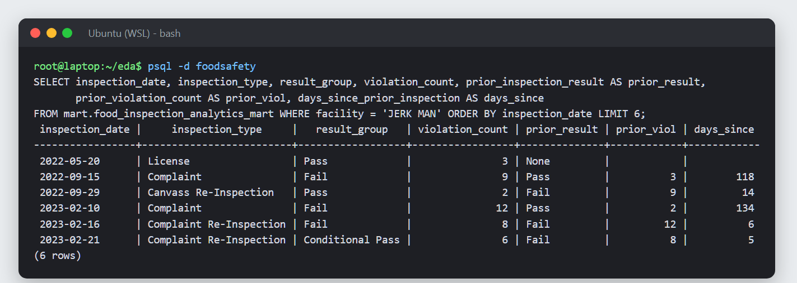

> **How to read it:** six inspections of one restaurant. The first has no previous inspection (None). The second (a complaint, Fail, 9 violations) remembers the first: previous result Pass, 3 violations, 118 days earlier. The third (a re-inspection, Pass) remembers the fail 14 days before. Each row carries its own past.  
> **Why it matters:** this history is what the models learn from; the most important input of the decision tree is "previous result = Fail".

### See it yourself

Menu **5** rebuilds and shows it; `demo_queries.sql` **D10**.

---

## Part G · Regression

**Goal:** predict the **number of violations** an inspection will find, using only what is known before the visit.
**Input → output:** the analytics table → `results/regression_metrics.csv`, charts.
**Owner:** Vishwaraj · **File:** `notebooks/07_regression.ipynb`

### The steps in detail

1. **Read** the analytics table from the warehouse; keep the 61,185 inspections with a known violation count.
2. **Inputs** (known before the visit): facility type, risk, inspection type, month, weekday, ZIP code, area, the previous result, the previous violation count, days since the previous inspection. For a place with no history, the previous count is set to 0 and a flag "no prior inspection" is set to 1.
3. **Split by time**: train on 2022-2024 (45,266 inspections), test on 2025 (15,919). Never a random split, so the model never learns from the future.
4. **Baseline**: always predict the training average (3.85 violations). Any model must beat this.
5. **Simple linear regression**: one input, the previous violation count. Result: violations = 2.737 + 0.209 × previous violations.
6. **Multiple linear regression**: all inputs. Word inputs are **one-hot encoded** into 0/1 columns (rare categories grouped), giving 102 columns. `LinearRegression` finds the weight of each column.
7. **Score on 2025**: MAE (average error), RMSE (error that punishes big misses), R² (share of the variation explained).
8. **Diagnostics**: VIF for inputs that are too similar (multicollinearity); the Breusch-Pagan test for errors that are bigger for some predictions (heteroscedasticity); the effect of outliers (counts above 14).

### The diagram, explained


> **How to read it:** the analytics table (left) is split by date into a **training** set (blue, 2022-24) and a **test** set (orange, 2025). Only the training set is used to **fit the line**. The fitted model then **predicts 2025**, and the predictions are compared with what really happened in 2025 to get the **score** (green): MAE 2.45, R² 0.12.  
> **Why we made it:** to show that the test year is never seen during training.

### The code

```python
train = df[df["inspection_date"] < "2025-01-01"]          # 2022-2024: learn
test  = df[df["inspection_date"] >= "2025-01-01"]         # 2025: check

enc = ColumnTransformer([
    ("cat", OneHotEncoder(drop="first", min_frequency=100), CAT),   # words -> 0/1 columns; rare values grouped
    ("num", "passthrough", NUM)])                                   # numbers stay as they are
X_tr = enc.fit_transform(train[CAT + NUM])                # learn the columns from the training data only
X_te = enc.transform(test[CAT + NUM])

model = LinearRegression().fit(X_tr, train["violation_count"])      # find one weight per column
pred = model.predict(X_te)
mae = mean_absolute_error(test["violation_count"], pred)            # average size of the error
r2  = r2_score(test["violation_count"], pred)                       # share of the variation explained
```

- `fit_transform` on train, only `transform` on test: the encoder never sees 2025.
- `drop="first"` drops one column per category to avoid duplicated information.

### What came out

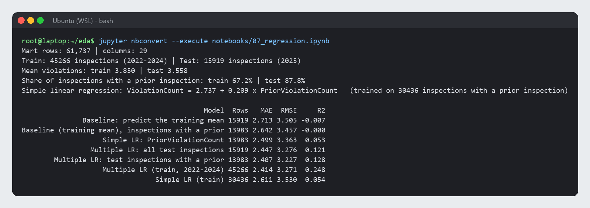

> **How to read it:** first the sizes (45,266 train, 15,919 test) and the simple equation. Then the results table, one row per model: the **baseline** (MAE 2.71, R² about 0), the **simple** model (MAE 2.50, R² 0.05) and the **multiple** model (MAE **2.45**, RMSE 3.28, R² **0.12**). Lower MAE is better, higher R² is better.  
> **Why it matters:** the model is better than guessing, but only a little.


> **How to read it:** the x-axis is the violation count at the previous inspection, the y-axis the count at this one. Each bubble is the average for one x value (bigger bubble = more inspections). The red line is the fitted line: it rises, so more violations last time means more this time.  
> **Why we made it:** the simple regression as a picture.

### See it yourself

Open notebook 07 and read the grey notes. Menu **6** re-runs it (about 3.5 minutes).

### In one sentence

*Trained on 2022-24 and tested on 2025, the multiple regression predicts violations with an average error of 2.45 (guessing: 2.71); R² is 0.12 because the real causes are not in the data.*

---

## Part H · Association rules

**Goal:** find characteristics that often happen **together** in an inspection.
**Input → output:** the analytics table → 1,198 frequent itemsets, `results/association_rules_selected.csv` (14 rules with interpretations).
**Owner:** Vishwaraj · **File:** `notebooks/08_association_mining.ipynb`

### The steps in detail

1. **Make baskets.** Each completed inspection with a known violation band becomes one "basket" (transaction) of **7 items**, one per attribute: `FacilityType=…` (the 8 most common types, the rest *Other*), `Risk=…`, `InspType=…`, `Result=…`, `Violations=…` (the band), `Area=…`, `Season=…`. 61,185 baskets, 35 different items.
2. **One-hot encode**: one True/False column per item.
3. **Count single items** (support). Risk=High is in 82% of baskets, FacilityType=Restaurant in 69%.
4. **Apriori** (minimum support 2%): find all item sets that appear in at least 2% of baskets, growing them level by level (pairs from frequent singles, triples from frequent pairs …) and pruning any set with an infrequent subset.
5. **FP-Growth** with the same 2%: builds a compact tree of the baskets and reads the frequent sets from it without generating candidates. We **check** that it finds exactly the same sets.
6. **Make rules** "A ⇒ B" from the itemsets, with **confidence** at least 30%.
7. **Select meaningful rules**: support ≥ 2%, confidence ≥ 30%, **lift** ≥ 1.3; remove rules that are true **by definition** (for example Result=Fail ⇒ has violations) and rules that only repeat a shorter rule. 275 → 41 → the 14 we report, each with an interpretation and a possible use.

### The diagram, explained


> **How to read it:** the rule "IF 10+ violations THEN Fail". **Support 5.4%**: 5.4% of all inspections have both parts. **Confidence 69%**: of the inspections with 10+ violations, 69% failed. **Lift 3.0**: 69% divided by the normal fail rate (23%) = 3, so a fail is three times more likely than usual when there are 10+ violations.  
> **Why we made it:** these three numbers are how every rule is judged.

### The code

```python
# one True/False column per item, e.g. "Risk=High", "Result=Fail", "Violations=High (6-9)"
onehot = pd.concat([pd.get_dummies(data[c], prefix=name, prefix_sep="=") for c, name in item_cols.items()], axis=1)

ap = apriori(onehot, min_support=0.02, use_colnames=True)      # itemsets in at least 2% of baskets
fp = fpgrowth(onehot, min_support=0.02, use_colnames=True)     # same question, faster algorithm
rules = association_rules(ap, metric="confidence", min_threshold=0.30)   # A => B with confidence >= 30%
```

### What came out


> **How to read it:** 61,185 baskets; the most frequent single items with their support; Apriori found **1,198** frequent itemsets and made 3,951 rules; FP-Growth found the same 1,198 ("identical to Apriori: True"); 275 rules → 41 after cleaning. The table at the bottom: the top rules with support, confidence and lift. First rule: Risk=Low ⇒ Grocery Store, lift 6.5.  
> **Why it matters:** the whole result of Part H.

### See it yourself

Open notebook 08 and read the grey notes; the last table has every selected rule with its interpretation. Menu **7** re-runs it.

### In one sentence

*Each inspection became a basket of 7 items; Apriori and FP-Growth found the same 1,198 frequent sets; the strongest useful rule is "10+ violations ⇒ Fail" (69%, three times the normal rate).*

---

## Part I · Decision tree

**Goal:** predict **whether an inspection will fail**, in a way an inspector can read.
**Input → output:** the analytics table → `results/decision_tree_metrics.csv`, the tree, feature importance, three real paths.
**Owner:** Vishwaraj · **File:** `notebooks/09_decision_tree.ipynb`

### The steps in detail

1. **Target**: fail = 1, pass or conditional pass = 0. About 21-25% of inspections fail.
2. **Inputs**: the same pre-visit information as the regression (facility type, risk, inspection type, month, weekday, area, ZIP, previous result, previous violations, days since, number of previous inspections).
3. **Three-way time split**: train 2022-2023 (29,693), **validation 2024** (15,992) for choosing settings, **test 2025** (16,052) used once at the end.
4. **Baseline**: always say "not failed" = 78.9% accurate on 2025, so accuracy alone means little.
5. **Explore settings one at a time** on 2024: maximum depth, minimum rows to split, minimum rows per leaf, pruning strength. A deeper tree scores higher on training data but **lower on 2024**: overfitting.
6. **Grid search**: try all **420 combinations** of the four settings, keep the one with the best 2024 **ROC-AUC**: depth 8, at least 200 inspections per leaf.
7. **Choose a cut-off** on 2024: the tree gives a probability of failing; with the usual cut-off 0.5 it almost never says "fail". We picked the cut-off (0.217) that best balances catching fails and false alarms on 2024.
8. **Refit on 2022-2024 and test once on 2025**: accuracy, precision, recall, F1, ROC-AUC, confusion matrix.
9. **Explain**: feature importance, the top levels of the tree, and three real paths (highest fail rate, lowest, largest group), checked on 2025.

### The diagram, explained

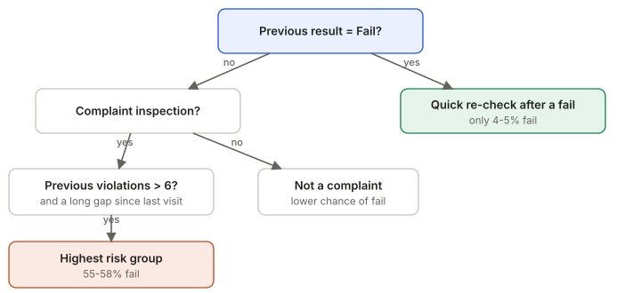

> **How to read it:** start at the top and answer each question. **Previous result = Fail?** If **yes** (right), this is usually a quick re-check after a fail, and only 4-5% fail (green). If **no** (left): **Complaint inspection?** If no, a routine visit with a lower chance of failing. If yes: **previous violations > 6** and a long gap since the last visit? If yes, the **highest-risk group**: 55-58% fail (orange).  
> **Why we made it:** a tree is a list of yes/no questions, which is easy to explain to an inspector.

### The code

```python
for depth, mss, msl, alpha in grid:                       # 420 combinations of the four settings
    m = DecisionTreeClassifier(max_depth=depth, min_samples_split=mss,
                               min_samples_leaf=msl, ccp_alpha=alpha).fit(Xtr, ytr)    # learn on 2022-23
    auc_val = roc_auc_score(yva, m.predict_proba(Xva)[:, 1])                          # score on 2024

tree = DecisionTreeClassifier(random_state=42, **BEST).fit(Xfit, yfit)   # refit on 2022-24 with the best settings
proba = tree.predict_proba(Xte)[:, 1]                                    # probability of failing, 2025
pred = (proba >= 0.217).astype(int)                                      # the cut-off chosen on 2024
```

### What came out

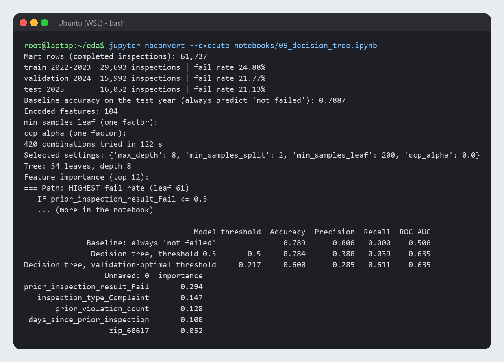

> **How to read it:** the split sizes and fail rates; the baseline accuracy 0.789; "420 combinations tried"; the chosen settings; "Tree: 54 leaves, depth 8"; the path with the highest fail rate (not a previous fail, complaint, previous violations > 6.5, more than 147 days since: 57.9% failed in 2025). The table: at cut-off 0.5 recall is 0.039 (4% of fails caught); at 0.217 recall is 0.611 (61%), precision 0.289; ROC-AUC 0.635 for both.  
> **Why it matters:** the whole result of Part I.

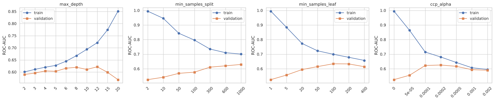

> **How to read it:** four small charts, one per setting. Blue = score on the training years, orange = score on 2024. For **max_depth** (first chart), blue keeps rising as the tree gets deeper, but orange peaks around depth 8 and then falls: the deeper tree is memorising, not learning.  
> **Why we made it:** overfitting, shown as a picture.


> **How to read it:** one bar per input; longer = the tree used it more. Previous result = Fail (0.29) is far ahead, then complaint inspection, previous violation count and days since the previous inspection.  
> **Why we made it:** to explain the model in plain words: the past predicts the future.

### See it yourself

Open notebook 09 and read the grey notes; the tree picture and the three paths are near the end. Menu **8** re-runs it (about 2 minutes).

### In one sentence

*A depth-8 tree tuned on 2024 reaches AUC 0.635 on 2025; with a cut-off of 0.217 it catches 61% of fails, and its best clue is whether the previous inspection failed.*

---

## Part D · Distributed warehouse (Citus)

**Goal:** spread the same warehouse over several database nodes, and measure whether it answers the same questions identically and faster.
**Input → output:** the `dw` tables → a 3-node Citus cluster, `results/distribution_key_analysis.csv`, `results/distributed_scaling.csv` (25 comparisons).
**Owner:** Rushi · **Files:** `scripts/setup_citus_cluster.sh`, `etl/distributed_baseline.py`, `etl/distributed_citus.py`

### The steps in detail

1. **Start three PostgreSQL servers** with the Citus extension (`setup_citus_cluster.sh`): a **coordinator** on port 5440 and two **workers** on 5441 and 5442, and register the workers with the coordinator (`citus_add_node`).
2. **Choose the distribution key** (`distributed_baseline.py`). For three candidates (facility, location, date) we counted distinct values and simulated how rows would spread over 32 shards using the same hash function Citus uses. **facility_key** has 17,084 values and spreads evenly; date and location gave uneven shards (**data skew**).
3. **Make bigger copies for timing.** The real fact table has 61,737 rows, too small to show any benefit. We made copies at 100,000, 500,000, 1,000,000 and 2,000,000 rows by **resampling real rows** (same mix of places, dates and areas, new ids). They are used **only** to time queries, never for analysis.
4. **Time the single server** (port 5432) on five queries at each size.
5. **Load Citus** (`distributed_citus.py`): copy the dimensions and make them **reference tables** (a full copy on every node); copy each fact table and make it a **distributed table** split by facility_key into **32 shards**, 16 per worker.
6. **Time the same five queries on Citus** and **compare the answers** row by row with the single server.
7. **Look inside a query** with `EXPLAIN`: Citus shows "Task Count: 32", one task per shard.

### The diagram, explained


> **How to read it:** your SQL query goes to the **coordinator** (blue, port 5440). The coordinator splits it into one task per shard and sends them to the **workers** (green, ports 5441 and 5442), each holding 16 of the 32 shards of the fact table plus a full copy of the dimensions. Each worker answers for its shards, and the coordinator **merges** the partial answers into one result.  
> **Why we made it:** this is what "distributed" means in our project.

### The code

```python
cur.execute("SELECT citus_add_node('localhost', 5441)")                     # register a worker
cur.execute("SELECT create_reference_table('dw.dim_facility')")             # full copy on every node
cur.execute("SELECT create_distributed_table('bench.fact_2000000_facility_key', 'facility_key')")
# -> 32 shards: rows with the same facility_key always land in the same shard
```

### What came out

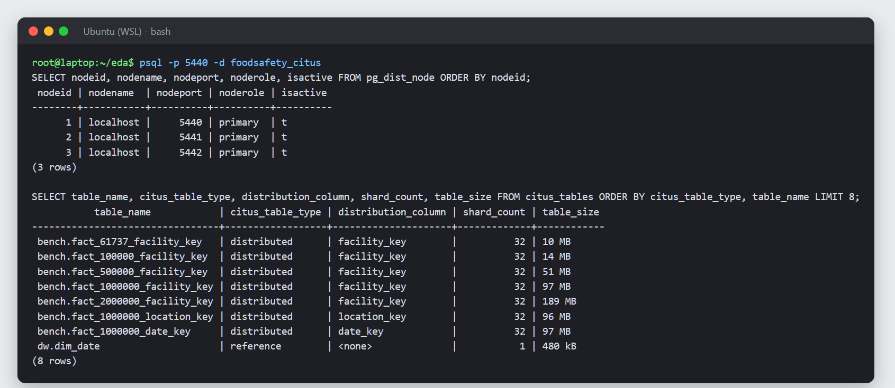

> **How to read it:** first table, `pg_dist_node`: three nodes, all active (5440 coordinator, 5441 and 5442 workers). Second table, `citus_tables`: the fact tables are **distributed** by facility_key with **32** shards (plus two test copies by location and date for the key comparison); the dimensions are **reference** tables (1 shard copied everywhere).  
> **Why it matters:** proof the cluster exists and how the tables are spread.


> **How to read it:** for the 2-million-row fact table: worker 5441 holds 16 shards (95 MB), worker 5442 holds 16 shards (94 MB).  
> **Why it matters:** an even split = a good distribution key.

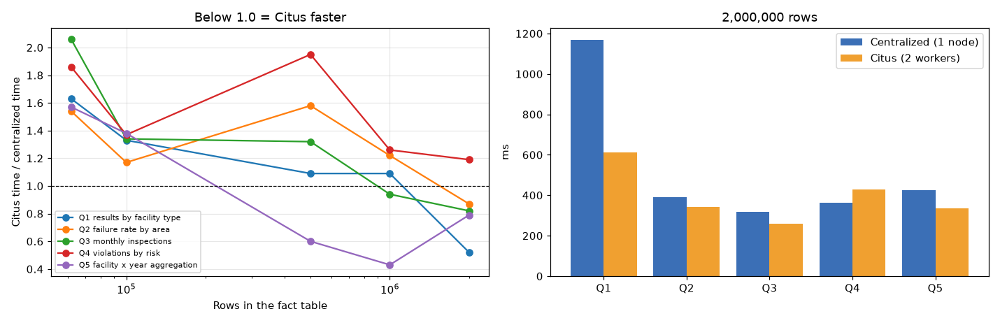

> **How to read it:** left, one line per query: Citus time divided by single-server time, as the table grows from 61,737 to 2 million rows (log scale). Above the dashed line (1.0) Citus is slower; below it, faster. At small sizes every line is above 1; as the data grows most lines fall below 1. Right: the actual times at 2 million rows, blue single server vs orange Citus.  
> **Why we made it:** the brief asks for a centralized-vs-distributed comparison.

### See it yourself

In pgAdmin connect to the Citus server (port 5440) and run the Citus queries at the bottom of `sql/demo_queries.sql`. Menu **13** shows the cluster; menu **9** re-runs the whole experiment (3-5 minutes).

### In one sentence

*The fact table is split into 32 shards by facility over two workers with the dimensions copied to each; all 25 test queries gave identical answers, slower than one server on small data and mostly faster from about half a million rows.*

---

## Part E · Real-time warehouse

**Goal:** process inspections as a live stream and show the brief's real-time KPIs on a live dashboard.
**Input → output:** the clean file (Oct-Dec 2025) → events in Kafka → validated rows in ClickHouse → the Grafana dashboard.
**Owner:** Rushi · **Files:** `streaming/producer.py`, `streaming/spark_stream.py`, `streaming/clickhouse_ddl.sql`, `streaming/grafana/build_dashboard.py`, `scripts/start_realtime_stack.sh`

### The steps in detail

1. **Replay, not live.** The city publishes a historical file, not a live feed. The brief allows replaying records in time order as a simulation, if we say so. Every event carries `source_mode = REPLAY_SIMULATION`, and Grafana's title says so.
2. **Start the stack** (`start_realtime_stack.sh`): **ClickHouse** (creates the `food` tables), **Kafka** (creates the topic `food_inspections` with 3 partitions), the **Spark** streaming job, and **Grafana**.
3. **Produce** (`producer.py`): read October-December 2025 (3,647 completed inspections), sort by date, and send each as one **JSON message** to Kafka at a fixed speed (40-80 messages per second). Every 150th message is a deliberately **broken** test message (bad JSON, an impossible result, or a violation count of 999) to test the checks.
4. **Process** (`spark_stream.py`, Spark Structured Streaming): every **2 seconds** Spark reads the new messages and:
   - parses the JSON and applies the checks; a failing message gets a **reason**;
   - writes valid events to `food.inspection_events` and broken ones to `food.invalid_events` (a **dead-letter** table);
   - counts inspections, fails, violations per **10-second window**, and per inspection **day** (with a watermark that waits one day for late events), into `food.window_agg` and `food.daily_event_time_agg`.
5. **Store** in **ClickHouse**, a column database built for fast totals: `MergeTree` tables for events, `ReplacingMergeTree` for the windows (a newer version of a window replaces the older one).
6. **Show** in **Grafana**, refreshing every 5 seconds: inspections, peak per minute, fails, passes, violations, high-violation inspections, inspections per minute by result, top facility types, risk distribution, ZIP alerts (fail rate ≥ 40% with at least 5 inspections) and pipeline health (valid, rejected, delay).

### The diagram, explained


> **How to read it:** left to right, the journey of one event. **producer.py** sends it to **Kafka**, the message queue that holds it until it is read. **Spark** (blue) reads it and checks it. A **valid** event goes up into **ClickHouse** (green: 3,647 good events) and from there to **Grafana**; a **broken** one goes down into **invalid_events** (orange: 24 caught). Underneath: about 1.8 seconds from sending to seeing it in Grafana.  
> **Why we made it:** to name each tool and its job in one picture.

### The code

The producer:

```python
event = {"event_id": f"e-{r.inspection_id}", "source_mode": "REPLAY_SIMULATION",
         "emitted_at": now_iso(),                                  # when it was sent (to measure the delay)
         "facility_type": r.facility_type, "result_group": r.result_group, "violation_count": r.violation_count, ...}
producer.send("food_inspections", key=r.inspection_id, value=event)   # one message per inspection
if (i + 1) % 150 == 0:                                                # every 150th: a broken test message
    producer.send("food_inspections", key="bad", value=b"{this is not json")
```

The checks in Spark:

```python
reason = (F.when(F.expr("try_parse_json(raw)").isNull(), "not valid JSON")
           .when(~j["result_group"].isin("Pass", "Conditional Pass", "Fail"), "result_group not valid")
           .when((j["violation_count"] < 0) | (j["violation_count"] > 100), "violation_count out of range"))
invalid = checked.filter(F.col("reason").isNotNull())     # -> food.invalid_events
valid   = checked.filter(F.col("reason").isNull())        # -> food.inspection_events
```

### What came out

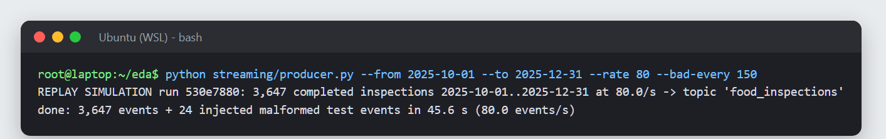

> **How to read it:** "REPLAY SIMULATION run …: 3,647 completed inspections 2025-10-01..2025-12-31 at 80/s → topic food_inspections", then "done: 3,647 events + 24 injected malformed test events in 45.6 s".  
> **Why it matters:** the input of the stream.

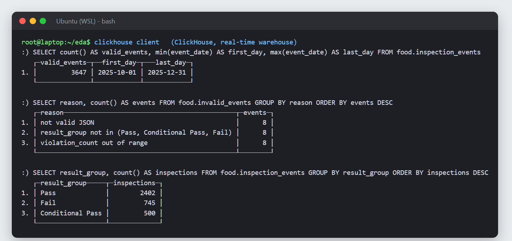

> **How to read it:** three queries in ClickHouse. 3,647 valid events from 1 October to 31 December 2025. The rejected events: 8 not valid JSON, 8 with an invalid result, 8 with an impossible violation count, so all 24 broken messages were caught. Then the valid events by result.  
> **Why it matters:** the checks work and nothing valid was lost.


> **How to read it:** the title says REPLAY SIMULATION. Top row, six totals for the replay: 3,647 inspections, peak inspections per minute, 745 fails, 2,402 passes, violations, high-violation inspections. Middle: inspections per minute by result over time, top facility types, risk distribution. Bottom: **area alerts** (ZIP codes failing 40% or more, red) and **pipeline health** (3,647 valid, 24 rejected, average and 95th-percentile delay in milliseconds).  
> **Why we made it:** these are exactly the streaming KPIs the brief lists.

### See it yourself

Open Grafana, then double-click `Replay_Stream.cmd` and watch the numbers rise for 2.5 minutes. Type the queries from the screenshot at <http://localhost:8123/play>. Menu **14** shows the counts; menu **10** restarts the stack and replays.

### In one sentence

*Past inspections are replayed as events through Kafka; Spark checks each one every 2 seconds, sends valid ones to ClickHouse and broken ones to a dead-letter table, and Grafana shows the KPIs about 1.8 seconds later.*

---

## Part J · Comparing the three warehouses

All three were measured on the same data and the same laptop.

| | Batch (PostgreSQL) | Distributed (Citus) | Real-time (Kafka/Spark/ClickHouse) |
|---|---|---|---|
| Data arrives | in batches (initial + monthly) | in batches, through the coordinator | continuously, event by event |
| Delay until visible | after each load (a month in about 1 s) | after each load | about 1.8 seconds |
| History and reports | excellent, every question in milliseconds | same answers; faster only on big data | recent events only |
| Live monitoring | no | no | yes |
| Grows with more data | one server | add more servers | add more servers |
| If something fails | a load is one transaction: all or nothing | a lost worker loses its shards (no replicas here) | Kafka keeps the events; Spark resumes |
| Effort to run | low: one database | medium: 3 nodes, a distribution key | high: 4 services, about 2.5 GB memory |

**Recommendation:** the **batch warehouse** as the main system, because Chicago adds only about 16,000 inspections a year and one server answers everything in milliseconds; a **real-time** layer only if inspections are recorded digitally as they happen and the city wants live monitoring; **Citus** only when the data outgrows one server.

---

## Results at a glance

| What | Number |
|---|---|
| Raw rows → completed inspections | 73,630 → 61,737 |
| Initial + incremental load | 60,608 + 1,129 |
| Checks after each load | 5, all 0 |
| Fail rate overall / 2022 → 2025 | 23.1% / 24.9% → 21.1% |
| Highest fail rate by inspection type | Complaint, 37.6% |
| Next visit after a fail passes | 79% (about 13 days later) |
| Star vs snowflake joins / time | 3 vs 9 / about half the time |
| Index speed-up | about 10× (6.5 → 0.5 ms) |
| Regression MAE (model vs guessing) / R² | 2.45 vs 2.71 / 0.12 |
| Frequent itemsets / top rule | 1,198 / 10+ violations ⇒ Fail, 69%, lift 3.0 |
| Decision tree AUC / fails caught | 0.635 / 61% at cut-off 0.217 |
| Citus answers identical to one server | 25 of 25 |
| Real-time: events / broken caught / delay | 3,647 / 24 of 24 / ≈1.8 s |

---

## How we show each part in the presentation

Rushi drives the laptop for the whole presentation. The words are in the **Team Script**; this is what is on the screen for each part.

| Part | Spoken by | On screen | Backup if it fails |
|---|---|---|---|
| Introduction | Aryan | slides 1-3, the project picture | – |
| A | Omkar | notebook 01: the profiling output and the cleaning log; notebook 02: the time charts | the screenshots in this guide |
| B, C | Aryan | pgAdmin: D1 (tables), D2 (fact rows), D4 (two loads), `04_validation.sql` (five zeros); ERD For Schema | screenshots |
| F | Aryan | pgAdmin: D7 (roll-up), D9 (pivot); the dashboard overview | screenshots |
| G, H, I | Vishwaraj | notebooks 07, 08, 09: the results tables, the tree picture | the dashboard's Data mining page |
| D | Rushi | pgAdmin on port 5440: the nodes and the 16 + 16 shards | screenshots |
| E | Rushi | Grafana while `Replay_Stream.cmd` runs (started during Vishwaraj's part) | the Grafana screenshot |
| J, close | Rushi | slide 10 | – |

**30 minutes before:** double-click `Start_Project.cmd`, run menu **0** (everything OK), open every link in the "Setting up" table, run `demo_queries.sql` **D1** once.
