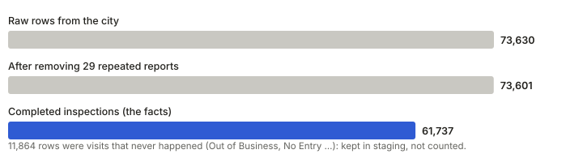
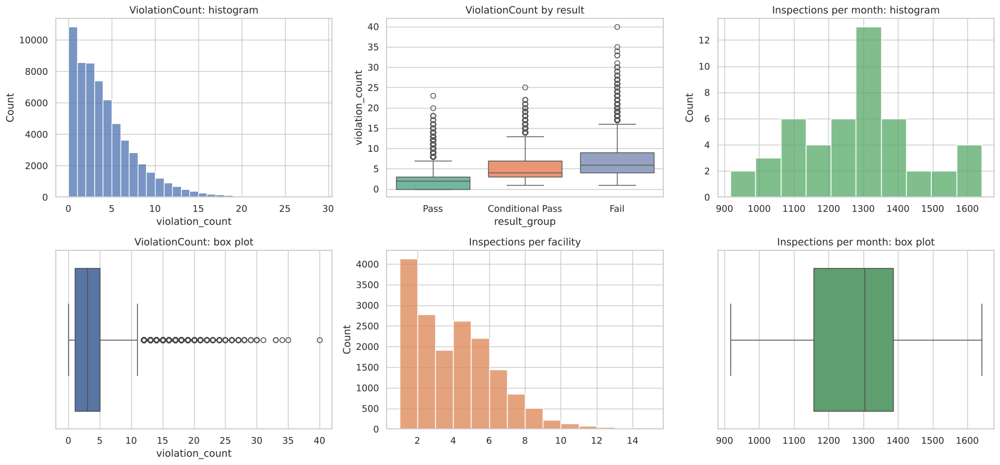
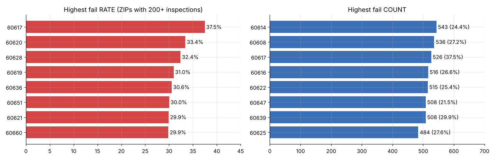
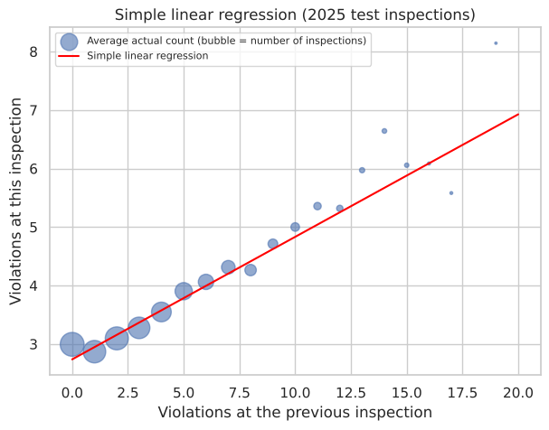
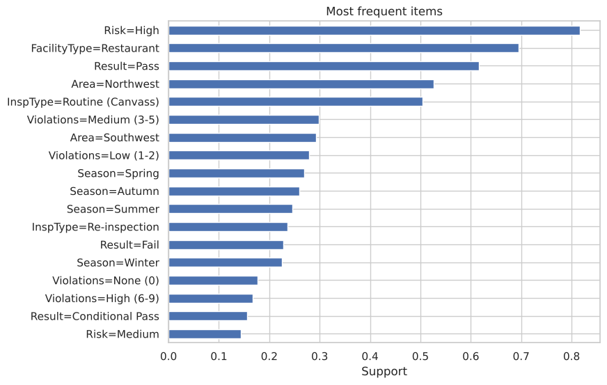
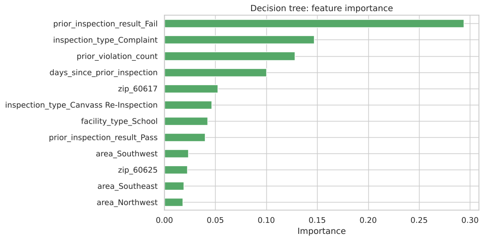
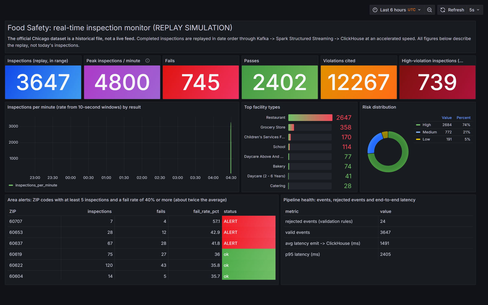

# Food Safety & Restaurant Inspection Analytics

A first data-science project: we take four years of Chicago food inspections, clean them, store them in a data warehouse, ask business questions with SQL, and train three simple models. Then we store the same data in two more kinds of warehouse (distributed and real-time) and compare all three.

Group project · Department of Computer Engineering · Guide: **Mrs. Shubhangi Kale**

| PRN | Name |
|---|---|
| 202502040010 | Omkar Patil |
| 202502040013 | Aryan Tandale |
| 202502040037 | Rushikesh Maddewad |
| 202502040035 | Vishwaraj Savairam |

---

## Contents

1. [The project in one minute](#the-project-in-one-minute)
2. [Words you need](#words-you-need)
3. [The big picture](#the-big-picture)
4. [How to run it](#how-to-run-it)
5. [What is in each folder](#what-is-in-each-folder)
6. [Part A · Clean and explore the data](#part-a--clean-and-explore-the-data)
7. [Part B · Design the warehouse (star schema)](#part-b--design-the-warehouse-star-schema)
8. [Part C · Load the warehouse (ETL)](#part-c--load-the-warehouse-etl)
9. [Part F · OLAP queries and the dashboard](#part-f--olap-queries-and-the-dashboard)
10. [Part G · Regression](#part-g--regression)
11. [Part H · Association rules](#part-h--association-rules)
12. [Part I · Decision tree](#part-i--decision-tree)
13. [Part D · Distributed warehouse (Citus)](#part-d--distributed-warehouse-citus)
14. [Part E · Real-time warehouse](#part-e--real-time-warehouse)
15. [Part J · Comparing the three warehouses](#part-j--comparing-the-three-warehouses)
16. [Results at a glance](#results-at-a-glance)
17. [Questions the professor may ask](#questions-the-professor-may-ask)

---

## The project in one minute

- **Data.** The City of Chicago publishes every food inspection it does. We took 2022 to 2025: **73,630 rows**.
- **Question.** Which places fail inspections, where, when, and can we predict it?
- **What we built.**
  1. Cleaned the data (Python, notebooks).
  2. Stored it in a **data warehouse** in PostgreSQL, designed as a **star schema**.
  3. Answered the 10 business questions from the brief with **SQL** and **OLAP**, and drew a **dashboard**.
  4. Trained three models: **regression** (how many violations?), **association rules** (what goes together?) and a **decision tree** (will it fail?).
  5. Stored the same data in a **distributed** warehouse (Citus) and a **real-time** warehouse (Kafka → Spark → ClickHouse → Grafana), as the brief asks, and compared the three.

Main results: **61,737** completed inspections, **23%** of them failed, complaint inspections fail most (**38%**), and after a fail the next visit passes **79%** of the time.

---

## Words you need

| Word | In plain English |
|---|---|
| **Dataset** | The table of raw data we start from (one CSV file). |
| **Data cleaning** | Fixing mistakes in the data: wrong types, repeated rows, typos, missing values. |
| **EDA** | Exploratory data analysis: charts and summaries to understand the data before using it. |
| **Data warehouse** | A database designed for analysis (asking questions), not for day-to-day app use. |
| **Fact table** | The table of events, with numbers you can add up. Here: one row per inspection. |
| **Dimension table** | A lookup table that describes the facts: when, where, what kind of place, what result. |
| **Star schema** | One fact table in the middle, dimension tables around it, like a star. |
| **Snowflake schema** | A star whose dimension tables are split further into smaller tables. |
| **Fact constellation** | Two fact tables that share the same dimension tables. |
| **Grain** | What exactly one row of the fact table means. |
| **Surrogate key** | A simple number the warehouse gives to each row (1, 2, 3 …) and uses to join tables. |
| **ETL** | Extract (read the file) → Transform (clean, look up keys) → Load (insert into the warehouse). |
| **Staging table** | A "waiting room" table where new data lands before it goes into the warehouse. |
| **Initial / incremental load** | First load of all old data / later loads of only the new data. |
| **OLAP** | Looking at the same numbers at different levels: by year → by month, by city → by ZIP. |
| **Roll-up / drill-down** | Go up to a summary level / go down to more detail. |
| **Slice / dice / pivot** | Filter on one value / filter on several values / turn rows into columns. |
| **Regression** | A model that predicts a number. |
| **Classification** | A model that predicts a category (here: fail or not fail). |
| **Association rule** | "If A then B" patterns found in data, like "10+ violations ⇒ Fail". |
| **Train / test split** | Learn on old data (2022–2024), check on new data (2025) that the model never saw. |
| **Distributed database** | One database spread over several computers (nodes) that work together. |
| **Shard** | One piece of a table that has been split up for a distributed database. |
| **Streaming** | Processing data event by event as it arrives, instead of in big batches. |
| **Kafka / Spark / ClickHouse / Grafana** | A message queue / a processing engine / a very fast analytics database / a live dashboard tool. |

---

## The big picture


> **What it shows:** the path of the data, from the raw file to the warehouse and from there to the queries, the dashboard and the models. The dashed lines are the two extra warehouses the brief asks for.  
> **Why we made it:** to see the whole project in one picture before looking at any single part.

The middle of everything is the **batch warehouse**. Everything else either feeds it or reads from it.

---

## How to run it

The project runs on **Ubuntu inside Windows (WSL)**.

**First time only** (installs PostgreSQL, Python packages, Citus, Kafka, Spark, ClickHouse, Grafana; about 30 minutes):

```bash
bash scripts/run_everything_wsl.sh install
```

**Run the whole project** (Parts A, B, C, F, G, H, I in order; about 9 minutes):

```bash
python run_all.py
```

`run_all.py` simply runs these steps one after another:

| Step | What runs | Part |
|---|---|---|
| 1 | unpack `data/raw/food_inspections_2022_2025.csv.gz` | A |
| 2 | `notebooks/01_data_curation.ipynb`: clean the data | A |
| 3 | `notebooks/02_eda.ipynb`: charts | A |
| 4 | `etl/run_etl.py`: create the warehouse and load it | B, C |
| 5 | `etl/model_comparison.py`: star vs snowflake vs constellation | B |
| 6 | `etl/run_queries.py`: the 10 business questions + index test | C |
| 7 | `etl/run_olap.py`: roll-up, drill-down, slice, dice, pivot | F |
| 8 | `sql/08_analytics_mart.sql`: one flat table for the models | G-I |
| 9 | `dashboard/build_dashboard.py`: the dashboard | F |
| 10-12 | notebooks `07`, `08`, `09`: the three models | G, H, I |

**Parts D and E** need their own servers:

```bash
bash scripts/setup_citus_cluster.sh && python etl/distributed_baseline.py && python etl/distributed_citus.py   # Part D
bash scripts/start_realtime_stack.sh                                                                     # Part E
```

**Every time after a restart**, double-click `Start_Project.cmd`. It starts the databases, Grafana and JupyterLab.

| Open this | To see |
|---|---|
| `dashboard/food_safety_dashboard.html` (double-click) | the dashboard, all parts |
| <http://localhost:8888> | the notebooks (JupyterLab) |
| <http://localhost:3000/d/food-safety-rt> | the real-time Grafana dashboard |
| pgAdmin → `localhost:5432`, user/password `foodsafety` | the batch warehouse |
| pgAdmin → `localhost:5440`, user `postgres` | the Citus cluster |

---

## What is in each folder

```
data/raw/            the original Chicago file (zipped)
notebooks/           01 cleaning · 02 EDA · 07 regression · 08 association rules · 09 decision tree
etl/                 Python scripts that load and query the warehouse
sql/                 all the SQL: tables, load procedure, checks, queries, OLAP
dashboard/           the dashboard builder and the finished HTML page
streaming/           the real-time part: producer, Spark job, ClickHouse tables, Grafana
scripts/             setup and start scripts for WSL
results/             every output table (CSV) the scripts write
build_docs/          builds the report, the screenshots and README.html
docs/                report, images, data dictionary, data-quality report
run_all.py           runs everything in order
```

---

## Part A · Clean and explore the data

**In one line.** Read the raw Chicago file, fix its problems, add useful columns, and look at it with charts.

**What it is called.** Data profiling, data cleaning (curation), feature engineering (derived attributes), EDA.

**Files.** `notebooks/01_data_curation.ipynb`, `etl/curation.py`, `notebooks/02_eda.ipynb`, `docs/data_quality_report.md`

**Code: counting the violations from the text** (`etl/curation.py`)

The violations column is long text like `"34. FLOORS MUST BE CLEAN ... | 35. WALLS ..."`. We split it at `|` and count the rule numbers.

```python
def violation_codes(text):
    """'34. FLOORS ... | 35. WALLS ...'  ->  [34, 35]"""
    if not isinstance(text, str):
        return []
    return [int(m.group(1)) for part in text.split("|") for m in [re.match(r"^\s*(\d+)\.", part)] if m]
```

**Code: removing repeated reports**

```python
key = ["license_number", "inspection_date", "inspection_type", "results", "violations"]
same_content = df[has_lic].duplicated(subset=key, keep="first")
df = df.drop(index=same_content[same_content].index)      # 29 repeated reports removed
```

**Run.** Open the notebook in JupyterLab → *Run → Run All Cells*.

**Output: the main cleaning decisions**

| Problem found | Rows | What we did |
|---|---|---|
| Same report entered twice | 29 | removed |
| Invalid risk value "All" | 38 | set to "Unknown" |
| Facility type typed by hand | 217 spellings | cleaned and grouped into 7 groups |
| Fail with no violation text | 552 | violation count = unknown, not 0 |
| Visit never happened (Out of Business, No Entry …) | 11,864 | kept, but not counted as inspections |
| Very high violation counts | 2,686 | kept and flagged (they are real) |

73,630 raw rows → 73,601 clean rows → **61,737 completed inspections**.



> **What it shows:** how many rows are left after each cleaning step, drawn to scale.  
> **Why we made it:** to prove that nothing was lost silently: every drop has a reason.

**EDA charts** (notebook 02): histograms and box plots of violations, result mix by category, trends by year/month/day of week, a map of locations.



> **What it shows:** most inspections have 0 to 5 violations, a few have 20 or more (a long tail); fails have more violations than passes.  
> **Why we made it:** to understand the main number before modelling it, and to spot outliers.


> **What it shows:** inspections per year, quarter, month, week and weekday, and the fail rate per month. Volume grows a little each year; there is no strong busy season.  
> **Why we made it:** the brief asks for trends over time (yearly, monthly, weekly, day of week).

**Say this.** *"We profiled every column first, then fixed each problem with a written rule and the number of rows it affected. We never silently deleted data: visits that didn't happen stay in the data but are not counted as inspections."*

---

## Part B · Design the warehouse (star schema)

**In one line.** Decide which tables the warehouse has and how they connect.

**What it is called.** Dimensional modelling. Star schema, snowflake schema, fact constellation.

**Grain.** One row in the fact table = **one completed inspection of one place on one date**.


> **What it shows:** the fact table in the middle (one row per inspection, only keys and numbers) and the five lookup tables around it.  
> **Why we made it:** a warehouse is designed before it is built; this picture is that design.

| Table | Kind | One row = |
|---|---|---|
| `dw.fact_inspection` | fact | one completed inspection |
| `dw.fact_facility_annual_inspection_performance` | 2nd fact | one place in one year |
| `dw.dim_date` | dimension | one calendar day |
| `dw.dim_facility` | dimension | one restaurant / shop / school |
| `dw.dim_inspection_type` | dimension | Canvass, Complaint, License, … |
| `dw.dim_result` | dimension | Pass, Conditional Pass, Fail |
| `dw.dim_location` | dimension | one ZIP code + area |

**Files.** `sql/01_schema.sql` (star), `sql/05_snowflake_schema.sql` (snowflake), `etl/model_comparison.py`

**Code: the fact table** (`sql/01_schema.sql`)

```sql
CREATE TABLE dw.fact_inspection (
    inspection_key      bigserial PRIMARY KEY,
    inspection_id       bigint NOT NULL UNIQUE,                    -- id from the source file
    date_key            int NOT NULL REFERENCES dw.dim_date,       -- links to the 5 dimensions
    facility_key        int NOT NULL REFERENCES dw.dim_facility,
    inspection_type_key int NOT NULL REFERENCES dw.dim_inspection_type,
    result_key          int NOT NULL REFERENCES dw.dim_result,
    location_key        int NOT NULL REFERENCES dw.dim_location,
    violation_count     smallint,                                  -- the numbers (measures)
    fail_count smallint NOT NULL, pass_count smallint NOT NULL, conditional_pass_count smallint NOT NULL,
    high_violation_flag smallint NOT NULL
);
```

The fact table holds only **keys and numbers**. The words live in the dimensions.

**Output: what a fact row looks like** (pgAdmin)

```sql
SELECT inspection_id, date_key, facility_key, result_key, location_key, violation_count, fail_count
FROM dw.fact_inspection ORDER BY inspection_id LIMIT 3;
```

| inspection_id | date_key | facility_key | result_key | location_key | violation_count | fail_count |
|---|---|---|---|---|---|---|
| 2535216 | 20220215 | 4927 | 2 | 57 | 2 | 0 |
| 2546079 | 20220104 | 6722 | 3 | 79 | 3 | 0 |
| 2546082 | 20220104 | 3026 | 1 | 60 | 5 | 1 |

**Output: comparing the three designs** (`python etl/model_comparison.py`)

```
                                   criterion   star  snowflake  fact_constellation
                            Number of tables    6.0       16.0                 7.0
   Joins for QA (year x facility group x area) 3.0        9.0                 3.0
                         QA median time (ms)   83.2      161.5                83.2
  Facility x year question: median time (ms)   29.5       29.5                 4.3
```

**Say this.** *"The grain is one completed inspection. We built both a star and a snowflake and measured them: the snowflake needs 9 joins instead of 3 and is about twice as slow. We added a second fact table (one place per year), which makes it a fact constellation, and it answers yearly questions 7 times faster."*

---

## Part C · Load the warehouse (ETL)

**In one line.** Move the clean data into the warehouse tables: first the old data, then the new month.

**What it is called.** ETL, staging, initial load, incremental load, surrogate keys, indexing.


> **What it shows:** the five steps every batch goes through on its way into the warehouse.  
> **Why we made it:** so each step can be checked on its own, and the same steps can be reused for every new month.

**Files.** `etl/run_etl.py` (driver), `sql/02_load_batch.sql` (the load procedure), `sql/03_indexes.sql`, `sql/04_validation.sql` (checks)

**Code: the heart of the load** (`sql/02_load_batch.sql`, shortened)

```sql
-- 1. add places we have not seen before to the facility dimension
INSERT INTO dw.dim_facility (facility_nk, dba_name, facility_type, risk_group, ...)
SELECT DISTINCT ON (s.facility_nk) s.facility_nk, s.dba_name, ...
FROM staging.inspection_stg s WHERE s.batch_id = p_batch
ON CONFLICT (facility_nk) DO NOTHING;

-- 2. insert the facts, looking up each surrogate key (0 = Unknown if not found)
INSERT INTO dw.fact_inspection (inspection_id, date_key, facility_key, ..., fail_count, pass_count)
SELECT s.inspection_id, d.date_key, coalesce(f.facility_key, 0), ...,
       (s.results = 'Fail')::int, (s.results = 'Pass')::int
FROM staging.inspection_stg s
JOIN dw.dim_date d ON d.full_date = s.inspection_date
LEFT JOIN dw.dim_facility f ON f.facility_nk = s.facility_nk
WHERE s.batch_id = p_batch AND s.is_completed;
```

**Run.**

```bash
python etl/run_etl.py all
```

**Output** (real console)

```
INITIAL LOAD: 72,130 curated rows (2022-01-03 .. 2025-11-28)
  [initial] stage 72,130 rows (COPY)                         3.428 s
  [initial] DQ rules + dimensions + facts (CALL dw.load_batch)   21.782 s
  [initial] create indexes + ANALYZE                         5.061 s
  validation [after initial load]: 5 checks, failures = 0
  warehouse after initial load: {'fact_inspection': 60608, 'dim_facility': 16902, 'dim_location': 252, ...}
INCREMENTAL LOAD: 1,471 curated rows (2025-12-01 .. 2025-12-31)
  [incremental] DQ rules + dimensions + facts (CALL dw.load_batch)    1.174 s
  validation [after incremental load]: 5 checks, failures = 0
  warehouse after incremental load: {'fact_inspection': 61737, 'dim_facility': 17084, ...}
```

So: **60,608** inspections in the first load, **+1,129** in December = **61,737**.


> **What it shows:** the two loads drawn to scale: the big first load and the small new month.  
> **Why we made it:** to show what an incremental load means: only the new data is added.

**Output: the checks** (`sql/04_validation.sql`, run in pgAdmin)

| check_name | value |
|---|---|
| fact rows whose date/facility/type/result/location key is missing in its dimension | 0 |
| duplicate inspection ids in the fact table | 0 |
| cleaned completed rows in staging that did not reach the fact table | 0 |
| total violations: staging minus fact | 0 |
| inspections: yearly summary fact minus detail fact | 0 |

**Output: indexes make lookups faster** (`python etl/run_queries.py`)

```
history of one facility   without index  6.50 ms   with index  0.53 ms
one month of inspections  without index  6.69 ms   with index  0.90 ms
```

**Say this.** *"The ETL copies the clean file into a staging table, then one SQL procedure adds new dimension rows and inserts the facts with their keys. We loaded 2022 to November 2025 first and December 2025 as an incremental load. After each load five checks confirm nothing was lost or duplicated."*

---

## Part F · OLAP queries and the dashboard

**In one line.** Answer the brief's 10 business questions with SQL, look at the numbers at different levels, and show them on a dashboard.

**What it is called.** OLAP (roll-up, drill-down, slice, dice, pivot), business intelligence (BI) dashboard.


> **What it shows:** the six OLAP operations and a one-line example of each, all on our data.  
> **Why we made it:** these are the operations the syllabus asks us to demonstrate.

**Files.** `sql/06_analytical_queries.sql` (10 questions), `sql/07_olap_queries.sql`, `etl/run_olap.py`, `dashboard/build_dashboard.py`

**Code: a star-schema query** (fail rate per facility group)

```sql
SELECT fa.facility_group,
       count(*) AS inspections,
       round(100.0 * sum(f.fail_count) / count(*), 1) AS fail_rate_pct
FROM dw.fact_inspection f
JOIN dw.dim_facility fa USING (facility_key)
GROUP BY fa.facility_group
ORDER BY inspections DESC;
```

| facility_group | inspections | fail_rate_pct |
|---|---|---|
| Restaurant & Food Service | 43080 | 22.9 |
| Schools & Childcare | 8609 | 23.6 |
| Retail Food & Grocery | 7132 | 24.9 |
| Mobile, Catering & Events | 1510 | 16.5 |
| Healthcare & Residential Care | 1303 | 22.9 |

**Code: roll-up** (quarters → year total)

```sql
SELECT coalesce(d.year::text, 'ALL') AS year, coalesce('Q' || d.quarter, 'ALL') AS quarter,
       count(*) AS inspections, round(100.0 * sum(f.fail_count) / count(*), 1) AS fail_rate_pct
FROM dw.fact_inspection f JOIN dw.dim_date d USING (date_key)
WHERE d.year = 2025
GROUP BY ROLLUP (d.year, d.quarter);
```

| year | quarter | inspections | fail_rate_pct |
|---|---|---|---|
| 2025 | Q1 | 4269 | 21.4 |
| 2025 | Q2 | 4246 | 20.5 |
| 2025 | Q3 | 3890 | 22.2 |
| 2025 | Q4 | 3647 | 20.4 |
| 2025 | ALL | 16052 | 21.1 |

**Code: pivot** (results become columns)

```sql
SELECT d.year,
       count(*) FILTER (WHERE r.result_group = 'Pass')             AS pass,
       count(*) FILTER (WHERE r.result_group = 'Conditional Pass') AS conditional,
       count(*) FILTER (WHERE r.result_group = 'Fail')             AS fail
FROM dw.fact_inspection f JOIN dw.dim_date d USING (date_key) JOIN dw.dim_result r USING (result_key)
GROUP BY d.year ORDER BY d.year;
```

| year | pass | conditional | fail |
|---|---|---|---|
| 2022 | 8225 | 2503 | 3553 |
| 2023 | 9223 | 2354 | 3835 |
| 2024 | 9906 | 2605 | 3481 |
| 2025 | 10380 | 2281 | 3391 |


> **What it shows:** the share of Pass, Conditional Pass and Fail each year. Fails fall from 24.9% (2022) to 21.1% (2025).  
> **Why we made it:** business question 3: how pass and fail rates change.


> **What it shows:** complaint inspections fail most (37.6%); re-inspections fail least. The dashed line is the average, 23.1%.  
> **Why we made it:** business question 5: which inspection types fail more.


> **What it shows:** left: the 1st inspection of a place fails most. Right: after a fail, 79.4% of next visits pass.  
> **Why we made it:** business question 8 on repeat inspections; it shows follow-up visits work.



> **What it shows:** the ZIP codes with the highest fail RATE (left) are not the same as the ones with the most FAILS (right).  
> **Why we made it:** business question 7; a busy area is not always a bad area.

**The dashboard.** `python dashboard/build_dashboard.py` writes one HTML file. Double-click `dashboard/food_safety_dashboard.html`. It has six pages in a side menu: **Overview · Facilities & risk · Locations · Inspections · Data mining · Warehouses**.


> **What it shows:** the first page of the dashboard: six key numbers, inspections and fail rate by year, and the result mix.  
> **Why we made it:** one place to show the results to someone who does not read SQL.

**Say this.** *"Every OLAP operation is plain SQL on the star schema: ROLLUP for roll-up, WHERE for slice and dice, FILTER for the pivot. The dashboard reads the same warehouse, so its numbers match the report."*

---

## Part G · Regression

**In one line.** Predict **how many violations** an inspection will find, using only what is known before the visit.

**What it is called.** Simple and multiple linear regression. Evaluated with MAE, RMSE and R².


> **What it shows:** the data is split by time: the model learns from 2022-2024 and is tested on 2025, which it has never seen.  
> **Why we made it:** a random split would let the model peek at the future; a time split is how it would really be used.

**Inputs.** facility type, risk, inspection type, area, month, the **previous** inspection's result and violation count, days since the last visit.

**File.** `notebooks/07_regression.ipynb`

**Code**

```python
train = df[df["inspection_date"] < "2025-01-01"]          # learn on the past
test  = df[df["inspection_date"] >= "2025-01-01"]         # check on 2025

enc = ColumnTransformer([("cat", OneHotEncoder(drop="first", min_frequency=100), CAT),   # words -> 0/1 columns
                         ("num", "passthrough", NUM)])
model = LinearRegression().fit(enc.fit_transform(train[CAT + NUM]), train["violation_count"])
pred = model.predict(enc.transform(test[CAT + NUM]))
```

**Output**

```
Train: 45266 inspections (2022-2024) | Test: 15919 inspections (2025)
Simple linear regression: ViolationCount = 2.737 + 0.209 x PriorViolationCount

                                        Rows    MAE    RMSE     R2
Baseline: predict the training mean    15919  2.713   3.505  -0.007
Simple LR: PriorViolationCount         13983  2.499   3.363   0.053
Multiple LR: all test inspections      15919  2.447   3.276   0.121
```

- **MAE** = on average the prediction is off by 2.45 violations (guessing the average: 2.71).
- **R² = 0.12**: the model explains 12% of the variation, so it is weak.




> **What it shows:** each bubble is the average number of violations for a given previous count; the red line is the fitted line. More violations last time means more this time.  
> **Why we made it:** to see the simple regression (one input) as a picture before the multiple one.

**Say this.** *"The model beats a simple guess, but only a little. That is an honest finding: the real causes, like how clean the kitchen is, are not in the data. We split by time so the model never sees the future."*

---

## Part H · Association rules

**In one line.** Find characteristics that often appear **together**, like "10+ violations ⇒ Fail".

**What it is called.** Market-basket analysis. Apriori and FP-Growth algorithms. Support, confidence, lift.

| Measure | Meaning |
|---|---|
| **Support** | how often the items appear together (share of all inspections) |
| **Confidence** | when the "if" part happens, how often the "then" part also happens |
| **Lift** | how many times more often than by chance (above 1 = a real link) |

**File.** `notebooks/08_association_mining.ipynb`

**Code**

```python
# each inspection becomes a "basket" of items: Risk=High, Result=Fail, Violations=High (6-9), ...
onehot = pd.concat([pd.get_dummies(data[c], prefix=name, prefix_sep="=") for c, name in item_cols.items()], axis=1)
ap = apriori(onehot, min_support=0.02, use_colnames=True)
fp = fpgrowth(onehot, min_support=0.02, use_colnames=True)
rules = association_rules(ap, metric="confidence", min_threshold=0.30)
```

**Output**

```
Transactions used: 61,185 | Items: 35
Apriori:   1198 frequent itemsets in 1.40 s
FP-Growth: 1198 frequent itemsets in 0.46 s | identical to Apriori: True
```

| Rule | Confidence | Lift |
|---|---|---|
| Risk=Low ⇒ FacilityType=Grocery Store | 62% | 6.5 |
| Violations=Very High (10+) ⇒ Result=Fail | 69% | 3.0 |
| Restaurant & License & Pass ⇒ Violations=None | 49% | 2.8 |
| Violations=High (6-9) ⇒ Result=Fail | 43% | 1.9 |


> **What it shows:** support, confidence and lift for the rule 10+ violations ⇒ Fail.  
> **Why we made it:** these three numbers are how every rule is judged.



> **What it shows:** how often each item appears (support). High risk, restaurants and passes are the most common.  
> **Why we made it:** the algorithms start from these frequent items and combine them.

**Say this.** *"Apriori and FP-Growth found the same 1,198 itemsets; FP-Growth was three times faster. For example, inspections with 10 or more violations fail 69% of the time, three times more than normal."*

---

## Part I · Decision tree

**In one line.** Predict **whether an inspection will fail**.

**What it is called.** Classification with a decision tree (CART). Tuning, overfitting, confusion matrix, precision, recall, ROC-AUC.


> **What it shows:** the first questions the real tree asks, and where the highest and lowest fail rates end up.  
> **Why we made it:** a tree is easy to explain to an inspector: just follow the yes/no answers.

**File.** `notebooks/09_decision_tree.ipynb`

**Code**

```python
for depth, mss, msl, alpha in grid:              # try many settings
    m = DecisionTreeClassifier(max_depth=depth, min_samples_split=mss, min_samples_leaf=msl, ccp_alpha=alpha).fit(Xtr, ytr)
    auc_val = roc_auc_score(yva, m.predict_proba(Xva)[:, 1])     # score on 2024

tree = DecisionTreeClassifier(random_state=42, **BEST).fit(Xfit, yfit)
proba = tree.predict_proba(Xte)[:, 1]              # chance of failing, for 2025
```

**Output**

```
   max_depth  train AUC  validation AUC
           2     0.6006          0.5899
           8     0.6674          0.6195
          20     0.8511          0.5685     <- too deep: memorises the training data (overfitting)

Final tree on 2025:  AUC 0.635
  cut-off 0.5   -> catches  4% of the fails
  cut-off 0.217 -> catches 61% of the fails (precision 29%)

Most important inputs: previous result = Fail (0.29), complaint inspection (0.15), previous violation count (0.13)
```


> **What it shows:** training score (blue) vs 2024 score (orange) for each setting. When the tree gets too deep, training goes up but 2024 goes down.  
> **Why we made it:** this is overfitting, shown as a picture; we picked the setting where the 2024 score was best.



> **What it shows:** which inputs the tree uses most. The previous result being Fail matters most.  
> **Why we made it:** to explain the model in plain words: the past predicts the future.

**Say this.** *"AUC 0.635 is better than guessing (0.5) but weak. Because only about 21% of inspections fail, the normal 0.5 cut-off catches almost none, so we picked the cut-off on 2024 data: 0.22 catches 61% of the fails. The tree is useful for deciding which places to inspect first."*

---

## Part D · Distributed warehouse (Citus)

**In one line.** Spread the same warehouse over three database nodes and compare it with one server.

**What it is called.** Distributed data warehouse, horizontal partitioning (sharding), distribution key, reference tables.


> **What it shows:** one coordinator that receives the query and two workers that each hold half of the fact table.  
> **Why we made it:** to show how one database is spread over several computers.

- The **fact table** is cut into **32 shards** by `facility_key` and spread over the two workers.
- The **dimension tables** are small, so a full copy goes to every node (**reference tables**). Joins then happen locally on each worker.
- **Why facility_key?** It has many different values (17,084) and spreads rows evenly. `date_key` or `location_key` gave uneven shards (data skew).

**Files.** `scripts/setup_citus_cluster.sh`, `etl/distributed_baseline.py` (single server + key analysis), `etl/distributed_citus.py`

**Code**

```python
cur.execute("SELECT create_reference_table('dw.dim_facility')")                     # copy to every node
cur.execute("SELECT create_distributed_table('dw.fact_inspection', 'facility_key')")  # split into 32 shards
```

**Output: the cluster** (pgAdmin on port 5440)

```sql
SELECT nodename, nodeport, noderole, isactive FROM pg_dist_node;
```

| nodename | nodeport | noderole | isactive |
|---|---|---|---|
| localhost | 5440 | primary | true |
| localhost | 5441 | primary | true |
| localhost | 5442 | primary | true |

**Output: one server vs Citus** (facility × year query)

| rows | one server (ms) | Citus (ms) | same answer? |
|---|---|---|---|
| 61,737 | 102.3 | 160.8 | yes |
| 500,000 | 278.4 | 166.0 | yes |
| 1,000,000 | 471.0 | 200.8 | yes |
| 2,000,000 | 423.6 | 335.8 | yes |

(Rows above 61,737 are copies of real rows, used only to test speed.)


> **What it shows:** left: Citus time divided by single-server time (below 1.0 = Citus faster) as the data grows. Right: times at 2 million rows.  
> **Why we made it:** the brief asks for a centralized-vs-distributed comparison.

**Say this.** *"All test queries gave the same answers on Citus and on one server. With small data Citus is slower because the coordinator has to talk to the workers; with large data it becomes faster. Our three nodes share one laptop, so on real separate servers the gain would be bigger."*

---

## Part E · Real-time warehouse

**In one line.** Pretend the inspections are happening now, send them one by one, and watch a live dashboard update.

**What it is called.** Stream processing, message queue, replay simulation.


> **What it shows:** how one inspection event travels from the producer to the live Grafana dashboard, and where broken events go.  
> **Why we made it:** the brief asks for a real-time warehouse; this is its path.

The city only publishes a **historical** file, not a live feed, so we **replay** October to December 2025 in date order. The brief asks us to label this clearly as a simulation, and we do.

**Files.** `streaming/producer.py`, `streaming/spark_stream.py`, `streaming/clickhouse_ddl.sql`, `streaming/grafana/`

**Code: the producer sends one JSON message per inspection**

```python
event = {"event_id": f"e-{r.inspection_id}", "source_mode": "REPLAY_SIMULATION",
         "facility_type": r.facility_type, "result_group": r.result_group, "violation_count": r.violation_count, ...}
producer.send("food_inspections", key=r.inspection_id, value=event)
```

**Code: Spark checks every message**

```python
reason = (F.when(F.expr("try_parse_json(raw)").isNull(), "not valid JSON")
           .when(~j["result_group"].isin("Pass", "Conditional Pass", "Fail"), "result_group not valid")
           .when((j["violation_count"] < 0) | (j["violation_count"] > 100), "violation_count out of range"))
```

**Run.**

```bash
python streaming/producer.py --from 2025-10-01 --to 2025-12-31 --rate 80 --bad-every 150
```

**Output**

```
REPLAY SIMULATION: 3,647 completed inspections 2025-10-01..2025-12-31 at 80.0/s -> topic 'food_inspections'
done: 3,647 events + 24 malformed test events in 45.6 s
```

In ClickHouse: **3,647** valid events stored, all **24** broken test messages caught, about **1.8 seconds** from send to dashboard.

The Grafana dashboard (<http://localhost:3000/d/food-safety-rt>) shows the KPIs the brief lists: inspections per minute, fails, passes, violations, high-violation inspections, top facility types, risk mix and area alerts.




> **What it shows:** the live dashboard during the replay: 3,647 inspections, fails, passes, violations, top facility types, risk mix, ZIP alerts and pipeline health.  
> **Why we made it:** these are exactly the streaming KPIs the brief lists.

**Say this.** *"The producer replays inspections into Kafka. Spark reads them every two seconds, rejects broken messages and writes the rest to ClickHouse. Grafana shows them about two seconds later. It is a replay because the official data is historical."*

---

## Part J · Comparing the three warehouses

| | Batch (PostgreSQL) | Distributed (Citus) | Real-time (Kafka/Spark/ClickHouse) |
|---|---|---|---|
| Data arrives | in batches (monthly) | in batches | continuously |
| Delay until visible | after each load | after each load | about 2 seconds |
| History and reports | excellent | excellent | recent data only |
| Live monitoring | no | no | yes |
| Grows with more data | one server | add more servers | add more servers |
| Effort to run | low | medium | high (4 services) |

**Recommendation.** Use the **batch warehouse** as the main system; Chicago adds only about 16,000 inspections a year, so one server is enough. Add the **real-time** layer only if the city wants live monitoring. Move to **Citus** only when the data grows too big for one server.

---

## Results at a glance

| What | Number |
|---|---|
| Raw rows → completed inspections | 73,630 → 61,737 |
| Fail rate overall | 23.1% |
| Fail rate 2022 → 2025 | 24.9% → 21.1% |
| Highest fail rate by inspection type | Complaint, 37.6% |
| Next visit after a fail passes | 79% (about 13 days later) |
| Regression error (MAE) vs guessing | 2.45 vs 2.71 |
| Association itemsets / selected rules | 1,198 / 14 |
| Decision tree AUC / fails caught | 0.635 / 61% |
| Citus answers identical to one server | 25 of 25 |
| Real-time: events / bad events caught / delay | 3,647 / 24 of 24 / ~1.8 s |

---

## Questions the professor may ask

**Why a star schema and not just one big table?** The facts stay small (only numbers and keys) and each description is stored once. Questions become simple joins of the fact table with the dimensions you need.

**What is the grain?** One completed inspection of one place on one date.

**What is a surrogate key and why use one?** A simple number the warehouse assigns (like `facility_key = 4927`). It is small, fast to join, and does not change if the source id changes.

**What is the difference between staging and the warehouse?** Staging is where new data waits and is checked. Only clean, completed inspections move on to the warehouse.

**What is an incremental load?** Loading only the new period (December 2025) instead of reloading everything.

**Why is R² so low?** The real causes of violations (staff training, cleaning habits) are not in the data. The model is still better than guessing.

**What do support, confidence and lift mean?** How common the pattern is; how often the rule is true; how much stronger than chance.

**Why didn't you use a random train/test split?** A random split would let the model learn from the future. We train on the past and test on 2025, the way it would be used in real life.

**What is overfitting?** When a model memorises the training data. Our depth-20 tree scored 0.85 on training data but 0.57 on new data.

**Why is Citus slower on small data?** The coordinator must send the query to the workers and merge the answers. That overhead only pays off when there is a lot of data.

**Is the real-time data really live?** No. It is a replay of 2025 inspections, labelled `REPLAY_SIMULATION`, because the city publishes only a historical file.

**Which warehouse would you recommend?** The batch warehouse for reports; add real-time only for live monitoring; Citus only when the data outgrows one server.
