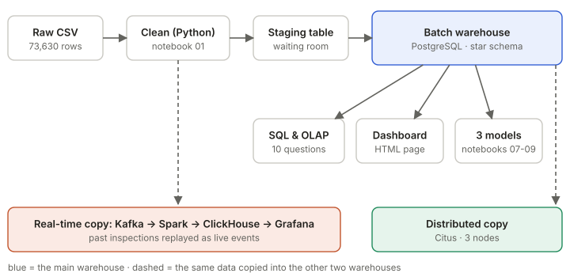
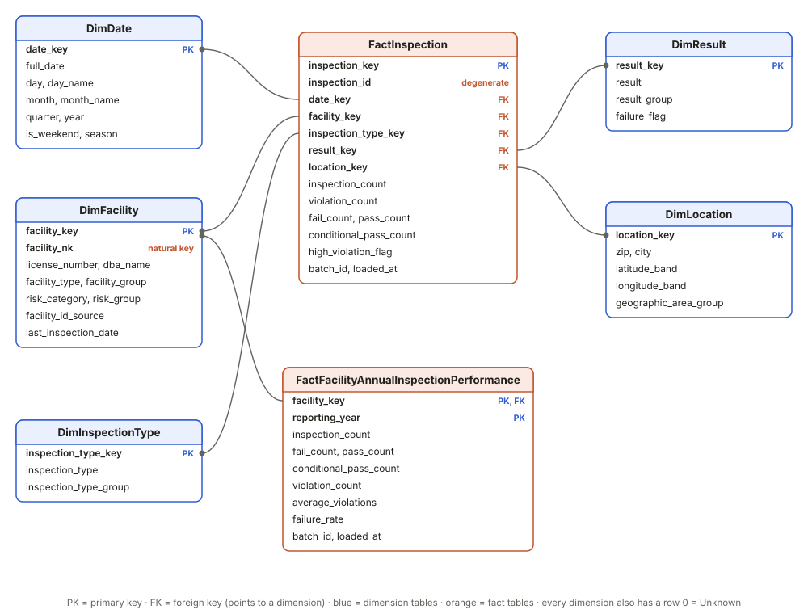
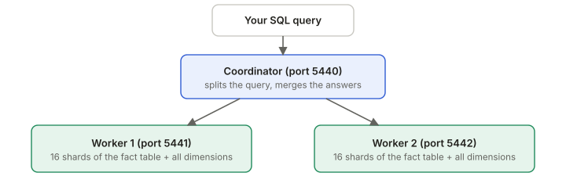
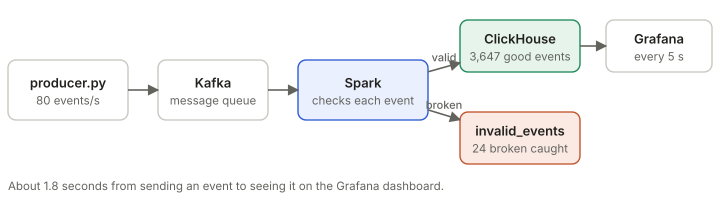

# Food Safety & Restaurant Inspection Analytics

Data warehousing, OLAP and data mining on four years of City of Chicago food inspections (2022 – 2025).

**Course:** Exploratory Data Analytics (PEC) · **Department:** Computer Engineering · **Guide:** Mrs. Shubhangi Kale · **Academic year:** 2026-27

| Member | PRN |
|---|---|
| Aryan Tandale | 202502040013 |
| Omkar Patil | 202502040010 |
| Vishwaraj Savairam | 202502040035 |
| Rushikesh Maddewad | 202502040037 |

---

## Overview

The City of Chicago publishes the result of every food inspection it carries out. This project takes the 73,630 records from January 2022 to December 2025 and:

1. profiles and cleans the data, logging every cleaning decision;
2. designs a dimensional model (star schema → fact constellation) and loads it into a PostgreSQL data warehouse with an ETL process (initial and incremental load);
3. answers ten business questions with SQL and OLAP operations, and presents them on a dashboard;
4. builds three data-mining models on the warehouse: linear regression, association rules and a decision tree;
5. stores the same data in a distributed warehouse (Citus) and a real-time warehouse (Kafka → Spark → ClickHouse → Grafana), and compares the three architectures by measurement.



## Key results

| Measure | Result |
|---|---|
| Raw records → completed inspections | 73,630 → 61,737 |
| Overall fail rate | 23.1% (24.9% in 2022 → 21.1% in 2025) |
| Highest fail rate by inspection type | complaint inspections, 37.6% |
| Next inspection after a fail | passes 79% of the time, about 13 days later |
| Regression (violation count) | MAE 2.45 vs 2.71 for the mean baseline; R² 0.12 |
| Association rules | 1,198 frequent itemsets; *10+ violations ⇒ Fail*: confidence 69%, lift 3.0 |
| Decision tree (fail / not fail) | ROC-AUC 0.635; recall 61% at threshold 0.217 |
| Citus vs single node | 25 of 25 queries identical; faster from ~500,000 rows |
| Real-time replay | 3,647 events, 24 of 24 malformed events rejected, ≈1.8 s latency |

## Technology

| Area | Tools |
|---|---|
| Language and notebooks | Python 3, Jupyter / JupyterLab |
| Data processing and charts | pandas, NumPy, Matplotlib, Seaborn, Plotly |
| Data warehouse | PostgreSQL 18, SQL, PL/pgSQL |
| Data mining | scikit-learn, statsmodels, mlxtend |
| Distributed warehouse | Citus 14.3 |
| Real-time warehouse | Apache Kafka 3.9, Apache Spark 4.0 Structured Streaming, ClickHouse 26.3, Grafana 11.3 |
| Platform | Windows 11 with WSL 2 (Ubuntu) |

---

## Methodology

### A · Data curation and exploratory analysis
- **Source:** City of Chicago *Food Inspections* open data (dataset `4ijn-s7e5`), 17 columns.
- **Profiling:** missing values, value distributions, duplicates and invalid codes for every column.
- **Curation** (`etl/curation.py`), each rule logged with its row count in `docs/data_quality_report.md`:
  - 29 duplicate reports removed;
  - invalid risk code "All" mapped to Unknown;
  - 217 free-text facility types grouped into 7 facility groups;
  - violation count extracted from the violations text; a fail without violation text is recorded as unknown;
  - 11,864 records of visits that did not take place (Out of Business, No Entry …) kept but excluded from the inspection facts.
- **Derived attributes:** result group, risk group, facility group, inspection-type group, violation band, high-violation flag, season, area (street-grid quadrant).
- **EDA** (`notebooks/02_eda.ipynb`): numerical, categorical, temporal, geographic and outcome analysis.


### B · Dimensional model
- **Grain:** one completed inspection of one facility on one date.
- **Fact table** `fact_inspection`: surrogate keys and additive measures (violation count, fail / pass / conditional-pass counts, high-violation flag).
- **Dimensions:** date, facility, inspection type, result, location; each with an Unknown member (key 0). Facility is a Type 1 dimension.
- **Fact constellation:** a second fact table, `fact_facility_annual_inspection_performance` (facility × year), shares the facility dimension.
- **Snowflake comparison** (`etl/model_comparison.py`): 16 tables and 9 joins vs 6 tables and 3 joins, about twice the query time; the star / constellation design was selected.



### C · ETL and validation
- **Extract:** bulk `COPY` of the curated file into `staging.inspection_stg`, per batch.
- **Transform and load:** the PL/pgSQL procedure `dw.load_batch` applies data-quality rules, inserts new dimension members, looks up surrogate keys and loads the facts in one transaction, and records each batch in `staging.load_audit`.
- **Initial load** (Jan 2022 – Nov 2025): 60,608 facts. **Incremental load** (Dec 2025): 1,129 facts.
- **Validation** (`sql/04_validation.sql`): five reconciliation and referential-integrity checks after each load, all returning 0.
- **Indexes** on the fact foreign keys reduce selective lookups from about 6.5 ms to 0.5 ms.


### F · Business questions, OLAP and dashboard
- The ten business questions are answered in `sql/06_analytical_queries.sql`.
- OLAP operations in `sql/07_olap_queries.sql`: roll-up (`GROUP BY ROLLUP`), drill-down, slice, dice, pivot (`FILTER`), `CUBE` and `GROUPING SETS`; outputs and interpretations in `docs/olap_operations.md`.
- Ten findings in `docs/ten_findings.md`.
- Dashboard `dashboard/food_safety_dashboard.html`: overview, facilities and risk, locations, inspections and violations, data mining and warehouse-comparison pages, built from the warehouse with Plotly.


### Analytical mart
`sql/08_analytics_mart.sql` builds `mart.food_inspection_analytics_mart` from the warehouse. Window functions (`LAG` per facility, in date order) add the previous inspection's result, violation count, days since it and the number of earlier inspections. All three models read this table and use only information available before an inspection.

### G · Regression
`notebooks/07_regression.ipynb`
- Target: violation count. Temporal split: train 2022 – 2024, test 2025.
- Mean baseline, simple linear regression (previous violation count) and multiple linear regression (one-hot encoded categories, 102 features).
- Evaluation: MAE, MSE, RMSE, R²; diagnostics: VIF, Breusch-Pagan test, outlier influence.
- Result: MAE 2.45 (baseline 2.71), R² 0.12.

### H · Association rules
`notebooks/08_association_mining.ipynb`
- Each inspection is a transaction of seven items: facility type, risk, inspection type, result, violation band, area, season (61,185 transactions).
- Apriori and FP-Growth at minimum support 0.02 produce the same 1,198 frequent itemsets.
- Rules filtered by confidence ≥ 0.30 and lift ≥ 1.3, with definitional and redundant rules removed; 14 rules reported with interpretations.

### I · Decision tree
`notebooks/09_decision_tree.ipynb`
- Target: failed inspection (1 / 0). CART (`DecisionTreeClassifier`, Gini criterion).
- Temporal split: train 2022 – 2023, validation 2024, test 2025.
- Hyper-parameters (max depth, min samples split, min samples leaf, cost-complexity pruning) studied one at a time and by grid search over 420 combinations; selected: depth 8, at least 200 samples per leaf.
- Decision threshold chosen on the validation year (0.217).
- Evaluation: accuracy, precision, recall, F1, ROC-AUC, confusion matrix; feature importance, decision paths, and a hand calculation of the Gini index for the first split.
- Result: ROC-AUC 0.635; recall 61% and precision 29% at threshold 0.217. The strongest predictor is the result of the previous inspection.


### D · Distributed warehouse (Citus)
- Cluster: one coordinator (port 5440) and two workers (5441, 5442).
- Distribution-key analysis of the facility, location and date keys; `facility_key` chosen for its cardinality (17,084) and even distribution.
- Fact table hash-distributed into 32 shards; dimensions as reference tables.
- Five queries timed on a single node and on Citus at 61,737 to 2,000,000 rows (larger sizes resampled from real facts, for timing only): 25 of 25 results identical; Citus slower on small data and mostly faster from about 500,000 rows.



### E · Real-time warehouse (replay simulation)
- The source is historical, so October – December 2025 is replayed in date order and every event is labelled `REPLAY_SIMULATION`.
- `streaming/producer.py` publishes JSON events to Kafka, including deliberately malformed test events.
- `streaming/spark_stream.py` (Spark Structured Streaming, 2-second micro-batches) validates every event, routes invalid ones to a dead-letter table, and computes 10-second and daily windows.
- ClickHouse stores the events and aggregates; a Grafana dashboard shows the streaming KPIs: inspections per minute, fails, passes, violations, high-violation inspections, top facility types, risk distribution and area alerts.



### J · Architecture comparison

| | Batch (PostgreSQL) | Distributed (Citus) | Real-time |
|---|---|---|---|
| Data arrival | batches | batches | continuous |
| Latency | per load | per load | ≈1.8 s |
| Historical analysis | best | identical results | recent window |
| Live monitoring | no | no | yes |
| Operational effort | low | medium | high |

A batch warehouse serves as the system of record; a real-time layer adds value only for live monitoring, and distribution only once the data outgrows one node. Recommendations for the health department are in `docs/domain_recommendations.md`.

---

## Repository structure

```
run_all.py               batch pipeline: Parts A, B, C, F, G, H, I in order
data/raw/                source data (zipped CSV) and its metadata
notebooks/               01 curation · 02 EDA · 07 regression · 08 association rules · 09 decision tree
etl/                     curation rules, ETL driver, model comparison, query timing, OLAP, Citus experiment
sql/                     schema, load procedure, indexes, validation, snowflake, business questions, OLAP, mart, demo queries
dashboard/               dashboard builder and the generated HTML dashboard
streaming/               producer, Spark job, ClickHouse DDL, Grafana dashboard
scripts/                 setup and run scripts (WSL / Ubuntu)
results/                 output tables (CSV) of every step
docs/                    report, data dictionary, data-quality report, OLAP results, findings, images, console logs
build_docs/              builders for the report, slides, diagrams and documentation pages
deliverables/            report (PDF, DOCX), presentation (PPTX, PDF, HTML) and documentation pages
```

## Running the project

The project runs on Ubuntu (WSL 2 on Windows).

| Purpose | Command |
|---|---|
| First-time installation | `bash scripts/run_everything_wsl.sh install` |
| Build everything from the raw data | `bash scripts/run_everything_wsl.sh full` |
| Start all services | `bash scripts/run_everything_wsl.sh start` (Windows: `Start_Project.cmd`) |
| Batch pipeline only (~10 min) | `python run_all.py` |
| One part (A, B, C, F, mart, G, H, I, D, E) | `bash scripts/part.sh <part>` (Windows: `Project_Menu.cmd`) |
| All parts in order, logs in `docs/run_logs/` | `bash scripts/part.sh all` (Windows: `Run_All_Parts.cmd`) |
| Real-time replay | `bash scripts/run_everything_wsl.sh replay` (Windows: `Replay_Stream.cmd`) |

| Service | Address | Login |
|---|---|---|
| Data warehouse (PostgreSQL) | `localhost:5432`, database `foodsafety` | `foodsafety` / `foodsafety` |
| Citus coordinator | `localhost:5440`, database `foodsafety_citus` | `postgres` |
| JupyterLab | http://localhost:8888 | – |
| Grafana | http://localhost:3000/d/food-safety-rt | – |
| ClickHouse | http://localhost:8123/play | – |

## Documentation

| Document | Content |
|---|---|
| `deliverables/Food_Safety_Analytics_Report.pdf` | the full project report |
| `deliverables/Food_Safety_Presentation.pptx` | presentation slides |
| `docs/data_dictionary.md` | source and derived columns |
| `docs/data_quality_report.md` | every cleaning decision with its row count |
| `docs/olap_operations.md` | OLAP queries, outputs and interpretations |
| `docs/ten_findings.md` | the ten analytical findings |
| `docs/architecture_comparison.md` | measured comparison of the three warehouses |
| `docs/domain_recommendations.md` | recommendations for the health department |

**Data source:** City of Chicago, *Food Inspections* — https://data.cityofchicago.org/Health-Human-Services/Food-Inspections/4ijn-s7e5
