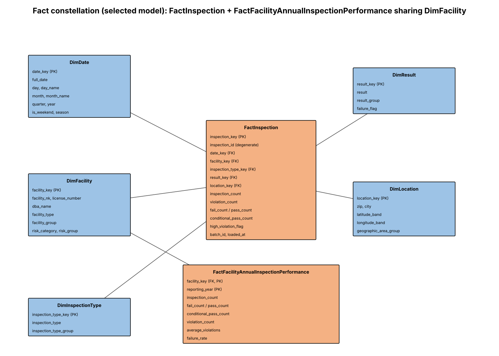
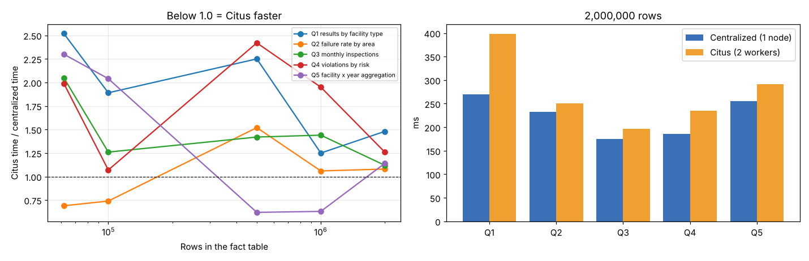
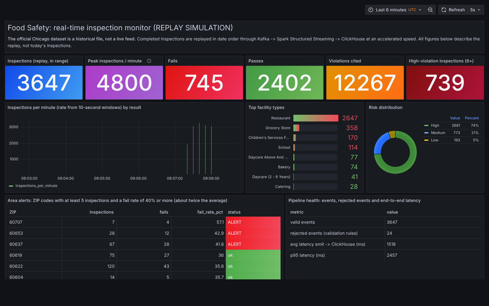
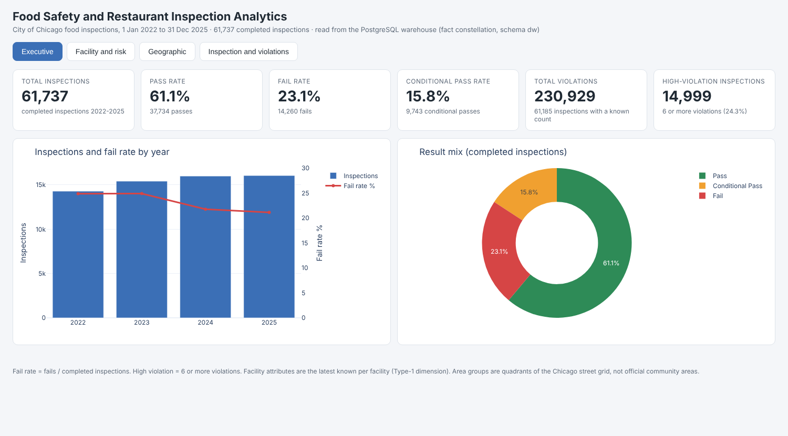
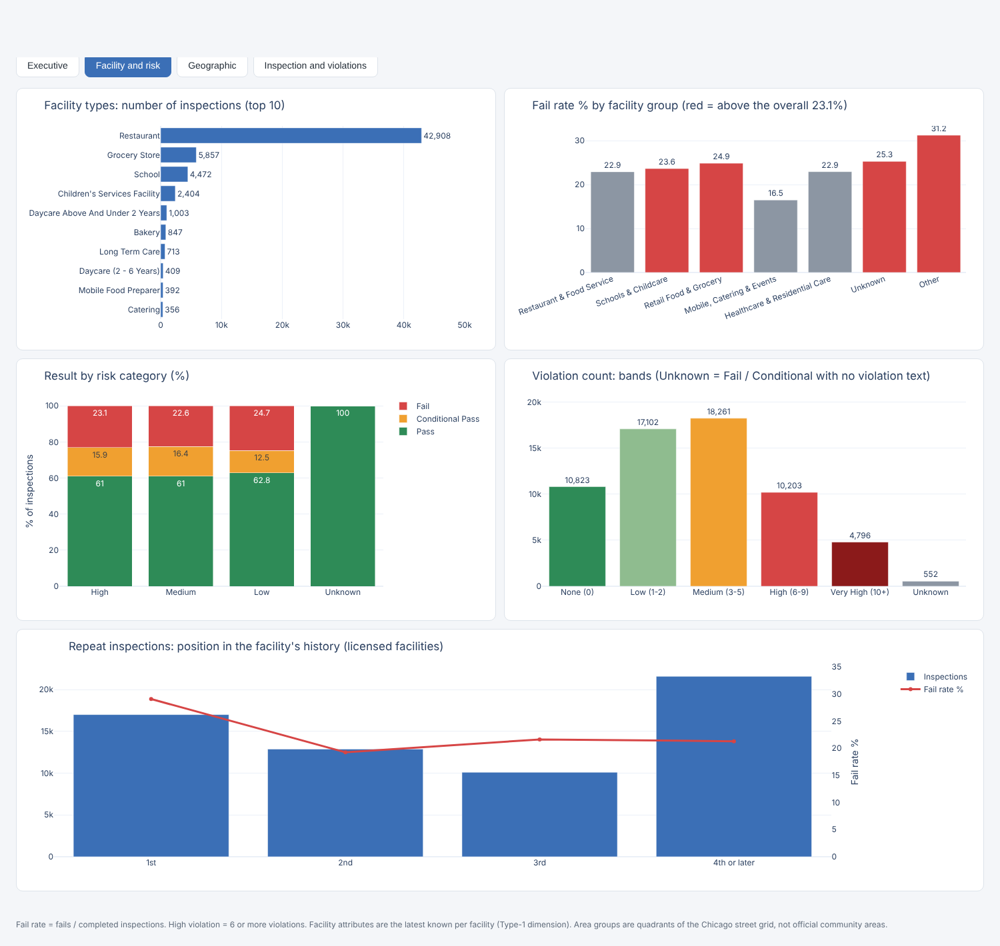
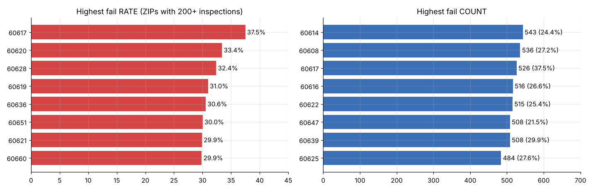

# Food Safety and Restaurant Inspection Analytics
### Integrated Data Warehouse, OLAP and Data Mining Project: Technical Report
**Rushikesh Maddewad** &nbsp;|&nbsp; PRN 202502040037 &nbsp;|&nbsp; Roll No 353

**Dataset:** City of Chicago Food Inspections (official Data Portal), 1 January 2022 to 31 December 2025: 73,630 records, of which 61,737 are completed inspections.

## Summary
This report describes one integrated lifecycle: *raw data, profiling, curation, staging, dimensional warehouse, OLAP and dashboard, analytical mart, regression / association mining / decision tree*, with three warehouse architectures (batch, distributed, real-time) evaluated on the same data. Every number comes from code that was run in this project; the folders `etl/`, `sql/`, `streaming/`, `notebooks/` and `results/` hold the code and the raw measurements.

**Main results**

* A fact-constellation warehouse in PostgreSQL (two fact tables, five dimensions) was loaded from curated data, validated (16 integrity checks, all 0) and extended with an incremental load.
* A Kafka, Spark Structured Streaming and ClickHouse pipeline with a Grafana dashboard processed a replay of 3,647 inspections with an average delay of 1.5 s.
* The fail rate fell from 24.9% (2022) to 21.1% (2025). Complaint inspections fail most often (37.6%); after a failed inspection 79% of the next visits pass.
* Violations (R-squared 0.12) and failures (AUC 0.64) are only weakly predictable before the visit.
* Recommended architecture: a **batch warehouse at the centre**, a real-time layer only for operational monitoring, and a distributed layer only when the data outgrows one node.

**Status of the required parts.** Parts A, B, C, E, F, G, H, I and J are implemented and measured. Part D (Citus) is implemented and measured on a 3-node cluster that shares one machine; it was not faster than one node here (Section 4). **A Power BI file was not produced** because Power BI Desktop is Windows-only; an equivalent HTML dashboard and a Power BI rebuild package were delivered instead (Section 6). The DAX measures were written but not executed.

## 1. Data and curation (Part A)
**Source:** https://data.cityofchicago.org/Health-Human-Services/Food-Inspections/4ijn-s7e5 (extracted 29 October 2026, SHA-256 in `docs/dataset_source.md`). No external enrichment was used. Derived attributes (Year, Quarter, Month, DayOfWeek, IsWeekend, ViolationCount, HasViolations, ResultGroup, RiskGroup, FacilityGroup, InspectionTypeGroup, IsFailedInspection, HighViolationFlag, GeographicAreaGroup and the bands) are documented with formula, threshold and mapping in `docs/data_dictionary.md`.

**Selected data-quality decisions** (full report: `docs/data_quality_report.md`; every count is computed by the code):

| Problem | Field | Rows | Treatment | Justification |
|---|---|---|---|---|
| Logical duplicate (same licence, date, type, result and violation text, different inspection_id)  | inspection_id  | 29  | Remove later copies  | The source documentation says duplicate reports may remain; identical content for the same licence and day is a repeated report.  |
| Same licence, date and type but different result/violations  | license_number  | 496  | Retain and flag  | Different content means they may be separate visits (e.g. morning and afternoon); cannot be proven duplicates.  |
| Invalid risk code 'All'  | risk  | 38  | Map to Unknown member  | Only Risk 1/2/3 are documented, so 'All' is not a real category.  |
| Missing risk  | risk  | 17  | Map to Unknown member  | Facts are kept; excluding them would bias counts.  |
| Missing facility type  | facility_type  | 320  | Map to Unknown member  | Facts are kept; type is not needed for counts.  |
| Missing or zero licence number  | license_number  | 213  | Identify facility by name + address instead  | Licence 0 is a placeholder; such facilities are excluded from repeat-inspection analysis only.  |
| Missing coordinates  | latitude, longitude  | 255  | Keep row; LocationKey -> Unknown area  | ZIP is still available for these rows.  |
| Time of day not available  | inspection_date  | 73,601  | No hourly analysis possible  | All timestamps are 00:00:00 in the source, so hourly patterns are NOT derived or invented.  |
| Fail / Pass w/ Conditions without violation text  | violations  | 552  | ViolationCount = NULL (unknown)  | These results require at least one cited violation, so zero would be wrong; the row is kept for counts.  |
| Pass with no violation text  | violations  | 10,823  | ViolationCount = 0  | A passing inspection with nothing recorded cited no violations.  |
| Extreme violation count (above Q3 + 1.5 x IQR)  | violation_count  | 2,686  | Retain and flag  | Large counts are plausible for badly failing premises; capping would hide the very inspections of interest.  |
| Result is not a completed inspection (Out of Business, No Entry, Not Ready, Business Not Located)  | results  | 11,864  | Keep in curated/staging data, exclude from FactInspection  | The fact grain is one COMPLETED inspection; these rows are status outcomes with no assessment.  |

**Exploratory analysis** (notebook `02_eda.ipynb`): ViolationCount has a mean of 3.77, a median of 3 and a long right tail (skewness 1.64); restaurants are 70% of the inspections; the fail rate of the large facility groups is 22.9-24.9%; re-inspections fail least (11.9%) and complaints most (33.5% as a group); the fail rate is highest in the Southeast area group (26.7%); volume and rate rank the ZIP codes differently. There is no time of day in the source, so no hourly analysis was done.

## 2. Dimensional modelling (Part B)
**Grain:** one completed inspection on one date. Three designs were built and compared; the snowflake was implemented physically so the comparison is measured.

| Criterion | Star | Snowflake | Fact constellation |
|---|---|---|---|
| Number of tables | 6.0 | 16.0 | 7.0 |
| Joins for QA (year/quarter x facility group x area) | 3.0 | 9.0 | 3.0 |
| QA median time (ms) | 37.3 | 78.3 | 37.3 |
| QB median time (ms) | 30.4 | 46.9 | 30.4 |
| Facility x year question: median time (ms) | 21.7 | 21.7 | 2.7 |

**Selected: fact constellation** (star dimensions plus a facility-by-year fact): about 2 times faster queries than the snowflake with a third of the joins, and the second fact answers facility-year questions 8 times faster. Details: `docs/dimensional_models.md`.

## 3. Batch data warehouse (Part C)
PostgreSQL 16: staging tables, five dimensions with surrogate keys and explicit Unknown members, two facts, a PL/pgSQL load procedure and Python drivers.

| batch_id | batch_label | rows_staged | rows_rejected | rows_not_completed | rows_loaded_fact | new_facilities |
|---|---|---|---|---|---|---|
| 1 | initial load Jan 2022 - Nov 2025 | 72130 | 0 | 11522 | 60608 | 16901 |
| 2 | incremental load Dec 2025 | 1471 | 0 | 342 | 1129 | 182 |
| 3 | re-run of Dec 2025 (idempotency test) | 1471 | 1129 | 342 | 0 | 0 |

* **Validation:** 16 checks after each load (referential integrity, duplicates, reconciliation of rows and measures); failures = 0.
* **Incremental load:** the final month was loaded without rebuilding; an MD5 checksum over the rows of the first batch is unchanged, and loading the same month again added 0 facts.
* **Atomic load:** a deliberately failing load left all tables unchanged (`results/fault_test.csv`).
* **Indexing:** selective queries went from 3-5 ms to 0.2-0.3 ms.
* **Analytical SQL:** the eight queries for the mandatory questions 1-8 run in 10-74 ms (`results/batch_query_timing.csv`).

## 4. Distributed data warehouse (Part D)

**Distribution-key analysis** (shard assignment simulated with PostgreSQL's `hashint4`, the hash Citus uses for integer keys; 32 shards, 2 workers):

| candidate_key | distinct_values | largest_single_value_share_% | non_empty_shards_of_32 | rows_per_shard_mean | rows_per_shard_max | shard_skew_max_over_mean | shard_cv | worker_split_max_over_mean_(2_workers) |
|---|---|---|---|---|---|---|---|---|
| facility_key | 17083 | 0.04 | 32 | 1929 | 2119 | 1.1 | 0.047 | 1.0 |
| location_key | 252 | 3.1 | 32 | 1929 | 4943 | 2.56 | 0.608 | 1.049 |
| date_key | 986 | 0.17 | 32 | 1929 | 2544 | 1.32 | 0.142 | 1.043 |

`FacilityKey` is the best choice: 17,083 distinct values, no value above 0.04% of the rows, the most even shards (max/mean 1.10), it is the grouping column of the facility-year query, and the small dimensions can be reference tables so that all joins stay local. `LocationKey` has only 252 values with one value holding 3.1% of the rows (shard skew 2.56) and `DateKey` has weekday-only dates (skew 1.32).

**Centralized baseline** on one PostgreSQL node (volumes above 61,737 rows are a synthetic scale-up by resampling the real facts, for performance only), median ms:

| query | 61,737 | 100,000 | 500,000 | 1,000,000 | 2,000,000 |
|---|---|---|---|---|---|
| Q1 results by facility type | 26.4 | 38.9 | 78.3 | 178.3 | 269.3 |
| Q2 failure rate by area | 26.2 | 43.3 | 60.2 | 113.2 | 232.0 |
| Q3 monthly inspections | 20.0 | 34.7 | 58.7 | 91.0 | 174.5 |
| Q4 violations by risk | 32.9 | 49.8 | 56.0 | 88.8 | 186.2 |
| Q5 facility x year aggregation | 56.5 | 59.5 | 257.3 | 307.0 | 255.1 |

**Citus 13.2 on PostgreSQL 16.15, 3 instances on one machine** (coordinator + 2 workers, 32 shards, facts distributed by FacilityKey, dimensions as reference tables). The distributed result was identical to the centralized result in all 25 test cases. The measured shard skew (largest shard / average) is 1.15 for FacilityKey, 1.29 for DateKey and 2.43 for LocationKey, which confirms the choice of FacilityKey.

**Citus time divided by centralized time** (below 1.0 means Citus is faster; details and the full required table in `docs/distributed_warehouse.md`):

| query | 61,737 | 100,000 | 500,000 | 1,000,000 | 2,000,000 |
|---|---|---|---|---|---|
| Q1 results by facility type | 2.52 | 1.89 | 2.25 | 1.25 | 1.48 |
| Q2 failure rate by area | 0.69 | 0.74 | 1.52 | 1.06 | 1.08 |
| Q3 monthly inspections | 2.05 | 1.26 | 1.42 | 1.44 | 1.12 |
| Q4 violations by risk | 1.99 | 1.07 | 2.42 | 1.95 | 1.26 |
| Q5 facility x year aggregation | 2.3 | 2.04 | 0.62 | 0.63 | 1.14 |

Citus was clearly faster in only 4 of 25 cases (mainly the facility-year grouping at 0.5-1 million rows, which is pushed down to the shards) and clearly slower in 16. The reasons are the distributed-planning and coordination overhead, the final merge on the coordinator, and the fact that both workers share the same 4 cores. **Distributed processing is therefore not assumed to be faster**; for this domain one node is enough.

## 5. Real-time data warehouse (Part E)
**Replay simulation, not a live feed.** `producer.py` replays completed inspections in date order to the Kafka topic `food_inspections` (key = inspection id); Spark Structured Streaming validates the JSON, derives measures, aggregates 10-second windows and daily event-time windows, and writes to ClickHouse; Grafana refreshes every 5 s.

| Measure | Value |
|---|---|
| Events replayed / stored | 3,647 / 3,647 (each exactly once) |
| Injected malformed test events rejected | 24 of 24 |
| Latency emit to ClickHouse (average / p95) | 1518 ms / 2457 ms |
| ClickHouse dashboard queries | 5.7-7.3 ms |
| Resident memory of the four services | about 2.5 GB |

## 6. OLAP and dashboard (Part F)
Six OLAP operations were run on the warehouse (roll-up, three-step drill-down, slice, dice, pivot, CUBE and GROUPING SETS); each is documented as business question, dimensions, measure, operation, SQL and DAX, output and interpretation in `docs/olap_operations.md`. The DAX was not executed (no Power BI Desktop).

The four-section dashboard (executive, facility and risk, geographic, inspection and violations) is `dashboard/food_safety_dashboard.html`, built from the warehouse.

## 7. Ten analytical findings
Each finding (question, analysis, evidence with chart, interpretation, recommendation) is in `docs/ten_findings.md`:

1. Inspection volume grew 12% in four years and has no stable seasonal peak
2. Restaurants receive seven of every ten inspections
3. The fail rate fell from 24.9% to 21.1% while passes rose
4. The risk category does not change how often an inspection fails, but high-risk places record more violations
5. Complaint inspections fail most often; re-inspections fail least
6. Failing inspections cite three times the violations of passing ones, and the most common violations are about premises and cleanliness
7. The ZIP codes with the highest failure rates are mostly not the ones with the most failures
8. Follow-up works: after a failed inspection the next visit passes 79% of the time, on average 13 days later
9. Ten or more violations mean a 69% chance of failing; follow-up and licence visits are the cleanest
10. Violation counts and failures are only weakly predictable from what is known before the visit

## 8. Regression (Part G)
Target ViolationCount; predictors known before the inspection (facility type, risk, inspection type, month, day of week, ZIP, prior result, prior violation count); chronological split (train 2022-2024, test 2025); no leakage.

| Model | Rows | MAE | RMSE | R2 |
|---|---|---|---|---|
| Baseline: predict the training mean | 15919 | 2.713 | 3.505 | -0.007 |
| Baseline (training mean), inspections with a prior | 13983 | 2.642 | 3.457 | -0.0 |
| Simple LR: PriorViolationCount | 13983 | 2.499 | 3.363 | 0.053 |
| Multiple LR: all test inspections | 15919 | 2.447 | 3.276 | 0.121 |
| Multiple LR: test inspections with a prior | 13983 | 2.407 | 3.227 | 0.128 |
| Multiple LR (train, 2022-2024) | 45266 | 2.414 | 3.272 | 0.248 |
| Simple LR (train) | 30436 | 2.611 | 3.53 | 0.054 |

The multiple model lowers MAE from 2.71 to 2.45 (R-squared 0.12); the train R-squared is 0.25, so the model over-fits and 2025 differs from earlier years. Diagnostics: only 5 of 102 features have VIF above 5; the Breusch-Pagan test shows heteroscedasticity; 1.9% outliers cause 25% of the squared error.

## 9. Association-rule mining (Part H)
Apriori (mandatory) and FP-Growth find identical itemsets (1,198 at support 0.02). Ten of the 14 selected rules (support >= 2%, confidence >= 30%, lift >= 1.3; definitional and redundant rules removed):

| Rule | support | confidence | lift |
|---|---|---|---|
| Risk=Low  =>  FacilityType=Grocery Store | 0.025 | 0.618 | 6.52 |
| Violations=Very High (10+)  =>  Result=Fail | 0.054 | 0.688 | 3.02 |
| FacilityType=Restaurant & InspType=License & Result=Pass  =>  Violations=None (0) | 0.022 | 0.492 | 2.78 |
| Area=Northwest & InspType=License & Result=Pass  =>  Violations=None (0) | 0.021 | 0.479 | 2.71 |
| FacilityType=Restaurant & Risk=High & Violations=None (0)  =>  InspType=Re-inspection | 0.043 | 0.495 | 2.1 |
| Area=Southwest & Violations=None (0)  =>  InspType=Re-inspection | 0.02 | 0.447 | 1.89 |
| Result=Fail  =>  Violations=High (6-9) | 0.071 | 0.313 | 1.88 |
| Violations=High (6-9)  =>  Result=Fail | 0.071 | 0.428 | 1.88 |
| FacilityType=Restaurant & Result=Conditional Pass & Risk=High  =>  Violations=High (6-9) | 0.031 | 0.307 | 1.84 |
| FacilityType=School & Result=Pass  =>  Violations=Low (1-2) | 0.021 | 0.452 | 1.62 |

## 10. Decision tree (Part I)
Target FailedInspection; train 2022-2023, validation 2024 (tuning of max_depth, min_samples_split, min_samples_leaf, ccp_alpha by ROC-AUC), test 2025.

| Model | Accuracy | Precision | Recall | F1 | ROC-AUC |
|---|---|---|---|---|---|
| Baseline: always 'not failed' | 0.789 | 0.000 | 0.000 | 0.000 | 0.500 |
| Decision tree, threshold 0.5 | 0.784 | 0.380 | 0.039 | 0.070 | 0.635 |
| Decision tree, validation-optimal threshold | 0.600 | 0.289 | 0.611 | 0.392 | 0.635 |

Most important features: prior inspection result Fail (29%), inspection type Complaint (15%), prior violation count (13%), days since prior inspection (10%). Three decision paths are interpreted in the notebook (highest fail rate 55-58%, lowest 4-5%, largest group 27%).

## 11. Architecture evaluation and recommendation (Part J)
Full comparison table with measured values: `docs/architecture_comparison.md`.

*Which architecture mix should a public-health department use for longitudinal inspection reporting, large-scale compliance analytics and operational inspection monitoring?*

**Recommendation: a hybrid with the batch warehouse at its centre.**

1. **Batch PostgreSQL warehouse as the system of record** for longitudinal reporting and compliance analytics. It held every analytical question at 10-74 ms, supports full OLAP, validation and an auditable incremental load, and needs one server and low operating effort. Two million rows (32 times the four years of Chicago data) still queried in 174-269 ms on one node, so the data volume of this domain does not need more.
2. **Add the real-time layer only for operational monitoring,** and only if inspections are recorded digitally as they happen (for example from inspectors' devices). It gives a 1.5-second delay and live area alerts, but it costs four services and about 2.5 GB of memory, and it should feed the batch warehouse rather than replace it. The official dataset is a historical file updated over time, so for this data the layer is a demonstration of the pattern.
3. **Distributed warehouse (Citus) only when the data outgrows one node.** At about 16,000 inspections a year, one node is enough for decades. The measured Citus run did not beat one node at any tested volume except for one query shape, because the workers shared the same machine and the coordination overhead is as large as the scan. Distribution would pay off for a state-wide or national consolidation on separate hardware, where the key analysis in `docs/distributed_warehouse.md` (FacilityKey gives the most even shards, skew 1.15) applies.

## 12. Limitations
* The official dataset is historical; the real-time layer is a replay simulation.
* One 4-core machine ran every component, so the timings compare architectures under equal conditions but are not production capacity.
* The history starts in January 2022, which affects the prior-inspection features; 2025 differs from 2022-2024.
* The warehouse uses the latest facility attributes (Type-1), so counts per group differ slightly from the EDA.
* Area groups are quadrants of the Chicago street grid, not official community areas.
* Rule-level violation detail is kept in staging; the star schema keeps only the count.

## Appendix: where everything is
See `README.md` for the map of the 54 required deliverables and the commands to reproduce each part.
