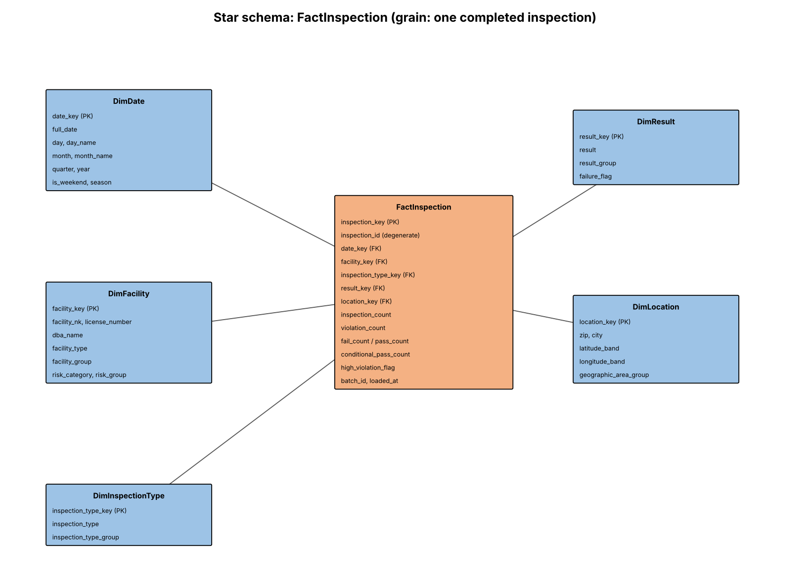
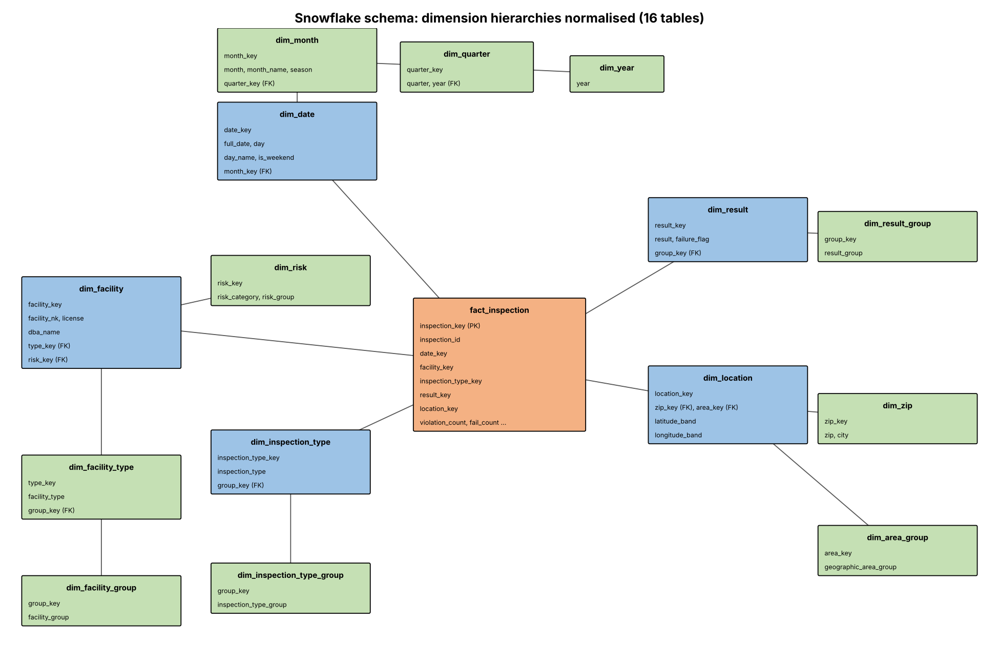
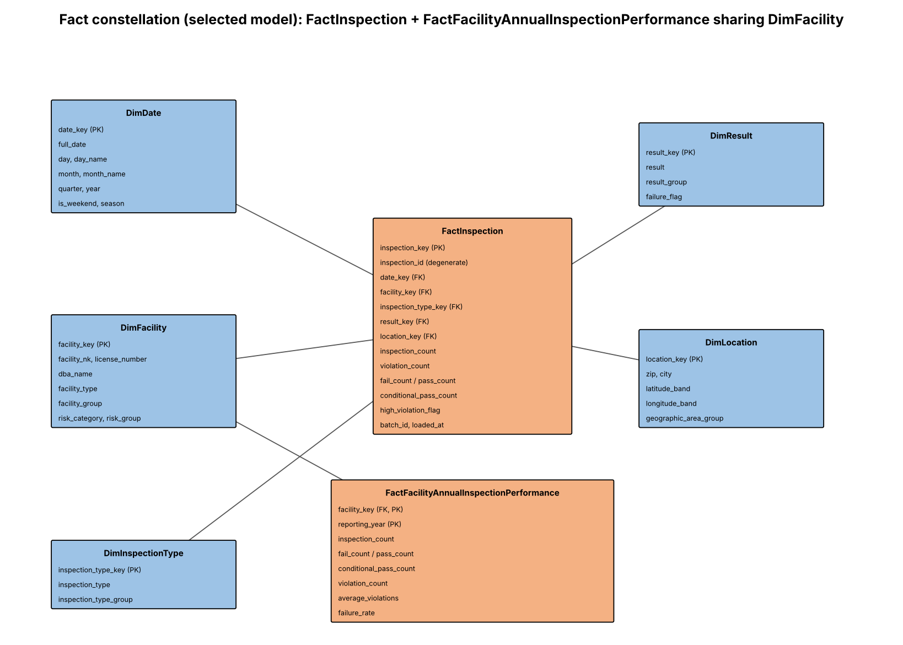

# Part B: Dimensional Modelling

All numbers on this page were measured on the real warehouse (61,737 completed inspections, 17,083 facilities) by `etl/model_comparison.py`.

## Grain declaration
**One row in FactInspection = one completed food-establishment inspection on one inspection date.**
"Completed" means the result is Pass, Pass w/ Conditions or Fail. Rows with *Out of Business*, *No Entry*, *Not Ready* or *Business Not Located* are kept in staging but are not facts, because no inspection took place. The fact table never mixes grains: the second fact table has its own grain (one facility in one reporting year).

## 1. Star schema

* **Fact:** `FactInspection` with measures InspectionCount, ViolationCount, FailCount, PassCount, ConditionalPassCount, HighViolationFlag and the degenerate dimension `inspection_id`.
* **Dimensions:** DimDate, DimFacility, DimInspectionType, DimResult, DimLocation (all denormalised; each has an explicit *Unknown* member with key 0).
* No role-playing dimension is needed: every dimension takes part in only one role per fact row.

## 2. Snowflake schema

The star dimensions were normalised along their hierarchies: Date > Month > Quarter > Year; Facility > FacilityType > FacilityGroup and Facility > Risk; Location > ZIP and Location > AreaGroup; InspectionType > InspectionTypeGroup; Result > ResultGroup. It is physically implemented in schema `snow` (16 tables) so the comparison below is measured, not guessed.

## 3. Fact constellation

The star schema plus a second fact, **FactFacilityAnnualInspectionPerformance** (grain: one facility x one reporting year) with InspectionCount, FailCount, PassCount, ViolationCount, AverageViolations and FailureRate. It shares the conformed `DimFacility` with FactInspection.

## 4. Comparison of the three models
| Criterion | Star | Snowflake | Fact constellation |
|---|---|---|---|
| Number of tables | 6.0 | 16.0 | 7.0 |
| Joins for QA (year/quarter x facility group x area) | 3.0 | 9.0 | 3.0 |
| QA median time (ms) | 37.3 | 78.3 | 37.3 |
| QB median time (ms) | 30.4 | 46.9 | 30.4 |
| Facility x year question: median time (ms) | 21.7 | 21.7 | 2.7 |

| Criterion | Star | Snowflake | Fact constellation |
|---|---|---|---|
| Storage of dimension tables (measured) | 4.08 MB | 3.21 MB (21% less) | 4.08 MB |
| Storage redundancy | Group and type text repeated for each of the 17,083 facilities | Each group/type stored once (7 facility groups, 161 facility types, 100 ZIP and city pairs) | Same as star, plus the small annual fact (42,154 rows) |
| Query complexity | Simple, 2-3 joins | 5-9 joins for the same questions | Simple for both grains |
| BI / dashboard simplicity | Best: one table per dimension, hierarchies are columns | Harder: the BI tool must follow chains of tables | Best, and the facility-year question needs no aggregation |
| Maintainability | Changing a group definition means re-running the ETL rule | A group change is one row, but any new attribute needs a new table | Same as star plus one more load step |
| Hierarchy management | Hierarchies are columns (Year > Quarter > Month > Day, Facility Type > Risk > Establishment) | Hierarchies are explicit tables | Same as star |

**Query timings (median of 9 runs, ms):**

| Query | Star joins | Snowflake joins | Star (ms) | Snowflake (ms) |
|---|---|---|---|---|
| QA: fail rate by year, quarter, facility group and area group | 3 | 9 | 37.3 | 78.3 |
| QB: inspections by facility type, risk group and result group | 2 | 5 | 30.4 | 46.9 |

## 5. Selected model and justification
**Selected model: fact constellation (star-based).**

1. The questions need **two grains**: inspection-level questions (volumes, rates, violations) and a facility-year question (repeat performance of an establishment). Only the constellation has a table for each, without mixing grains.
2. Denormalised dimensions give **fewer joins** (3 against 9 for question QA) and about **2.1 times faster queries** (37.3 ms against 78.3 ms).
3. The second fact answers "facilities with at least 3 inspections and a failure rate of 50% or more in 2025" in **2.7 ms against 21.7 ms** from the inspection fact.
4. The snowflake saves only about 0.9 MB (21%) of dimension storage. The dimensions are small, so this does not justify the extra joins.
5. The groupings (FacilityGroup, ResultGroup, ...) are derived by code in the ETL (`etl/curation.py`), so the update anomalies that normalisation prevents cannot appear in practice.

The selected model is **physically implemented** in PostgreSQL schema `dw` (see `sql/01_schema.sql` and `docs/batch_warehouse.md`).
