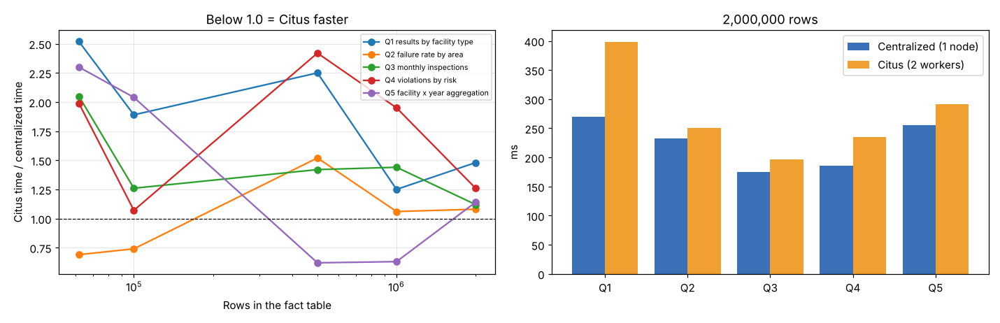

# Part D: Distributed Data Warehouse (Citus + PostgreSQL)

Everything on this page was run; the numbers come from `results/` (`etl/distributed_baseline.py`, `etl/distributed_citus.py`).

## 1. Set-up
| Item | Value |
|---|---|
| Software | Citus 13.2 on PostgreSQL 16.15 |
| Cluster | 3 PostgreSQL instances on one machine: coordinator (port 5440) and two worker nodes (5441, 5442); built by `scripts/setup_citus_cluster.sh` |
| Shards | 32 shards per distributed table (`citus.shard_count`), spread over the two workers (16 each); the coordinator holds no fact data |
| Fact table | distributed by hash of `facility_key` |
| Dimensions | **reference tables** (a full copy on every node), so all dimension joins are local to a shard |
| Data | the real 61,737 inspection facts and the synthetic scale-up tables (100,000 to 2,000,000 rows) used for the centralized baseline; the scale-up rows are resampled real facts, used for performance only |
| Centralized comparison | the main PostgreSQL node of the batch warehouse, measured in the same session with the same queries and data |

**Installation note.** Citus is not in the Ubuntu archive. It was installed from the official Citus repository (packagecloud, `citusdata/community`). Every Citus release declares a conflict with Ubuntu's `postgresql-16` package, so the PostgreSQL community (PGDG) repository was added as well and PostgreSQL 16.15 was replaced by the PGDG build of the same minor version. The data directory was untouched and the warehouse was backed up first. Both repositories were added with explicit approval.

## 2. Distribution-key selection
Candidate keys: FacilityKey, LocationKey, DateKey. Cardinality and skew were first simulated with PostgreSQL's `hashint4` (the hash Citus uses for integer keys) and then **measured** in Citus on the 1,000,000-row table, where all five queries were also timed for each key.

| candidate key | distinct values | largest single value (% of rows) | simulated shard skew (max/mean) | measured shard skew in Citus (max/mean) | total time of Q1-Q5 at 1,000,000 rows (ms) |
|---|---|---|---|---|---|
| facility_key | 17083 | 0.04 | 1.1 | 1.15 | 914.0 |
| location_key | 252 | 3.1 | 2.56 | 2.43 | 948.0 |
| date_key | 986 | 0.17 | 1.32 | 1.29 | 962.0 |

**Selected key: FacilityKey.**
* **Cardinality:** 17,083 distinct values and no value above 0.04% of the rows, so hashing gives even shards.
* **Data skew:** the measured shard skew is 1.15 (largest shard / average) against 1.29 for DateKey and 2.43 for LocationKey. LocationKey has only 252 values and one location holds 3.1% of the rows, so the largest shard is 2.4 times the average.
* **Workload and aggregation pattern:** the facility-year question groups by FacilityKey, so the aggregation can finish on the shards. Questions on facility type and risk join DimFacility, which is a reference table, so they stay local. Area and month questions group by a dimension attribute and need a final merge on the coordinator whichever key is used.
* **Joins and co-location:** only one fact table is large; the dimensions are replicated, so no data has to be re-partitioned for any join. If the annual fact table were distributed too, it would be co-located by the same FacilityKey, so facility-level joins between the two facts would also stay local.
* **Measured effect:** the total time of the five queries at 1,000,000 rows was 914 ms for FacilityKey, 948 ms for LocationKey and 962 ms for DateKey. The differences are small (within about 5%), so the decision rests mainly on the even shards and the facility-year workload, not on speed.

## 3. Parallel processing and distributed aggregation (EXPLAIN)
```
--- Q1 results by facility type (distributed by facility_key, 1,000,000 rows)
HashAggregate
  Group Key: remote_scan.facility_type, remote_scan.result_group
  ->  Custom Scan (Citus Adaptive)
        Task Count: 32
        Tasks Shown: One of 32
        ->  Task
              Node: host=localhost port=5441 dbname=foodsafety_citus
              ->  HashAggregate
                    Group Key: fa.facility_type, r.result_group
                    ->  Hash Join
                          Hash Cond: (f.result_key = r.result_key)
                          ->  Hash Join
                                Hash Cond: (f.facility_key = fa.facility_key)
                                ->  Seq Scan on fact_1000000_facility_key_102108 f
                                ->  Hash
                                      ->  Seq Scan on dim_facility_102009 fa
                          ->  Hash
                                ->  Seq Scan on dim_result_102010 r

--- Q5 facility x year aggregation (distributed by facility_key, 1,000,000 rows)
Custom Scan (Citus Adaptive)
  Task Count: 32
  Tasks Shown: One of 32
  ->  Task
        Node: host=localhost port=5441 dbname=foodsafety_citus
        ->  HashAggregate
              Group Key: f.facility_key, d.year
              ->  Hash Join
                    Hash Cond: (f.date_key = d.date_key)
                    ->  Seq Scan on fact_1000000_facility_key_102108 f
                    ->  Hash
                          ->  Seq Scan on dim_date_102008 d
```
Each query becomes 32 tasks, one per shard, run on the two workers in parallel. For the facility-year query (grouping by the distribution key) the whole aggregation runs on the shards; for the facility-type query the coordinator adds a final `HashAggregate` to merge the partial results.

## 4. Data-skew analysis (measured shard sizes at 1,000,000 rows)
| distribution key | worker | shards | MB on the worker | largest shard (MB) | smallest shard (MB) |
|---|---|---|---|---|---|
| facility_key | 5441 | 16 | 54.18 | 3.77 | 3.07 |
| facility_key | 5442 | 16 | 50.86 | 3.69 | 2.97 |
| location_key | 5441 | 16 | 57.38 | 8.17 | 0.95 |
| location_key | 5442 | 16 | 50.04 | 6.8 | 0.16 |
| date_key | 5441 | 16 | 52.42 | 4.14 | 2.51 |
| date_key | 5442 | 16 | 49.82 | 3.89 | 2.59 |

## 5. Centralized against distributed


Median of 5 runs after a warm-up run; times in ms. In every one of the 25 cases the distributed result was **identical** to the centralized result (`results_identical` in `results/distributed_scaling.csv`).

| Query | Rows | Centralized (ms) | Distributed (ms) | Interpretation |
|---|---|---|---|---|
| Q1 results by facility type | 61,737 | 26.4 | 66.6 | Citus 2.5x slower, most likely because distributed planning, the 32 shard tasks and the merge of partial results on the coordinator cost more than the parallel scan saves |
| Q2 failure rate by area | 61,737 | 26.2 | 18.0 | about equal: the difference of 8 ms is within the noise of a single-machine test |
| Q3 monthly inspections | 61,737 | 20.0 | 41.0 | Citus 2.0x slower, most likely because distributed planning, the 32 shard tasks and the merge of partial results on the coordinator cost more than the parallel scan saves |
| Q4 violations by risk | 61,737 | 32.9 | 65.4 | Citus 2.0x slower, most likely because distributed planning, the 32 shard tasks and the merge of partial results on the coordinator cost more than the parallel scan saves |
| Q5 facility x year aggregation | 61,737 | 56.5 | 130.2 | Citus 2.3x slower, most likely because distributed planning, the 32 shard tasks and the merge of partial results on the coordinator cost more than the parallel scan saves |
| Q1 results by facility type | 100,000 | 38.9 | 73.4 | Citus 1.9x slower, most likely because distributed planning, the 32 shard tasks and the merge of partial results on the coordinator cost more than the parallel scan saves |
| Q2 failure rate by area | 100,000 | 43.3 | 32.0 | about equal: the difference of 11 ms is within the noise of a single-machine test |
| Q3 monthly inspections | 100,000 | 34.7 | 43.8 | about equal: the difference of 9 ms is within the noise of a single-machine test |
| Q4 violations by risk | 100,000 | 49.8 | 53.5 | about equal: the difference of 4 ms is within the noise of a single-machine test |
| Q5 facility x year aggregation | 100,000 | 59.5 | 121.2 | Citus 2.0x slower, most likely because distributed planning, the 32 shard tasks and the merge of partial results on the coordinator cost more than the parallel scan saves |
| Q1 results by facility type | 500,000 | 78.3 | 176.2 | Citus 2.2x slower, most likely because distributed planning, the 32 shard tasks and the merge of partial results on the coordinator cost more than the parallel scan saves |
| Q2 failure rate by area | 500,000 | 60.2 | 91.8 | Citus 1.5x slower, most likely because distributed planning, the 32 shard tasks and the merge of partial results on the coordinator cost more than the parallel scan saves |
| Q3 monthly inspections | 500,000 | 58.7 | 83.1 | Citus 1.4x slower, most likely because distributed planning, the 32 shard tasks and the merge of partial results on the coordinator cost more than the parallel scan saves |
| Q4 violations by risk | 500,000 | 56.0 | 135.5 | Citus 2.4x slower, most likely because distributed planning, the 32 shard tasks and the merge of partial results on the coordinator cost more than the parallel scan saves |
| Q5 facility x year aggregation | 500,000 | 257.3 | 158.3 | Citus 1.6x faster: the grouping column is the distribution key, so each shard finishes its aggregation and the coordinator only merges |
| Q1 results by facility type | 1,000,000 | 178.3 | 223.2 | Citus 1.2x slower, most likely because distributed planning, the 32 shard tasks and the merge of partial results on the coordinator cost more than the parallel scan saves |
| Q2 failure rate by area | 1,000,000 | 113.2 | 120.3 | about equal: the difference of 7 ms is within the noise of a single-machine test |
| Q3 monthly inspections | 1,000,000 | 91.0 | 130.9 | Citus 1.4x slower, most likely because distributed planning, the 32 shard tasks and the merge of partial results on the coordinator cost more than the parallel scan saves |
| Q4 violations by risk | 1,000,000 | 88.8 | 173.1 | Citus 1.9x slower, most likely because distributed planning, the 32 shard tasks and the merge of partial results on the coordinator cost more than the parallel scan saves |
| Q5 facility x year aggregation | 1,000,000 | 307.0 | 192.5 | Citus 1.6x faster: the grouping column is the distribution key, so each shard finishes its aggregation and the coordinator only merges |
| Q1 results by facility type | 2,000,000 | 269.3 | 398.2 | Citus 1.5x slower, most likely because distributed planning, the 32 shard tasks and the merge of partial results on the coordinator cost more than the parallel scan saves |
| Q2 failure rate by area | 2,000,000 | 232.0 | 251.0 | Citus 1.1x slower, most likely because distributed planning, the 32 shard tasks and the merge of partial results on the coordinator cost more than the parallel scan saves |
| Q3 monthly inspections | 2,000,000 | 174.5 | 196.3 | Citus 1.1x slower, most likely because distributed planning, the 32 shard tasks and the merge of partial results on the coordinator cost more than the parallel scan saves |
| Q4 violations by risk | 2,000,000 | 186.2 | 234.6 | Citus 1.3x slower, most likely because distributed planning, the 32 shard tasks and the merge of partial results on the coordinator cost more than the parallel scan saves |
| Q5 facility x year aggregation | 2,000,000 | 255.1 | 291.3 | Citus 1.1x slower, most likely because distributed planning, the 32 shard tasks and the merge of partial results on the coordinator cost more than the parallel scan saves |

## 6. Discussion: distributed is not automatically faster
* **Summary:** Citus was clearly faster in 4 of 25 cases (Q2 at 61,737, Q2 at 100,000, Q5 at 500,000, Q5 at 1,000,000) and clearly slower in 16. At 2,000,000 rows it was 1.08-1.48 times the centralized time.
* **Overhead:** every query pays for distributed planning, 32 shard tasks, connections to the workers and the transfer of partial results to the coordinator. With a data set of a few hundred MB this overhead is as large as the scan itself.
* **Network communication:** the nodes talk over localhost, so the cost is serialisation and connection handling rather than network latency; on separate machines it would be higher.
* **Shard distribution and skew:** 32 shards on two workers are evenly sized for FacilityKey (skew 1.15); a skewed key such as LocationKey (2.43) leaves one worker waiting for its biggest shards.
* **Query shape:** queries that group by the distribution key (facility by year) are the ones that benefit; queries that group by a dimension attribute (area, month, facility type) need a coordinator merge and gain nothing.
* **Hardware:** the coordinator and both workers share the same 4-core machine, so the workers compete for the same CPUs. A real speed-up from distribution needs additional hardware, and none was available here.
* **Resources:** the Citus nodes use about 2.1 GB of resident memory against 0.12 GB for the single node after the same workload (the sums count shared buffers once per process, so both are overstated, but the order of magnitude is right). Loading and indexing 2,000,000 rows into the distributed table took 7.7 s.

**Conclusion for this domain:** one PostgreSQL node answers every test query in 307 ms or less at 2,000,000 rows, which is 32 times the four years of Chicago data (about 16,000 inspections a year). Distribution does not pay off at this size; it becomes relevant when the data is consolidated across many jurisdictions or when queries need more CPU than one machine has.
