# Final Presentation Guide

Everything for the presentation in one place: how to start, the script with what to show at every moment, each part with how to show it and the questions mam may ask (basic and deeper), and what to do if something breaks.

**Team:** Aryan Tandale (opens) · Omkar Patil · Vishwaraj Savairam · Rushikesh Maddewad (drives the laptop, live demo, closes) · **Guide:** Mrs. Shubhangi Kale

---

## Contents

0. [The slides](#the-slides)
1. [Start everything](#start-everything)
2. [The script: what to say and what to show](#the-script-what-to-say-and-what-to-show)
3. [Part A · Data and cleaning](#part-a--data-and-cleaning)
4. [Part B · The warehouse design](#part-b--the-warehouse-design)
5. [Part C · Loading and checking](#part-c--loading-and-checking)
6. [Part F · Business questions, OLAP, dashboard](#part-f--business-questions-olap-dashboard)
7. [The analytics table](#the-analytics-table)
8. [Part G · Regression](#part-g--regression)
9. [Part H · Association rules](#part-h--association-rules)
10. [Part I · Decision tree](#part-i--decision-tree)
11. [Part D · Distributed warehouse (Citus)](#part-d--distributed-warehouse-citus)
12. [Part E · Real-time warehouse](#part-e--real-time-warehouse)
13. [Part J · Comparison](#part-j--comparison)
14. [Questions about the whole project](#questions-about-the-whole-project)
15. [If something breaks](#if-something-breaks)

---

## The slides

The deck is `deliverables\Food_Safety_Presentation.pptx` (also `Food_Safety_Slides.html`: open it, use the arrow keys, press F for full screen).

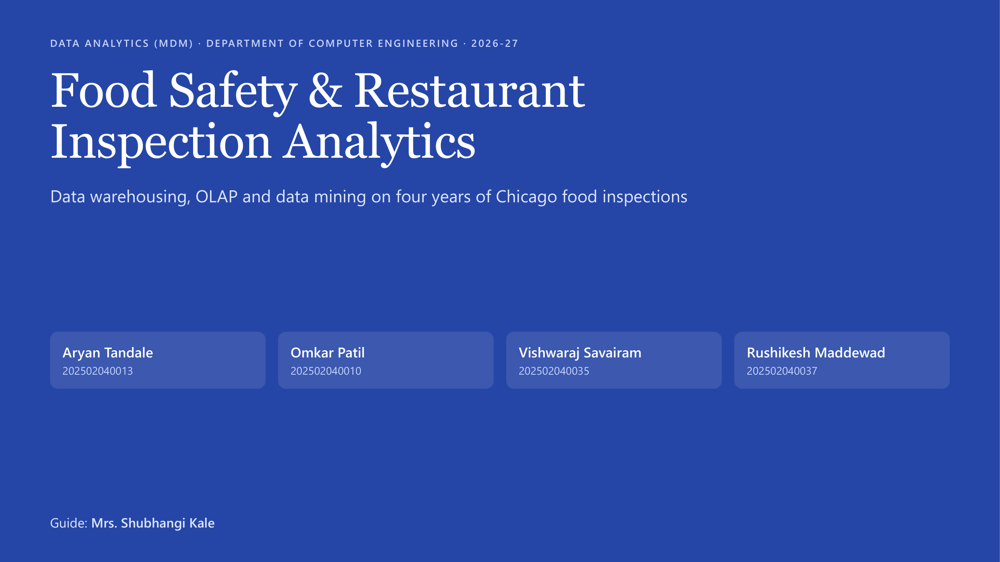

> **Slide 1:** Title

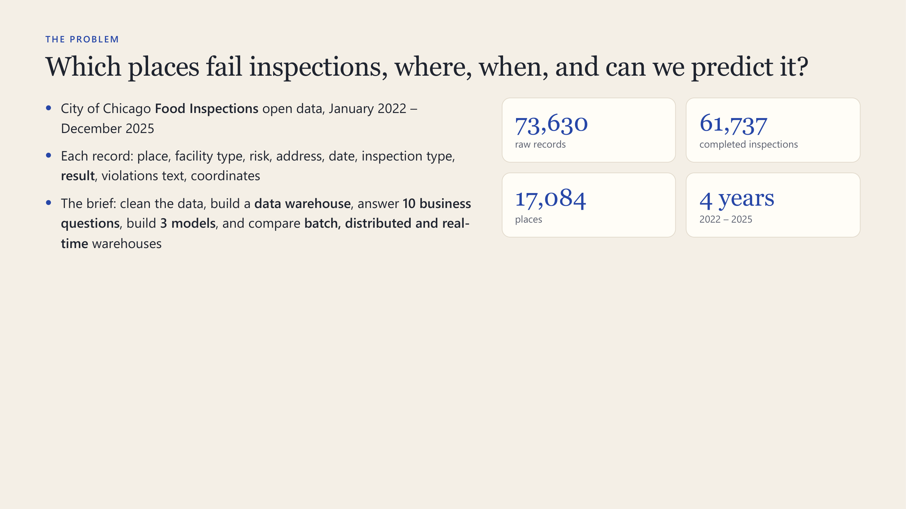

> **Slide 2:** The problem

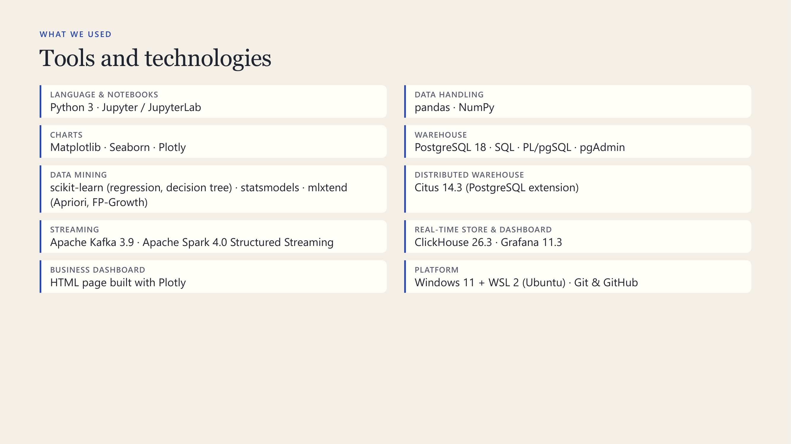

> **Slide 3:** What we used

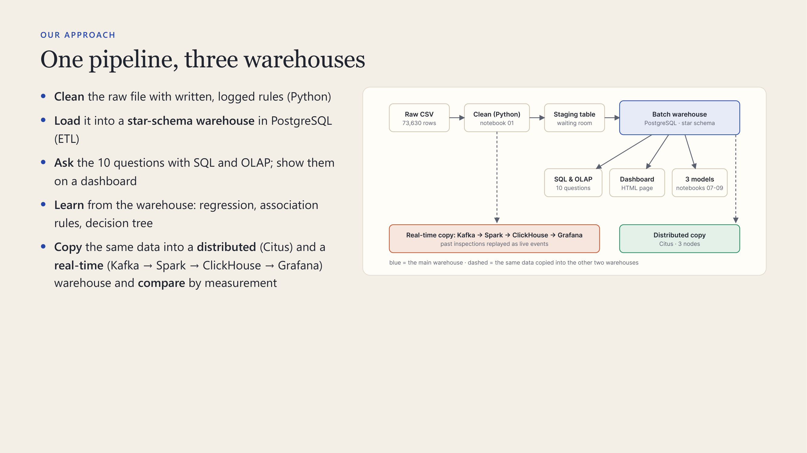

> **Slide 4:** Our approach

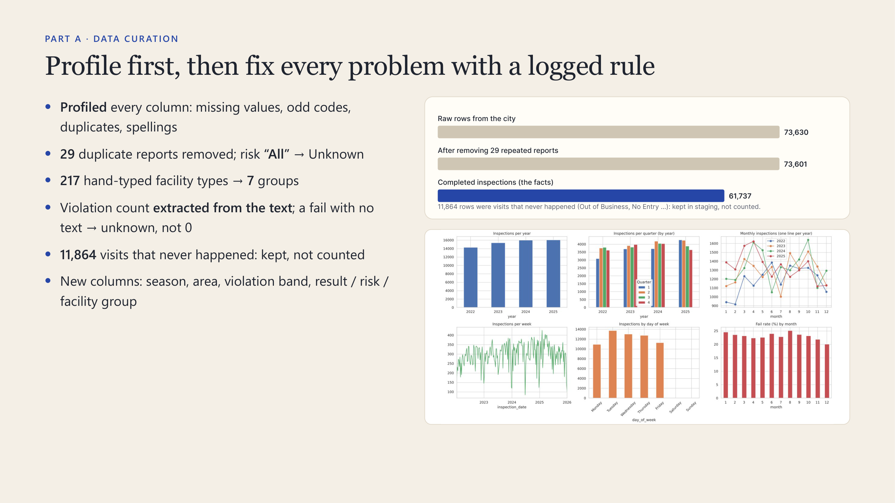

> **Slide 5:** Part A · Data curation

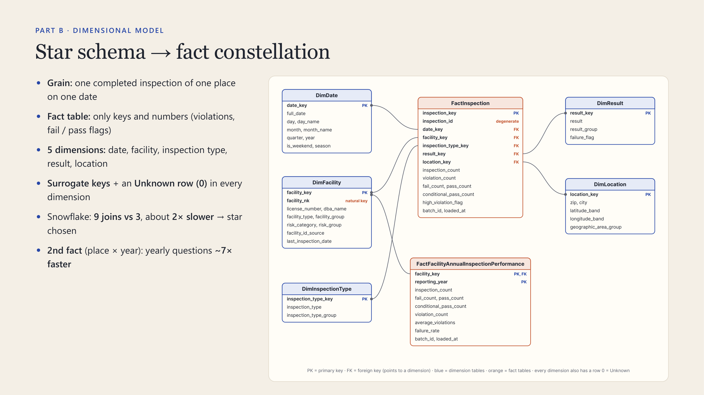

> **Slide 6:** Part B · Dimensional model

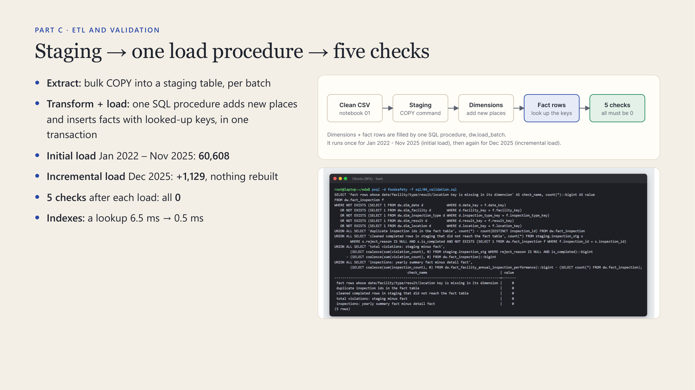

> **Slide 7:** Part C · ETL and validation

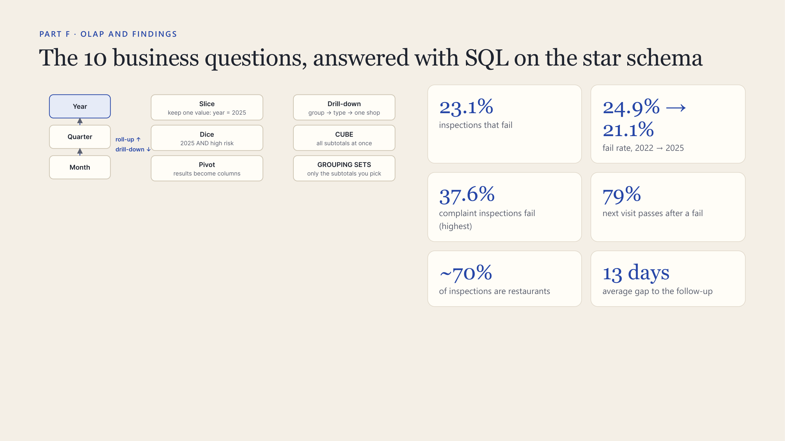

> **Slide 8:** Part F · OLAP and findings

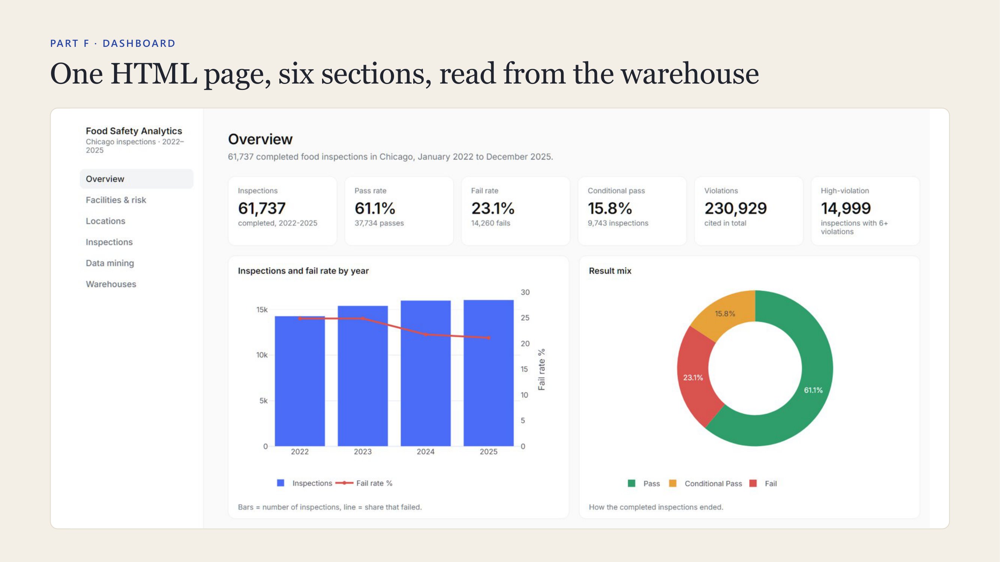

> **Slide 9:** Part F · Dashboard

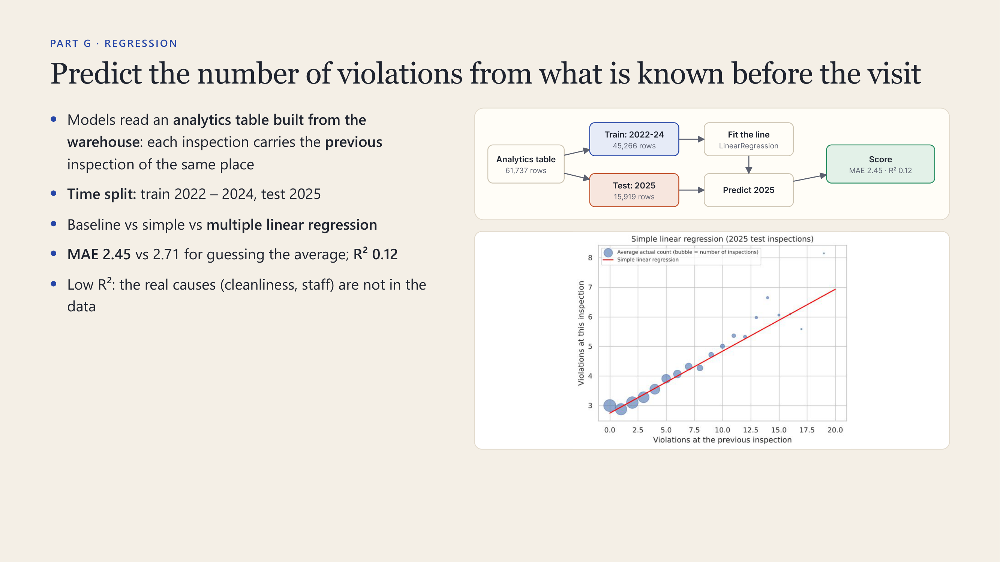

> **Slide 10:** Part G · Regression

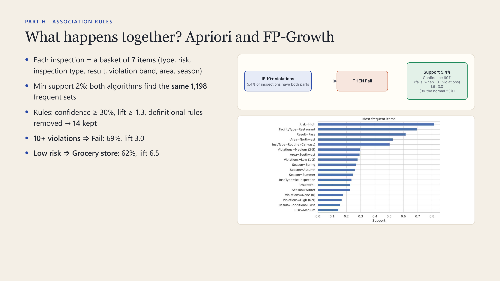

> **Slide 11:** Part H · Association rules

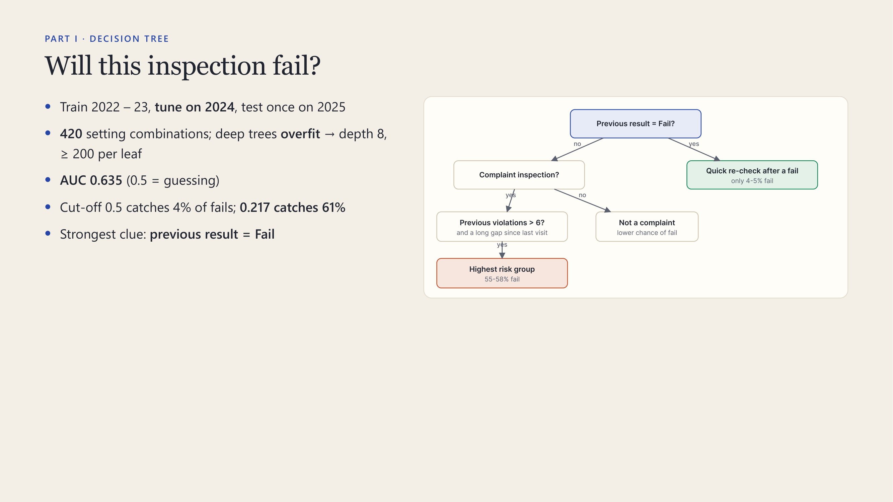

> **Slide 12:** Part I · Decision tree

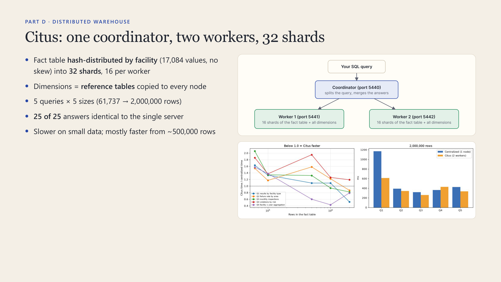

> **Slide 13:** Part D · Distributed warehouse

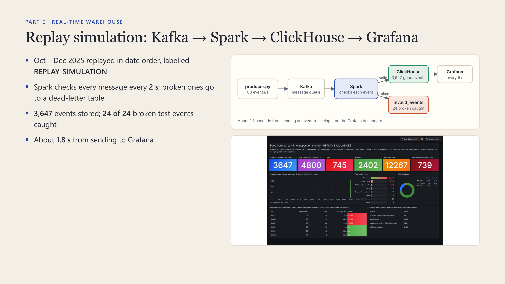

> **Slide 14:** Part E · Real-time warehouse

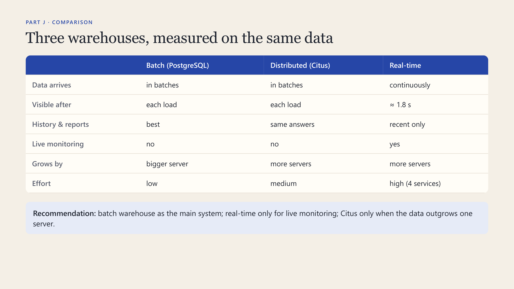

> **Slide 15:** Part J · Comparison

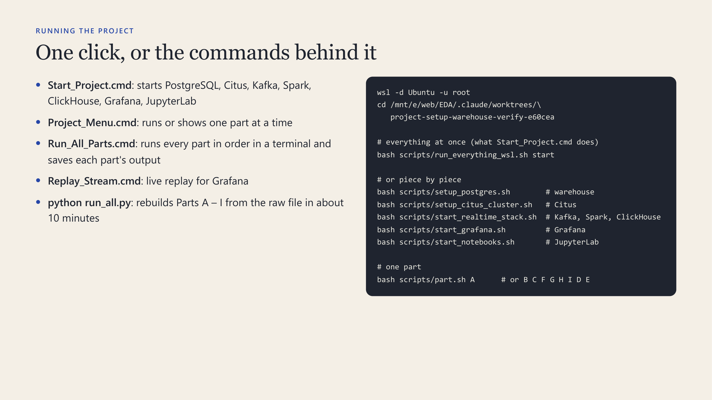

> **Slide 16:** Running the project


> **Slide 17:** Thank you

---

## Start everything

The project folder is `E:\web\EDA\.claude\worktrees\project-setup-warehouse-verify-e60cea` (`.claude` is a hidden folder: paste the path into File Explorer's address bar). Pin it to Quick access.

1. **30 minutes before class**, double-click **`Start_Project.cmd`**.
   - JupyterLab and Grafana are ready after about **1 minute**; everything else after about **3 minutes**.
   - **Keep this window open.** Closing it stops all the servers.
2. Double-click **`Project_Menu.cmd`**, type **0**, press Enter. All 8 lines must say **OK**.
3. Open these tabs, left to right:

| # | Open | Login |
|---|---|---|
| 1 | `deliverables\Food_Safety_Presentation.pptx` (slideshow) | |
| 2 | <http://localhost:8888/lab/tree/notebooks> | none |
| 3 | pgAdmin → server `localhost`, port `5432`, database `foodsafety`; then **File → Open → `sql\demo_queries.sql`** | `foodsafety` / `foodsafety` |
| 4 | pgAdmin → server `localhost`, port `5440`, database `foodsafety_citus` | `postgres`, no password |
| 5 | <http://localhost:3000/d/food-safety-rt> | none |
| 6 | `dashboard\food_safety_dashboard.html` (double-click) | |
| 7 | <http://localhost:8123/play> (only if asked) | none |

### Without Start_Project.cmd

`Start_Project.cmd` only runs Linux commands for you. You can type them yourself:

1. Open **Windows Terminal** (or Command Prompt) and type `wsl -d Ubuntu -u root`. You are now in Ubuntu.
2. Go to the project folder:
   ```bash
   cd /mnt/e/web/EDA/.claude/worktrees/project-setup-warehouse-verify-e60cea
   ```
3. Start everything at once (exactly what Start_Project.cmd does):
   ```bash
   bash scripts/run_everything_wsl.sh start
   ```
   Or start the pieces one by one:
   ```bash
   bash scripts/setup_postgres.sh          # the warehouse (PostgreSQL, port 5432)
   bash scripts/setup_citus_cluster.sh     # Citus: coordinator 5440, workers 5441, 5442
   bash scripts/start_realtime_stack.sh    # ClickHouse, Kafka, the Spark streaming job
   bash scripts/start_grafana.sh           # Grafana, port 3000
   bash scripts/start_notebooks.sh         # JupyterLab, port 8888
   ```
4. Run a part: `bash scripts/part.sh A` (or B, C, F, mart, G, H, I, D, E, data, db, citus, clickhouse). Rebuild Parts A-I: `python run_all.py`.
5. **Keep that terminal open.** Windows stops Ubuntu (and every server) when no Ubuntu window is open.
6. Stop the streaming services: `bash scripts/run_everything_wsl.sh stop`.

**To run a query in pgAdmin:** select the query text with the mouse, press **F5**. The queries are labelled D1 … D10 in `demo_queries.sql`.

**To run every part one after another in a real terminal:** double-click **`Run_All_Parts.cmd`** (about 9 minutes, with `Start_Project.cmd` running). It shows each command in green with its real output, and saves each part's output to `docs
un_logs\part_A.log`, `part_B.log`, … so you can read them later.

**To run any part live:** `Project_Menu.cmd` → a number. 1 = A · 2 = B · 3 = C · 4 = F · 5 = analytics table · 6 = G · 7 = H · 8 = I · 9 = D · 10 = E · 11-14 = show only (data files, warehouse tables, Citus, real-time data). Each prints the commands it runs.

---

## The script: what to say and what to show

Rushi controls the laptop the whole time. "Show" is what is on the screen while the person speaks.

### 0:00 – 1:30 · Aryan · introduction

| Say | Show |
|---|---|
| "Good morning, ma'am. We are Aryan, Omkar, Vishwaraj and Rushikesh. Our project is Food Safety and Restaurant Inspection Analytics." | slide 1 |
| "The City of Chicago inspects every place that serves food and publishes every result. We took four years, 2022 to 2025: 73,630 records." | slide 2 |
| "Our question: which places fail inspections, where, when, and can we predict it? The brief also gave us ten business questions." | slide 2 |
| "This picture is the whole project. We clean the data in Python, load it into a data warehouse in PostgreSQL designed as a star schema, answer the ten questions with SQL, show them on a dashboard, and train three models. As the brief asks, we also store the same data in a distributed and a real-time warehouse and compare all three. Omkar will explain the data and the warehouse." | slide 4 (the project picture), point at each box |

### 1:30 – 4:30 · Omkar · data, warehouse, findings

| Say | Show |
|---|---|
| "Before building anything, we profiled the data: we checked every column for missing values, duplicates and strange values." | notebook 01, the profiling output |
| "We found visits that never happened, like Out of Business; an invalid risk value 'All'; 217 hand-typed facility types; and violations stored as one long text." | same, point at each line |
| "We fixed each problem with a written rule and logged how many rows it changed. We removed only 29 duplicate reports, grouped the 217 types into 7 groups, and counted the violations in the text. Visits that never happened are kept but not counted. 73,630 rows became 61,737 inspections." | notebook 01, the cleaning-log table |
| "Then we explored the data with charts. Inspections grow a little each year, weekends are empty, and most inspections have 0 to 5 violations." | notebook 02, the time charts |
| "We built the warehouse as a star schema. The fact table has one row per inspection and only numbers. Around it are five dimension tables: date, facility, inspection type, result, location." | pgAdmin **D2** (fact rows) |
| "A snowflake design needed 9 joins instead of 3 and was twice as slow, so we kept the star, and added a yearly fact table, which makes it a fact constellation." | slide 6 (star schema) |
| "We loaded 2022 to November 2025 first, 60,608 inspections, then only December as an incremental load, 1,129 more. Five checks after each load all return zero." | pgAdmin **D4**, then `04_validation.sql` |
| "With SQL and OLAP we answered the ten questions. The fail rate is 23%, it fell from 25% to 21%, complaint inspections fail most at 38%, and after a fail 79% of next visits pass. Vishwaraj will show our models." | **D7** (roll-up), **D9** (pivot) |

### 4:30 – 6:30 · Vishwaraj · models

| Say | Show |
|---|---|
| "All three models read from the warehouse. Each inspection also remembers the previous inspection of the same place. We train on 2022 to 2024 and test on 2025, so the model never sees the future." | **D10** (one restaurant's history) |
| "Regression predicts how many violations. We are off by 2.45 on average, versus 2.71 if we just guess the average. R-squared is 0.12: the real causes are not in the data." | notebook 07, the results table |
| "Association rules find what happens together. Apriori and FP-Growth both found 1,198 patterns. The strongest: 10 or more violations means a fail 69% of the time, three times the normal rate." | notebook 08, the rules table |
| *(Rushi quietly double-clicks `Replay_Stream.cmd` now.)* | |
| "The decision tree predicts whether an inspection fails. A very deep tree overfits, so we limited it. AUC is 0.635. With a lower cut-off it catches 61% of the fails. The best clue is whether the previous inspection failed. Rushikesh will show the other two warehouses." | notebook 09, tree picture and ROC |

### 6:30 – 10:00 · Rushi · Citus, real-time, dashboard, close

| Say | Show |
|---|---|
| "Citus turns PostgreSQL into a cluster: one coordinator and two workers. The fact table is cut into 32 shards by facility, 16 per worker; the small tables are copied to every worker. All 25 test queries gave the same answers as one server; Citus is slower on small data and faster from about half a million rows." | pgAdmin on 5440: the Citus queries (nodes, tables, shards) |
| "For real-time, the city's data is historical, so we replay the last three months of 2025 and label it a simulation. A producer sends each inspection to Kafka, Spark checks each message every two seconds, ClickHouse stores them, and Grafana shows them every five seconds. You can see the numbers rising now. All 24 broken test messages were caught; it takes about 1.8 seconds to appear." | Grafana, numbers rising |
| "For a business user, this dashboard opens with a double-click and has the sections the brief asks for, plus the models and the warehouses." | dashboard: Overview, then Data mining |
| "Batch is the simplest and best for reports, distributed gives the same answers and grows with the data, real-time is the only live one but needs four services. We recommend the batch warehouse as the main system. Thank you, ma'am, we are happy to take your questions." | slide 15 (comparison), then 17 |

**If mam asks who did what:** Aryan: problem, dataset, the ten business questions. Omkar: cleaning, EDA, star schema, ETL, OLAP. Vishwaraj: analytics table and the three models. Rushikesh: setup and running, Citus, real-time, dashboard, comparison.

---

## Part A · Data and cleaning

**What we did:** profiled the raw file, fixed each problem with a written rule (logging the row count), created new columns, saved a clean file, explored it with charts.

**Why:** analysis on dirty data is wrong; recording each fix proves nothing was hidden.

**How:**
- **Profiled** every column first: gaps, odd values, duplicates, spellings.
- **Rules** (all in `etl/curation.py`):
  - 29 duplicate reports removed;
  - risk "All" → Unknown;
  - 217 facility types → 7 groups (keyword rules);
  - violations counted from the text;
  - a fail with no text → count unknown;
  - visits that never happened (11,864) kept but not counted.
- **Place identity:** licence number, or name + address when there is no licence.
- **New columns:** season, area (quadrant of the street grid), violation band, result group, risk group, high-violation flag.
- **EDA:** numbers, categories, time, places, counts vs rates.

**Show it:** notebook 01 (profiling output, the cleaning-log table, "Saved 73,601"); notebook 02 (charts). Menu **1** runs both, menu **11** shows the files.

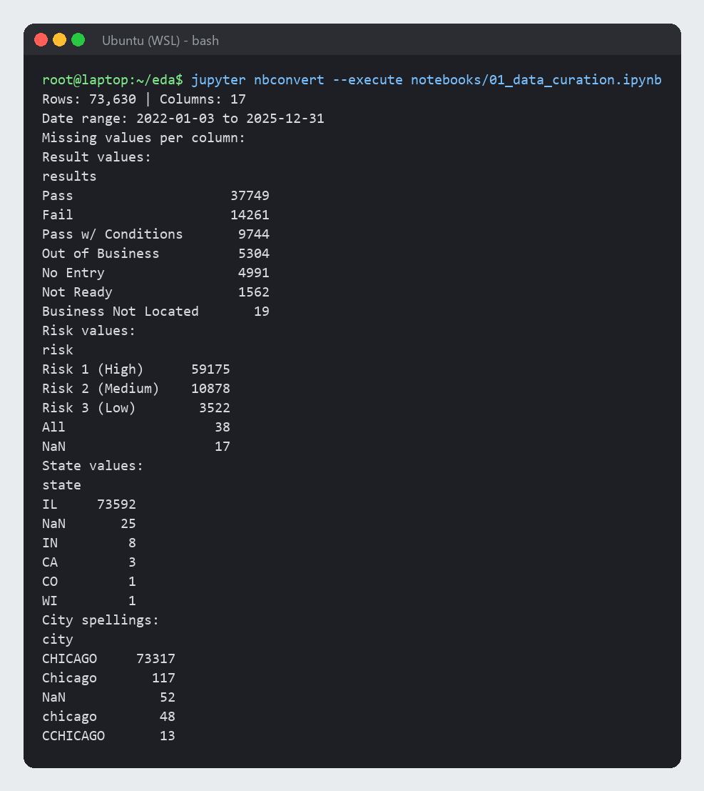

> **What it shows:** the problems profiling found: visits that never happened, risk "All", city spellings, 217 facility types.  
> **Why:** each line here became one cleaning rule.

**Basic questions**
- *Did you delete bad rows?* Only the 29 duplicates; everything else was fixed, marked, or mapped to Unknown.
- *Why 61,737 and not 73,630?* 29 duplicates removed; 11,864 visits never happened, so they aren't inspections.
- *How did you count violations?* Split the text at "|" and counted the numbered items.

**Deeper questions**
- *How do you know a row is a duplicate and not two inspections?* Same licence, same day, same type, same result and identical violation text; the only difference is the id, so it is one report entered twice.
- *Why "unknown" instead of 0 for a fail with no text?* A fail always has at least one violation; 0 would be false and would bias the averages and the models.
- *Why keep visits that never happened at all?* They are real records of the inspector's work; dropping them would change the totals; we only exclude them from inspection counts.
- *Why a quadrant for the area and not neighbourhoods?* The data has coordinates but no neighbourhood; the street-grid quadrant is simple, defined, and documented as derived, not official.
- *What can the data not tell you?* Time of day (always midnight) and the causes of a fail (staff, equipment, training).

---

## Part B · The warehouse design

**What we did:** designed a star schema, built a snowflake too, measured both, added a yearly fact table.

**Why:** a warehouse shaped for questions makes every question short and fast.

**How:**
- **Grain:** one row = one completed inspection of one place on one date.
- **Fact table:** ID numbers + countable numbers (violations, fail 1/0, pass 1/0, conditional 1/0).
- **Five dimensions:** date (1,826 days), facility (17,084), inspection type (15), result, location (252).
- **Surrogate keys** (1, 2, 3 …) and an **Unknown row (0)** in every dimension.
- **Second fact table:** one row per place per year (fact constellation).
- **Compared** with a snowflake by timing the same questions.

**Show it:** pgAdmin → `dw` → Tables (7 tables); right-click `dw` → **ERD For Schema**; **D1** (tables), **D2** (fact rows: only numbers), **D3** (row 0 = Unknown). Menu **12**.

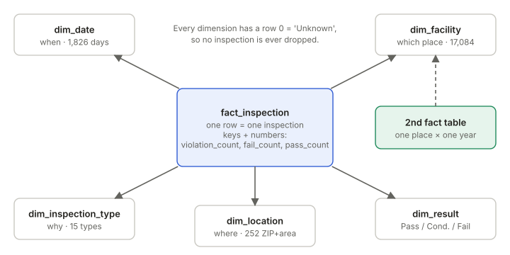

> **What it shows:** the fact table in the middle, five dimensions around it, the yearly fact sharing the facility dimension.  
> **Why:** the design, before building it.

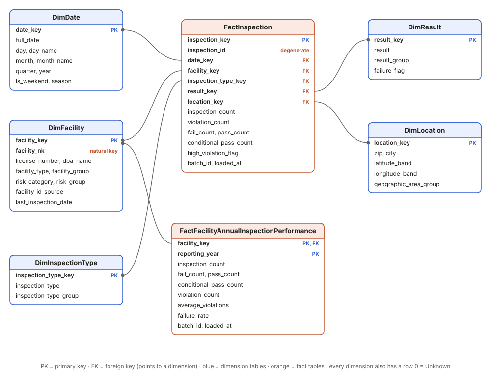

> **How to read it:** every table of the warehouse with its real columns. Blue = dimension tables, orange = fact tables. **PK** = primary key (the row's ID), **FK** = foreign key (an ID that points to a dimension). Each line goes from a key in a fact table to the dimension it points to. Both fact tables point to **DimFacility**, which is what makes this a fact constellation.  
> **Why we made it:** the exact structure of the database, the same one pgAdmin shows with *ERD For Schema*.

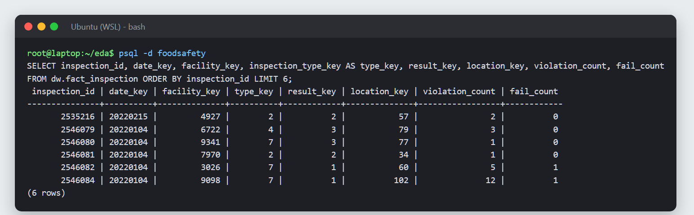

> **What it shows:** fact rows contain only keys and numbers, for example date_key 20220104 = 4 January 2022.  
> **Why:** the words are stored once, in the dimensions.

**Basic questions**
- *What is the grain?* One completed inspection of one place on one date.
- *Fact vs dimension?* Fact = events and numbers; dimension = descriptions.
- *Why a star?* Fewer joins, small fact table, each description stored once.

**Deeper questions**
- *What did the snowflake comparison show exactly?* 16 tables vs 6, 9 joins vs 3, about twice the query time, for a small saving in storage.
- *Why a second fact table?* Yearly per-place questions took about 27 ms on the star and about 4 ms on the yearly fact.
- *What happens when a restaurant changes its name or risk?* We overwrite with the latest value (Type 1); older inspections then show the current description. History of changes was not needed for our questions.
- *Why surrogate keys if you already have the city's ids?* Small integers join faster, and they don't break if the city changes or reuses an id; places without a licence still get a key.
- *Why not put everything in one table?* Names and types would repeat 61,737 times; updates would have to change many rows; joins on small keys are fast.

---

## Part C · Loading and checking

**What we did:** loaded the warehouse in two batches with one SQL procedure, checked it after each load, added indexes.

**Why:** to show both a first load and adding new data, and to prove nothing was lost or duplicated.

**How:**
- **Extract:** bulk-copy the clean file into a staging table, tagged with a batch number.
- **Transform + load** (one procedure, one transaction):
  - flag bad rows;
  - add new places to the dimensions;
  - look up the ID numbers and insert the facts;
  - rebuild the yearly fact;
  - write the audit row.
- **Initial load** (Jan 2022 – Nov 2025): 60,608. **Incremental** (Dec 2025): 1,129.
- **5 checks** (all 0):
  - no missing keys;
  - no duplicates;
  - nothing left in staging;
  - violation totals match;
  - the two facts agree.
- **Indexes** after loading: a lookup went from 6.5 ms to 0.5 ms.

**Show it:** **D4** (load audit); open `sql\04_validation.sql` → F5 (five zeros). Menu **2** reloads and prints "5 checks, failures = 0" twice; menu **3** runs the checks and the questions.

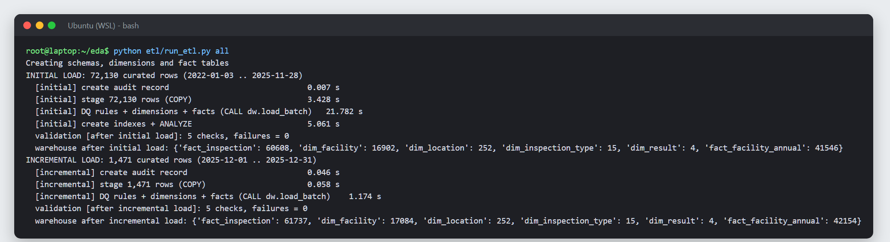

> **What it shows:** the initial load (60,608), the incremental load (+1,129 = 61,737), and "5 checks, failures = 0" after each.  
> **Why:** the whole of Part C in one screen.

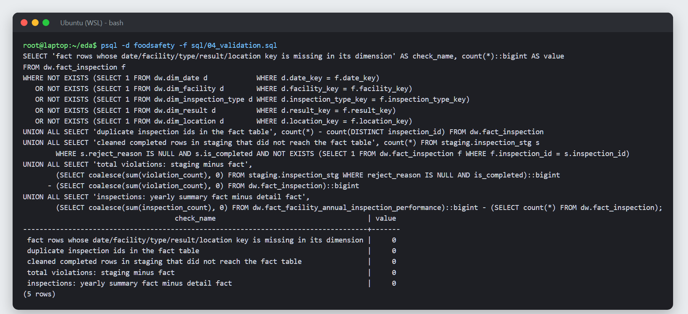

> **What it shows:** each check counts problems; all five are 0.  
> **Why:** proof the load is correct.

**Basic questions**
- *What is ETL?* Extract, transform, load: read the file, clean it and find the keys, insert into the warehouse.
- *Initial vs incremental load?* All old data first; then only the new month, without rebuilding.
- *Why staging?* New data waits and is checked before entering the warehouse.

**Deeper questions**
- *What if the same month is loaded twice?* The procedure flags inspection ids already in the warehouse, and the fact table refuses duplicate ids, so nothing is added twice.
- *What if the load fails halfway?* The procedure is one transaction: everything is saved or nothing is.
- *What does "look up the keys" mean?* For each inspection, find the ID number of its date, place, type, result and location in the dimension tables; if not found, use 0 (Unknown).
- *Why build indexes after the load?* Loading is faster without them; building them once afterwards is quicker than updating them for every row.
- *How were the 11,864 non-inspections handled in the load?* They stay in staging; the audit counts them as "not completed".

---

## Part F · Business questions, OLAP, dashboard

**What we did:** answered the ten business questions with SQL, demonstrated every OLAP operation, built a six-page dashboard.

**Why:** the brief's questions and the syllabus's OLAP operations; the dashboard is for non-technical users.

**How:**
- Each question = one SQL query joining the fact table with the dimensions it needs.
- **Roll-up:** up a level (month → quarter → year → total).
- **Drill-down:** down a level (group → type → one shop).
- **Slice:** one value fixed (2025).
- **Dice:** several fixed (2025 and high risk).
- **Pivot:** rows → columns (pass / conditional / fail side by side).
- **CUBE / grouping sets:** many subtotals in one query.
- **Dashboard:** Python reads the warehouse; Plotly draws the charts into one HTML page.

**Show it:** **D6** (by facility group), **D7** (roll-up: the "ALL" rows), **D8** (slice and dice), **D9** (pivot); the dashboard. Every OLAP query with its output and meaning is in `docs\olap_operations.md`. Menu **4**.

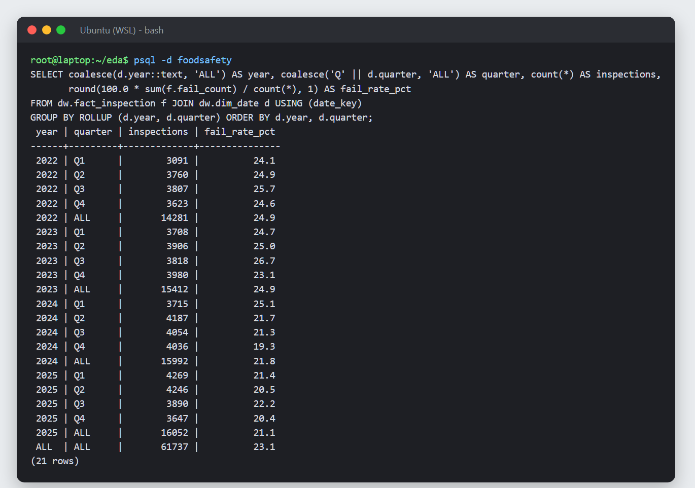

> **What it shows:** each quarter, then rows where quarter = ALL (the year total) and year = ALL (the grand total).  
> **Why:** that is what a roll-up produces.

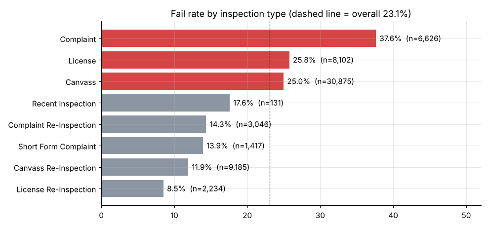

> **What it shows:** complaint inspections fail most (37.6%), re-inspections least; the dashed line is the 23.1% average.  
> **Why:** business question 5.

**Findings:**
- fail rate 23.1%, down from 24.9% to 21.1%;
- restaurants get about 70% of inspections;
- complaints fail most;
- after a fail, 79% of next visits pass (about 13 days later);
- the ZIP codes with the highest fail **rate** differ from those with the most fails.

**Basic questions**
- *What is OLAP?* Looking at the same numbers at different levels and angles.
- *Slice vs dice?* Slice fixes one dimension; dice fixes several.
- *Main findings?* As listed above.

**Deeper questions**
- *Why show counts and rates separately?* A busy group has many fails just because it is busy; the rate shows how risky it really is. The brief asks us not to confuse the two.
- *Why do complaint inspections fail more?* They happen because someone reported a problem, so there is usually a problem; it's a selection effect, not proof that complaints cause fails.
- *How did you measure "after a fail"?* For each licensed place, the inspection right after a fail; 79% of those passed, about 13 days later on average.
- *Why an HTML dashboard instead of Power BI?* It opens anywhere, reads the same warehouse, and has the required sections; Power BI is future work.
- *Do the dashboard numbers match the report?* Yes, they come from the same warehouse queries.

---

## The analytics table

**What we did:** built one flat table from the warehouse where each inspection also carries the previous inspection of the same place (result, violations, days since, how many before).

**Why:** the models must use the warehouse, and the past of a place is the only pre-visit clue about it.

**How:** SQL window function LAG over each place's inspections in date order; only licensed places get a history; same-day repeats don't count.

**Show it:** **D10** (one restaurant: each row remembers the one before). Menu **5**.

**Deeper question**
- *Doesn't using the previous result leak the answer?* No: it is the result of an **earlier** inspection, known before the current visit.

---

## Part G · Regression

**What we did:** predicted the number of violations from pre-visit information.

**How:**
- **Time split:** 2022-24 train (45,266), 2025 test (15,919).
- **Three models:** baseline (always the average), simple (previous violations only), multiple (all inputs, word columns turned into 0/1 columns).
- **Scores:** MAE (average error), RMSE (punishes big misses), R² (share explained).
- **Checks:** input overlap (VIF), error spread (Breusch-Pagan), outliers.

**Results:** MAE 2.45 vs 2.71 for guessing; R² 0.12; violations ≈ 2.7 + 0.21 × previous violations.

**Show it:** notebook 07 (results table, actual vs predicted chart). Menu **6**.

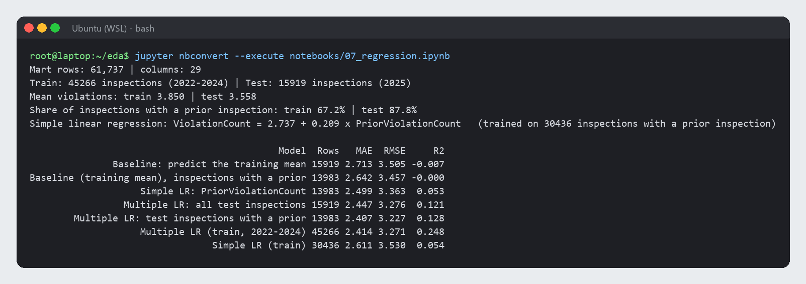

> **What it shows:** the split sizes, the simple equation, and the table: baseline 2.71, simple 2.50, multiple 2.45, R² 0.12.  
> **Why:** the whole result.

**Basic questions**
- *Why split by time?* So the model never learns from the future.
- *What do MAE and R² mean?* Average error in violations; share of the variation explained.

**Deeper questions**
- *Is R² 0.12 a failure?* No: it is a finding. The data has no information about the causes (cleanliness, staff), so prediction is limited. The model still beats guessing.
- *Why linear regression for a count?* It's the method the brief asks for and easy to explain; a Poisson model would suit counts better and is our next step (the linear model predicts a few negative counts).
- *What did the checks show?* Inputs barely overlap (5 of 102 slightly); the error is bigger for high counts; 2% of inspections (above 14 violations) cause about 25% of the error.
- *Which inputs matter most?* The previous inspection and some ZIP codes.

---

## Part H · Association rules

**What we did:** found characteristics that occur together.

**How:**
- **Baskets:** each inspection is a basket of 7 items: type, risk, inspection type, result, violation band, area, season (61,185 baskets).
- **Frequent sets:** Apriori and FP-Growth with minimum support 2%; both found 1,198.
- **Rules:** confidence ≥ 30%, lift ≥ 1.3.
- **Clean-up:** removed rules true by definition and repeats; 275 → 41 → 14 reported.

**Results:**
- 10+ violations ⇒ Fail: 69%, lift 3.0;
- low risk ⇒ grocery store: 62%, lift 6.5;
- passed licence inspections of restaurants often have 0 violations: 49%.

**Show it:** notebook 08 ("1198 frequent itemsets", "identical to Apriori: True", the rules table). Menu **7**.

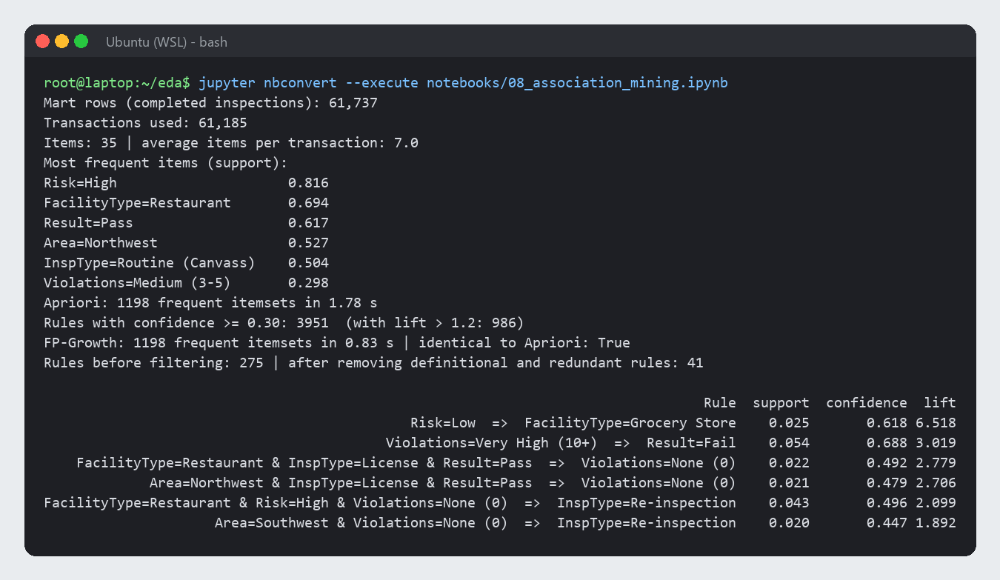

> **What it shows:** the most frequent items, both algorithms finding 1,198 sets, and the top rules with support, confidence and lift.  
> **Why:** the whole result.

**Basic questions**
- *Support, confidence, lift?* How often together; how often the rule holds; how many times more than chance.
- *Best rule?* 10+ violations ⇒ Fail, 69%, lift 3.

**Deeper questions**
- *Why remove "true by definition" rules?* E.g. "Fail ⇒ has violations" is guaranteed by how a fail is recorded; it teaches nothing.
- *Why 2% support?* Below that, rare combinations can show a huge lift by chance.
- *Why did both algorithms give the same answer?* They solve the same problem exactly; they only differ in speed (FP-Growth uses a compressed tree and skips candidate generation).
- *Does a rule mean cause?* No, only that the items occur together more often than chance.
- *How would the city use a rule?* For example, 10+ violations could trigger an early re-inspection.

---

## Part I · Decision tree

**What we did:** predicted whether an inspection will fail, with a readable tree.

**How:**
- **Three-way time split:** 2022-23 train, 2024 tune, 2025 test once.
- **Tuning:** each setting alone, then 420 combinations on 2024; best: depth 8, at least 200 inspections per leaf.
- **Cut-off:** chosen on 2024: 0.217 instead of 0.5.
- **Scores:** accuracy, precision, recall, ROC-AUC; feature importance; three real paths.

**Results:**
- AUC 0.635;
- at 0.217: 61% of fails caught, 29% of warnings correct;
- best clue: previous result = Fail;
- riskiest path (complaint, more than 6 previous violations, long gap): 55-58% fail.

**Show it:** notebook 09 (tuning chart, tree picture, ROC curve, importance, three paths). Menu **8**.

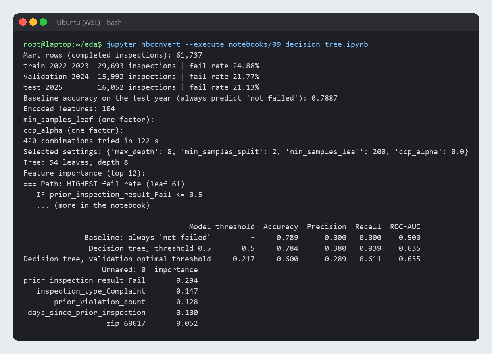

> **What it shows:** the splits, 420 settings tried, the chosen tree, the riskiest path, and the scores at both cut-offs.  
> **Why:** the whole result.

**Basic questions**
- *What is AUC?* How well the model ranks fails above passes: 0.5 = guessing, 1 = perfect.
- *What is overfitting?* Memorising the training data so it fails on new data.

**Deeper questions**
- *Why not use accuracy?* Always saying "pass" is already 79% accurate; accuracy rewards ignoring fails.
- *Why three splits instead of two?* Choosing settings on the test year would make the test score too optimistic; 2024 is for choosing, 2025 only for the final check.
- *How did you see overfitting?* A depth-20 tree scored 0.85 on training but 0.57 on 2024.
- *Why lower the cut-off?* Only about 21% fail, so the tree's probability rarely passes 50%; for inspections, missing a failing place costs more than an extra visit.
- *Precision is only 29%, is that bad?* For prioritising visits it's acceptable: it's better than the 21% you'd get by picking at random, and it catches 61% of fails.

---

## Part D · Distributed warehouse (Citus)

**What we did:** ran the warehouse on a 3-node Citus cluster and compared it with one server.

**How:**
- **Nodes:** coordinator (5440) + 2 workers (5441, 5442).
- **Distribution key:** compared facility, location and date; facility won (17,084 values, even spread).
- **Shards:** the fact table is cut into 32 shards, 16 per worker; dimensions are reference tables (copied to all).
- **Timing:** 5 queries at 61,737 to 2,000,000 rows, one server vs Citus. The bigger tables are copies of real rows, for timing only.

**Results:** 25 of 25 answers identical; slower on small data, mostly faster from about 500,000 rows.

**Show it:** pgAdmin on 5440, the Citus queries at the bottom of `demo_queries.sql`: 3 nodes; "distributed" vs "reference"; 16 + 16 shards (about 95 MB each). Menu **13** shows, menu **9** re-runs (3-5 min).

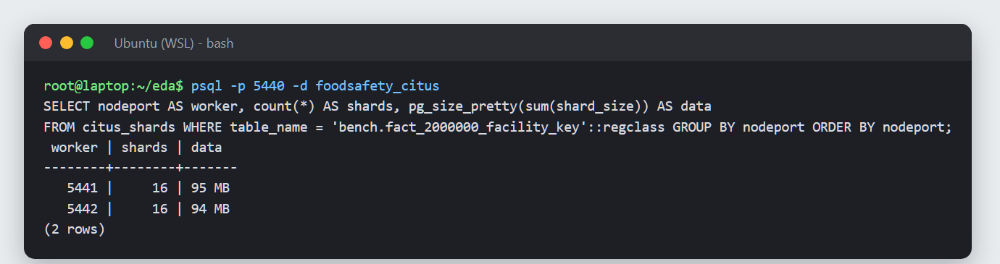

> **What it shows:** 16 shards and about 95 MB on each worker.  
> **Why:** the data really is split evenly.

**Basic questions**
- *What is a shard?* One piece of the fact table.
- *Reference table?* A small table copied to every node.

**Deeper questions**
- *Why is Citus slower on small data?* The coordinator spends time splitting the query and merging answers; that only pays off with lots of data. Our nodes also share one laptop's CPU.
- *What is data skew and why does the key matter?* If one value has most rows, one worker gets most of the work; date and location gave uneven shards.
- *Why copy the dimensions?* So each worker can join its shards with them locally, without asking another node.
- *What if a worker goes down?* Its shards become unavailable; production setups keep replicas.
- *Do you need Citus for Chicago?* No; one server is enough today. We built it to demonstrate and measure the approach.

---

## Part E · Real-time warehouse

**What we did:** replayed past inspections as a live stream and showed them on a live dashboard.

**How:**
- **Replay:** Oct-Dec 2025 in date order, labelled REPLAY SIMULATION (the city has no live feed).
- **Producer (Python):** sends each inspection to **Kafka** (a message queue); every 150th message is broken on purpose.
- **Spark:** every 2 seconds:
  - checks each message;
  - sends broken ones to a reject table;
  - counts per 10 seconds and per day.
- **ClickHouse:** a fast database, stores the results.
- **Grafana:** refreshes every 5 seconds with the brief's KPIs.

**Results:** 3,647 events; all 24 broken messages caught (8 of each kind); about 1.8 seconds from sending to screen.

**Show it:** Grafana while `Replay_Stream.cmd` runs; <http://localhost:8123/play> with `SELECT count() FROM food.inspection_events`. Menu **14**.

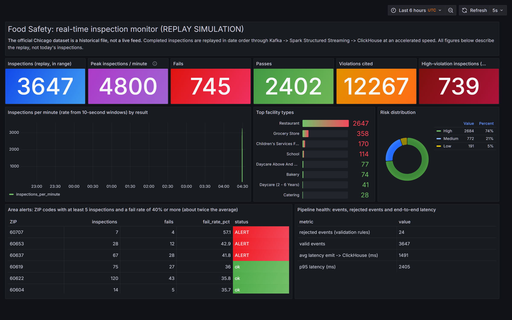

> **What it shows:** REPLAY SIMULATION; inspections, fails, passes, violations; per-minute chart; top facility types; risk mix; ZIP alerts; pipeline health.  
> **Why:** the streaming KPIs the brief lists.

**Basic questions**
- *Is it live?* No, a labelled replay of 2025, because the data is historical.
- *What does each tool do?* Kafka holds, Spark checks and counts, ClickHouse stores, Grafana shows.

**Deeper questions**
- *Why put Kafka between the producer and Spark?* It stores messages, so nothing is lost if Spark is slow or restarts, and several readers could use the same stream.
- *What checks does Spark do?* Valid JSON? Result one of Pass / Conditional / Fail? Violation count between 0 and 100? Failures go to `invalid_events` with the reason.
- *Why ClickHouse instead of PostgreSQL?* It stores data by column and adds up millions of rows very quickly while data keeps arriving; dashboard queries take about 11 ms.
- *What is a window?* A time bucket: Spark counts events per 10 seconds (for "per minute") and per inspection day.
- *What is an area alert?* A ZIP code with at least 5 inspections and a fail rate of 40% or more, shown in red.

---

## Part J · Comparison

| | Batch | Distributed | Real-time |
|---|---|---|---|
| Data arrives | in batches | in batches | continuously |
| Visible after | each load | each load | about 2 seconds |
| History and reports | best | same answers | recent only |
| Live view | no | no | yes |
| Grows by | bigger server | more servers | more servers |
| Effort | low | medium | high (4 services) |

**Recommendation:** batch warehouse as the main system (Chicago adds about 16,000 inspections a year); add real-time only for live monitoring; Citus only when data outgrows one server.

**Deeper questions**
- *Why not real-time for everything?* More complex and costly, and history questions are simpler and faster in the batch warehouse.
- *Can they work together?* Yes: real-time for today, batch for history (a hybrid).

---

## Questions about the whole project

- **Why this dataset?** Official, public, large, with dates, places, categories and outcomes, which every part of the brief needs.
- **What tools, and why?**
  - Python/pandas for cleaning;
  - PostgreSQL for the warehouse (free, standard SQL, supports OLAP functions);
  - scikit-learn and mlxtend for the models;
  - Citus because it is PostgreSQL made distributed;
  - Kafka/Spark/ClickHouse/Grafana because the brief recommends them.
- **Why WSL?** These servers are built for Linux; WSL runs Ubuntu inside Windows.
- **How is it reproducible?** `python run_all.py` rebuilds the batch part from the raw file in 10 minutes; `Project_Menu.cmd` reruns any part.
- **How do you know the results are right?**
  - five checks after each load;
  - counts reconciled before and after cleaning;
  - Citus matched one server on all 25 tests;
  - the dashboard and report read the same warehouse.
- **Hardest part?** Building Citus from source (no package for our Ubuntu version), and cleaning without losing data.
- **Limitations:**
  - no causes of failure in the data;
  - no time of day;
  - areas are quadrants;
  - the Citus nodes shared one laptop;
  - the stream is a replay.
- **Future work:** Poisson model for counts; one row per violation; Citus on separate machines; a live data feed; Power BI.
- **If you don't know:** "That part was done by [name], they can explain it better."

---

## If something breaks

| Problem | Do this |
|---|---|
| A link says "can't reach this page" | the servers are not up: is the `Start_Project.cmd` window still open? If not, start it again (JupyterLab is back in about 1 minute) |
| Menu 0 shows `--` lines | run `Start_Project.cmd` again |
| pgAdmin won't connect | show the screenshot of that query in this guide |
| Grafana shows no data | top right, set the time range to "Last 6 hours"; or run `Replay_Stream.cmd` again |
| JupyterLab is blank | open the dashboard's Data mining page, or the screenshots here |
| Projector problems | present `deliverables\Food_Safety_Presentation.pdf` on any computer |

**After the presentation:** close the `Start_Project.cmd` window.
