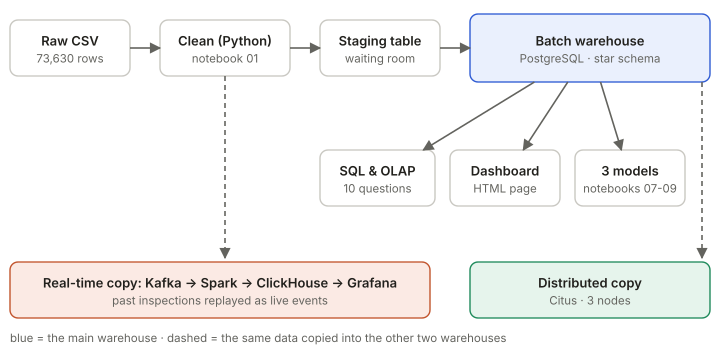
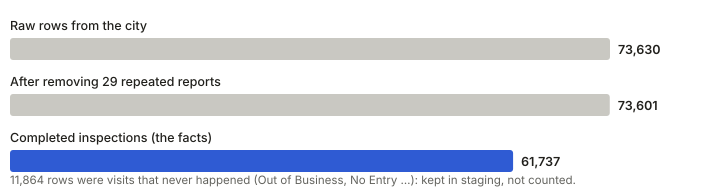
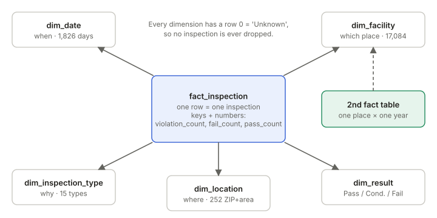
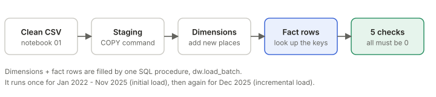
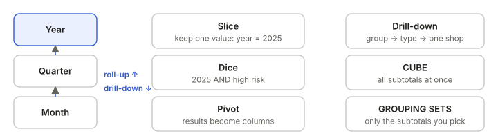
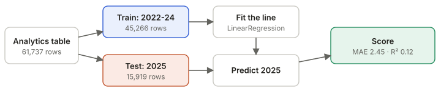
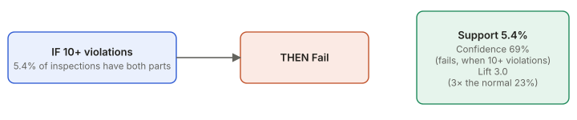
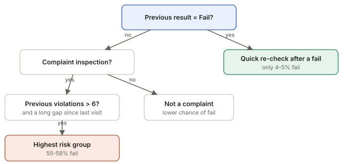

# Team Script

Our 10-minute presentation of **Food Safety & Restaurant Inspection Analytics**, split between the four of us. **Aryan opens, then Omkar, then Vishwaraj, and Rushi finishes.** Rushi drives the laptop for everyone, runs the live demo and answers most questions. Each of us speaks for about two minutes about the part we built.

**How to use this page:** read your own section out loud three times. You don't have to memorise it word for word; remember the **bold** words and the numbers. When your script says *(Rushi shows …)*, look at the screen and point at what you are talking about.

---

## Contents

1. [The plan: who speaks when](#the-plan-who-speaks-when)
2. [Who did what](#who-did-what)
3. [Rushi: opening](#rushi-opening)
4. [Omkar: the data and cleaning](#omkar-the-data-and-cleaning)
5. [Aryan: the warehouse, ETL and OLAP](#aryan-the-warehouse-etl-and-olap)
6. [Vishwaraj: the three models](#vishwaraj-the-three-models)
7. [Rushi: distributed, real-time and close](#rushi-distributed-real-time-and-close)
8. [Questions for everyone](#questions-for-everyone)

---

## The plan: who speaks when

| Time | Who | Slide | Topic | Rushi shows |
|---|---|---|---|---|
| 0:00 – 1:00 | **Aryan** | 1 – 3 | introduction, the whole pipeline | slides |
| 1:00 – 2:30 | **Omkar** | 4 | the data, cleaning, EDA | notebooks 01 and 02 |
| 2:30 – 4:30 | **Omkar** (Aryan helps on questions) | 5 – 6 | star schema, ETL, OLAP, findings | pgAdmin queries |
| 4:30 – 6:30 | **Vishwaraj** | 7 – 8 | regression, association rules, decision tree | notebooks 07, 08, 09 |
| 6:30 – 9:40 | **Rushi** | 9 – 10 | Citus, real-time Grafana, dashboard, conclusion | pgAdmin (Citus), Grafana, dashboard |
| 9:40 – | everyone | – | questions | – |

> **What it shows:** the whole project. Find your box: Omkar = Raw CSV and Clean; Aryan = Staging, Batch warehouse, SQL & OLAP; Vishwaraj = 3 models; Rushi = the dashed copies and the dashboard.  
> **Why it matters:** when mam points at any part of slide 3, the owner of that box answers.

---

## Who did what

If mam asks "who did what?", Rushi answers with this table and each person says one sentence about their part.

| Member | Parts | In one sentence |
|---|---|---|
| **Rushikesh Maddewad** (anchor) | D, E, J + setup, dashboard, report | "I set up and ran the whole project, built the Citus and real-time warehouses and the dashboard, and wrote the comparison." |
| **Omkar Patil** | A | "I profiled and cleaned the data, wrote the data-quality report and made the EDA charts." |
| **Aryan Tandale** | B, C, F | "I designed the star schema, wrote the ETL that loads it, and the OLAP and business-question queries." |
| **Vishwaraj Savairam** | G, H, I | "I built the analytics table and the three models: regression, association rules and the decision tree." |

---

## Aryan: opening

**Time:** 0:00 – 1:00 · **Slides:** 1 – 3

> "Good morning, mam. We are Omkar, Vishwaraj, Rushikesh and I am Aryan. Our project is **Food Safety and Restaurant Inspection Analytics**.
>
> The City of Chicago publishes every food inspection it does. We took four years, **2022 to 2025: 73,630 rows**.
>
> Our question: **which places fail inspections, where, when, and can we predict it?**
>
> *(slide 3)* This is the whole project on one picture. We clean the data in Python, load it into a **data warehouse** in PostgreSQL designed as a **star schema**, answer the **ten business questions** with SQL and OLAP, show them on a **dashboard**, and train **three models**. The same data also goes into a **distributed** and a **real-time** warehouse, as the brief asks.
>
> Rushikesh will run the demo on screen. **Omkar will start with the data.**"

---

## Omkar: the data and cleaning

**Time:** 1:00 – 2:30 · **Slide:** 4 · **Your part:** A · **Your files:** `etl/curation.py`, `notebooks/01_data_curation.ipynb`, `notebooks/02_eda.ipynb`, `docs/data_quality_report.md`

### Your words

> "Thank you, Rushi. Before building anything, we **profiled** the data: we looked at every column for missing values, duplicates and strange codes.
>
> *(Rushi shows notebook 01, the cleaning log)* Then we **cleaned** it, and every rule is written here with the number of rows it changed. For example:
> - **29 reports were entered twice**, so we removed them.
> - Facility type was typed by hand: **217 different spellings**, which we grouped into **7 groups** like Restaurant, School and Grocery.
> - The violations column is one long text. We **counted the violation numbers** in it to get a number we can analyse.
> - **11,864 rows were visits that never happened**, like Out of Business or No Entry. We did not delete them, but we don't count them as inspections.
>
> So **73,630 raw rows became 61,737 completed inspections**, and every drop has a reason.
>
> *(Rushi shows notebook 02)* Then we did **EDA**, exploratory data analysis: charts to understand the data before modelling. Inspections grow a little each year, there is no strong busy season, and most inspections have **0 to 5 violations**, with a few above 20.
>
> **Aryan will now show how we stored this data.**"

> **What it shows:** 73,630 → 73,601 → 61,737, drawn to scale.  
> **Why it matters for you:** this is your main story. Every row we lost has a reason.

### Words to remember

**Profiling** = looking at each column first. **Cleaning / curation** = fixing problems with a written rule. **EDA** = charts to understand the data. **Derived attribute** = a new column we made, like violation count, season or area.

### If mam asks you

**Why not just delete the bad rows?** Because the brief says not to silently drop data. Each problem gets a rule and a count, and some rows (like visits that never happened) are kept but not counted.

**A fail with no violation text, is that 0 violations?** No. A fail needs at least one violation, so we set it to "unknown" (552 rows), not 0.

**How did you count violations?** The text looks like `34. FLOORS … | 35. WALLS …`. We split it at `|` and count the numbers at the start of each piece.

**What did EDA show?** Volume grew about 12% in four years; restaurants get about 7 in 10 inspections; fails have more violations than passes.

### Numbers

73,630 raw · 29 duplicates removed · 217 spellings → 7 groups · 552 unknown counts · 11,864 not completed · **61,737 completed**

---

## Aryan: the warehouse, ETL and OLAP

**Time:** 2:30 – 4:30 · **Slides:** 5 – 6 · **Your parts:** B, C, F · **Your files:** `sql/01_schema.sql`, `sql/02_load_batch.sql`, `sql/04_validation.sql`, `sql/06`, `sql/07`, `etl/run_etl.py`, `etl/model_comparison.py`

### Your words

> "Thank you, Omkar. To answer questions quickly we built a **data warehouse**, designed as a **star schema**.
>
> In the middle is the **fact table**: one row is **one completed inspection**. That is called the **grain**. Around it are five **dimension tables**: date, facility, inspection type, result and location.
>
> *(Rushi shows the fact rows in pgAdmin)* As you can see, the fact table holds only **keys and numbers**, like violation count and fail count. The words, like the restaurant name, live in the dimension tables.
>
> We also built a **snowflake** version and compared them: the snowflake needs **9 joins instead of 3** and was about **twice as slow**, so we kept the star. We added a second fact table, one place per year, which makes it a **fact constellation**.
>
> To fill it we wrote the **ETL**: Extract, Transform, Load. The clean file goes into a **staging** table first, then one SQL procedure adds the new dimension rows and the fact rows. *(Rushi shows the load table)* We loaded **2022 to November 2025 first: 60,608 inspections**, then **December 2025 as an incremental load: 1,129 more**. After each load **five checks** confirm nothing was lost or duplicated, and all return zero.
>
> *(slide 6, Rushi shows roll-up and pivot)* Then we answered the ten business questions with **OLAP**: roll-up, drill-down, slice, dice and pivot. The main findings: the **fail rate is 23%**, it fell from **25% in 2022 to 21% in 2025**, **complaint inspections fail most at 38%**, and after a failed inspection the **next visit passes 79% of the time**.
>
> **Vishwaraj will now show our three models.**"

> **What it shows:** the fact table in the middle, five dimensions around it, and the second fact table.  
> **Why it matters for you:** if mam asks you to draw the schema, draw this.

> **What it shows:** the five steps of every load.  
> **Why it matters for you:** this is how you explain "ETL" in one breath.

> **What it shows:** the six OLAP operations and one example of each on our data.  
> **Why it matters for you:** mam may ask "show me a slice"; the example is right there.

### Words to remember

**Fact table** = events with numbers. **Dimension table** = the descriptions. **Grain** = what one fact row means. **Surrogate key** = a simple number the warehouse gives each row (like `facility_key = 4927`). **Staging** = a waiting room before the warehouse. **Incremental load** = adding only the new month. **Roll-up** = go up a level (month → year). **Drill-down** = go down. **Slice** = fix one value (year = 2025). **Dice** = fix several (2025 and high risk). **Pivot** = turn rows into columns.

### If mam asks you

**Why a star schema?** The fact table stays small (only numbers and keys), each description is stored once, and every question is a simple join.

**What is a fact constellation?** Two fact tables that share the same dimension tables. Our second one is one place per year; yearly questions became 7 times faster (29.5 → 4.3 ms).

**What is a surrogate key?** A simple number made by the warehouse, used for joins. It is small and stays the same even if the city changes its own id.

**What does the "Unknown" row do?** Every dimension has a row 0 called Unknown, so an inspection with a missing value is still loaded, not dropped.

**What are the five checks?** No missing keys, no duplicate inspections, no completed row left behind in staging, the same total of violations in staging and in the warehouse, and the two fact tables agree.

**What did the index do?** Looking up one facility's history went from 6.5 ms to 0.5 ms.

### Numbers

grain = one inspection · 5 dimensions · 3 vs 9 joins · 83 vs 162 ms · 60,608 + 1,129 = 61,737 · 5 checks = 0 · fail rate 23.1% · 24.9% → 21.1% · complaints 37.6% · next visit passes 79%

---

## Vishwaraj: the three models

**Time:** 4:30 – 6:30 · **Slides:** 7 – 8 · **Your parts:** G, H, I · **Your files:** `sql/08_analytics_mart.sql`, `notebooks/07_regression.ipynb`, `08_association_mining.ipynb`, `09_decision_tree.ipynb`

### Your words

> "Thank you, Aryan. All three models read from the warehouse, not the raw file. We made one **analytics table** where each inspection also remembers the **previous inspection** of the same place: its result, its violations and the days since.
>
> We always **train on 2022 to 2024 and test on 2025**, so the model never sees the future.
>
> First, **regression**: predict **how many violations** an inspection will find. *(Rushi shows notebook 07)* Our model is off by **2.45 violations on average**, against **2.71 if we just guess the average**. **R² is 0.12**, so it is weak. That is an honest finding: the real causes, like how clean the kitchen is, are not in the data.
>
> Second, **association rules**: what happens **together**. *(Rushi shows notebook 08)* We used **Apriori and FP-Growth**; both found the **same 1,198 patterns**, and FP-Growth was three times faster. The strongest rule: **10 or more violations ⇒ Fail, 69% of the time**, which is **three times** more than normal. That "three times" is called **lift**.
>
> Third, a **decision tree**: **will this inspection fail?** *(Rushi shows notebook 09)* We tuned it on 2024: a very deep tree memorised the training data, which is **overfitting**. The final tree has an **AUC of 0.635**, where 0.5 is guessing. Because only about 1 in 5 inspections fail, we lowered the cut-off to **0.217**, and then it catches **61% of the fails**. The most important clue is whether the **previous inspection failed**.
>
> So the tree can help decide **which places to inspect first**. **Rushi will now show the other two warehouses.**"

> **What it shows:** the split by time and the final score.  
> **Why it matters for you:** answers "how did you train and test?"

> **What it shows:** support, confidence and lift for the rule "10+ violations ⇒ Fail".  
> **Why it matters for you:** answers "what is lift?" with our own example.

> **What it shows:** the first questions the tree asks and where the highest and lowest fail rates are.  
> **Why it matters for you:** read it top to bottom as yes/no questions.

### Words to remember

**Regression** = predicts a number. **Classification** = predicts a category (fail / not fail). **MAE** = average error. **R²** = how much of the variation the model explains (1 = perfect). **Support** = how often items appear together. **Confidence** = how often the rule is true. **Lift** = how many times more than chance. **Overfitting** = the model memorises the training data and fails on new data. **AUC** = how well the model ranks fails above passes (0.5 = guessing, 1 = perfect). **Recall** = share of real fails we caught. **Precision** = share of our "fail" warnings that were right.

### If mam asks you

**Why not a random train/test split?** It would let the model learn from later inspections of the same place, which is like seeing the future. A time split is how it would be used for real.

**Why is R² so low?** The data has no information about the real causes (staff, cleaning habits). The model is still better than guessing.

**Why do Apriori and FP-Growth give the same result?** They solve the same problem; Apriori builds patterns step by step, FP-Growth uses a tree and is faster.

**Why change the cut-off from 0.5?** Only 21% of inspections fail, so the tree rarely says "above 50%". At 0.5 it caught only 4% of fails; at 0.217 it catches 61%.

**How did you stop overfitting?** We limited the depth and the minimum number of rows per leaf, and chose the setting that scored best on 2024.

**Which input matters most?** Whether the previous inspection failed (29% of the importance), then complaint inspections, then previous violation count.

### Numbers

train 2022-24 / test 2025 · MAE 2.45 vs 2.71 · R² 0.12 · 1,198 itemsets · 14 rules · 10+ violations ⇒ Fail 69%, lift 3.0 · AUC 0.635 · cut-off 0.217 catches 61%

---

## Rushi: distributed, real-time and close

**Time:** 6:30 – 9:40 · **Slides:** 9 – 10 · **Your parts:** D, E, J · Every click is in the **Project Guide** under "Presenting it". Your words:

> "**Part D, distributed:** Citus turns PostgreSQL into a cluster: one **coordinator** and two **workers**. The fact table is cut into **32 shards** by facility, 16 on each worker; the dimensions are copied to every worker. All **25 test queries gave the same answers** as one server; Citus is slower on small data and faster from half a million rows.
>
> **Part E, real-time:** we **replay** the last three months of 2025 as live events. **Producer → Kafka → Spark → ClickHouse → Grafana.** *(Grafana numbers going up)* 3,647 events, all 24 broken test messages caught, about 1.8 seconds from sending to screen. It is clearly labelled a simulation.
>
> **Dashboard:** one HTML page with the four sections the brief asks for, plus the models and the warehouses.
>
> **Conclusion:** batch is best for history and is simplest; distributed scales; real-time shows things live but needs four services. We recommend the **batch warehouse as the main system**, real-time only for live monitoring, Citus only when the data outgrows one server.
>
> **Thank you, mam. We are happy to take questions.**"

---

## Questions for everyone

Everyone should be able to answer these in one or two sentences.

**What is the project about?** Chicago food inspections 2022-2025: we find which places fail, where and when, and try to predict it.

**What is a data warehouse?** A database designed for analysis: asking questions about many records at once.

**What is ETL?** Extract (read the file), Transform (clean it, find the keys), Load (insert into the warehouse).

**What are the three warehouses?** Batch (PostgreSQL), distributed (Citus, several nodes), real-time (Kafka → Spark → ClickHouse → Grafana).

**What is the main finding?** The fail rate is 23% and falling; complaint inspections fail most; after a fail, 79% of next visits pass, so follow-ups work.

**Which tools did you use?** Python (pandas, scikit-learn, mlxtend) in Jupyter, PostgreSQL, Citus, Kafka, Spark, ClickHouse, Grafana, and an HTML dashboard with Plotly.

**How do you run it?** `python run_all.py` runs everything for the batch part in about 10 minutes.

**If you don't know an answer:** say *"That part was done by [name], they can explain it better"* and look at that person. That is completely fine.
