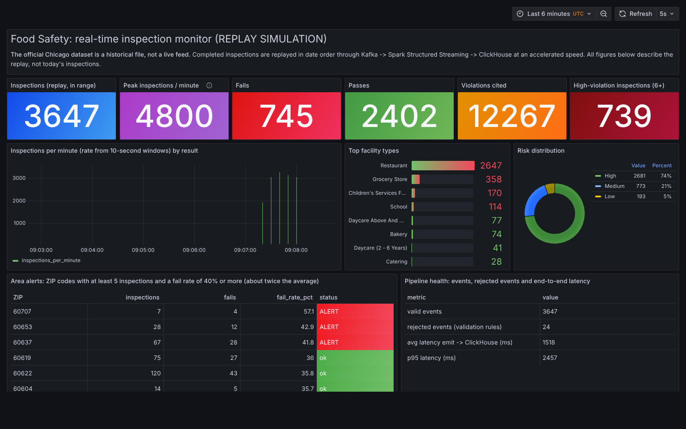

# Part E: Real-Time / Streaming Data Warehouse

**This is a replay simulation.** The official Chicago dataset is a historical file, not a live feed. Completed inspections are replayed in date order, at an accelerated speed, as simulated live events. Every event carries `source_mode = "REPLAY_SIMULATION"` and the Grafana dashboard says so in its header.

## Architecture
`Historical records (curated CSV)  >  Python producer  >  Kafka topic  >  Spark Structured Streaming  >  ClickHouse  >  Grafana`

| Component | Version / setup | File |
|---|---|---|
| Producer | kafka-python, replays completed inspections in chronological order at a chosen speed | `streaming/producer.py` |
| Kafka | Apache Kafka 3.9.0, one broker in KRaft mode, topic `food_inspections`, 3 partitions | `scripts/start_realtime_stack.sh` |
| Stream processing | PySpark 4.0.1 (Spark Structured Streaming, local mode, 2 cores), 2-second micro-batches | `streaming/spark_stream.py` |
| Real-time store | ClickHouse 26.3 LTS, database `food` | `streaming/clickhouse_ddl.sql` |
| Dashboard | Grafana 11.3 with the ClickHouse datasource plugin | `streaming/grafana/` |

## Event design
* **Topic:** `food_inspections`. **Key:** `inspection_id` (so one inspection always goes to the same partition). **Replay speed:** `--rate` events per second (80 per second in the test below).
* **Event timestamp:** `event_time` is the inspection date. The source has no time of day, so the time of day is NOT invented. `emitted_at` is the producer's wall-clock time and Kafka adds its own ingest timestamp.
* **Minimal operational payload** (derived from the source record, no free-text violations). Below is a real event taken from the ClickHouse event table:

```json
{
 "event_id": "e-2624628",
 "source_mode": "REPLAY_SIMULATION",
 "replay_run_id": "726ef195",
 "emitted_at": "2026-10-29 09:07:23.573",
 "event_time": "2025-10-01",
 "inspection_id": 2624628,
 "license_number": "2713071",
 "dba_name": "MANCINAS INC.",
 "facility_type": "Restaurant",
 "facility_group": "Restaurant & Food Service",
 "risk_group": "High",
 "inspection_type_group": "Re-inspection",
 "result": "Pass",
 "result_group": "Pass",
 "violation_count": 0,
 "zip": "60623",
 "area_group": "Southwest"
}
```
* **Validation rules** (first failing rule is stored in `food.invalid_events`): valid JSON; `inspection_id` present and > 0; `event_time` is a date; `result_group` in (Pass, Conditional Pass, Fail); `risk_group` in the documented list; `violation_count` is null or between 0 and 100; `emitted_at` present.
* To exercise the rules the producer can inject labelled malformed test events (`--bad-every N`). In the test run it injected 24: 8 not valid JSON, 8 with an invalid result group and 8 with a negative violation count. All 24 were rejected and none reached the event table.

## Required streaming operations
| Operation | Implemented in `spark_stream.py` |
|---|---|
| Parse and validate JSON | `from_json` with an explicit schema + the validation rules above; rejected events go to `food.invalid_events` |
| Create derived measures | `is_fail`, `is_pass`, `is_conditional`, `high_violation_flag` (violation count >= 6, same rule as the batch warehouse) |
| Event-time processing | one-day tumbling windows on `event_time` with a 1-day watermark, written to `food.daily_event_time_agg` |
| Aggregate over short windows | 10-second windows on ingest time by facility group, risk, area and result, written to `food.window_agg` (update mode; `ReplacingMergeTree` keeps the newest version of each window) |
| Write to ClickHouse | `foreachBatch` writers for the event table, the invalid table and both aggregate tables |
| Refresh Grafana continuously | dashboard refresh every 5 seconds |
| Live replay during evaluation | `scripts/start_realtime_stack.sh`, then `python3 streaming/producer.py --from 2025-10-01 --to 2025-12-31 --rate 80 --bad-every 150` |

## Required KPIs on the dashboard


| KPI | Panel and source |
|---|---|
| Inspections / minute during replay | time series (10-second windows x 6) and the *Peak inspections / minute* tile, from `window_agg` |
| Fails, Passes | stat tiles from `window_agg` |
| Violations, High-violation inspections | stat tiles (sum of `violations`, count of `high_violation_flag = 1`) |
| Top facility types | bar gauge from `inspection_events` |
| Risk distribution | donut chart from `window_agg` |
| Area alerts | table by ZIP: at least 5 inspections and a fail rate of 40% or more (about twice the average) is marked ALERT |

The dashboard JSON is `streaming/grafana/food_safety_realtime_dashboard.json` (provisioned automatically).

## Measured results (replay of Q4 2025: 3,647 completed inspections at 80 events per second)
| Measure | Value |
|---|---|
| Valid events stored / events replayed | 3,647 / 3,647 (each inspection exactly once) |
| Sum of the 10-second windows and of the event-time days | 3,647 and 3,647 (both reconcile with the event table) |
| Rejected injected test events | 24 of 24 |
| Peak rate shown on the dashboard | 4,800 inspections per minute (80 per second x 60) |
| End-to-end latency, emit to ClickHouse | average 1518 ms, median 1510 ms, p95 2457 ms, max 3541 ms |
| ClickHouse dashboard queries (median of 9) | 7.3, 5.6, 6.4 and 5.7 ms |
| Memory (resident) | Kafka 396 MB, ClickHouse 704 MB, Spark job 1244 MB, Grafana 175 MB |

The latency is dominated by the 2-second Spark micro-batch trigger. The test ran every component on one 4-core machine, so the figures show how the pipeline behaves, not the capacity of a production cluster. A throughput limit test was not part of this project.

## How to run
```bash
scripts/install_tools.sh            # downloads Kafka, ClickHouse and Grafana and verifies their checksums
scripts/start_realtime_stack.sh     # ClickHouse, Kafka, Spark streaming job, Grafana
python3 streaming/producer.py --from 2025-10-01 --to 2025-12-31 --rate 80 --bad-every 150
# open http://127.0.0.1:3000/d/food-safety-rt   (set the time range to the last 5-10 minutes)
```
