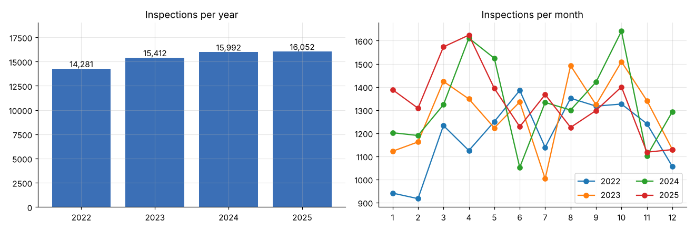
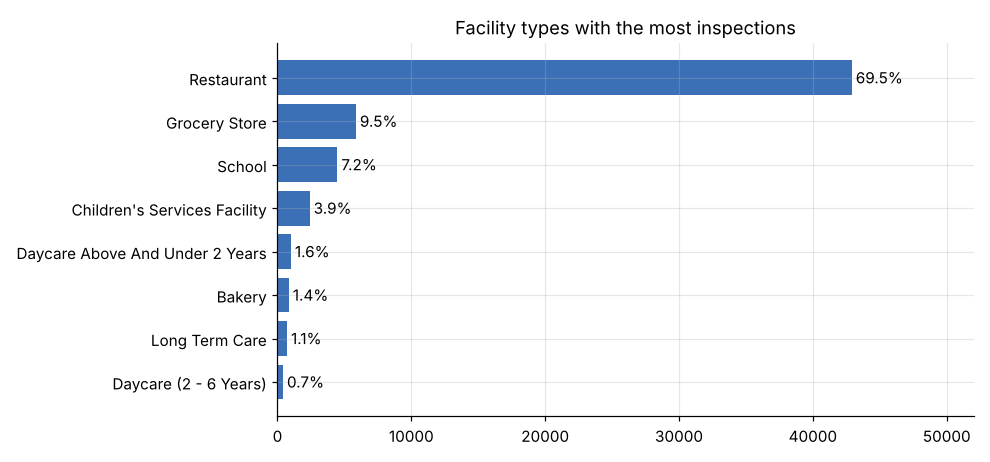
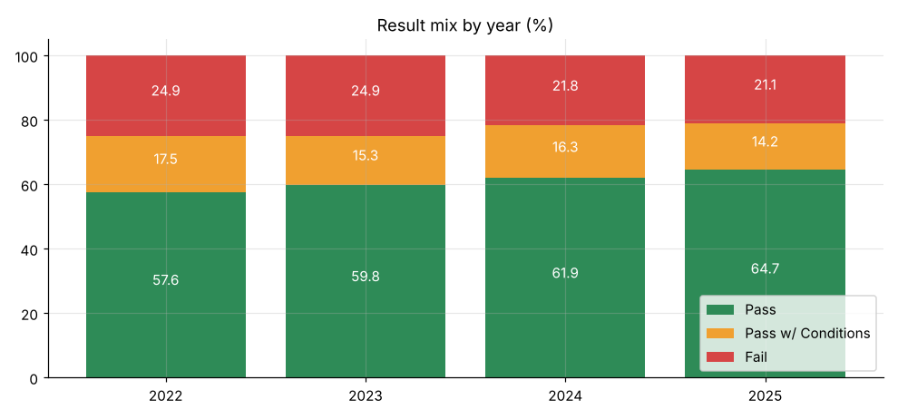
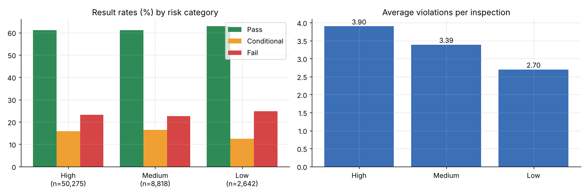
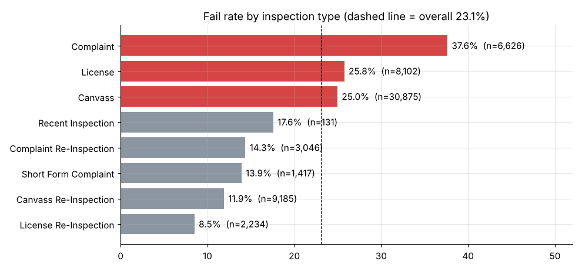
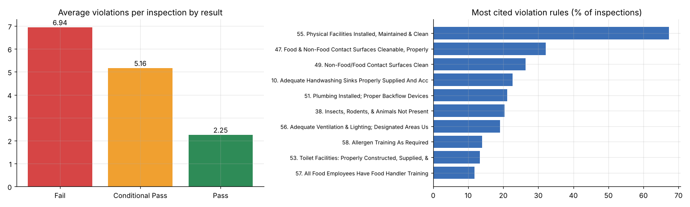
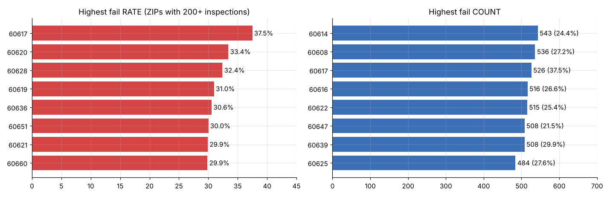
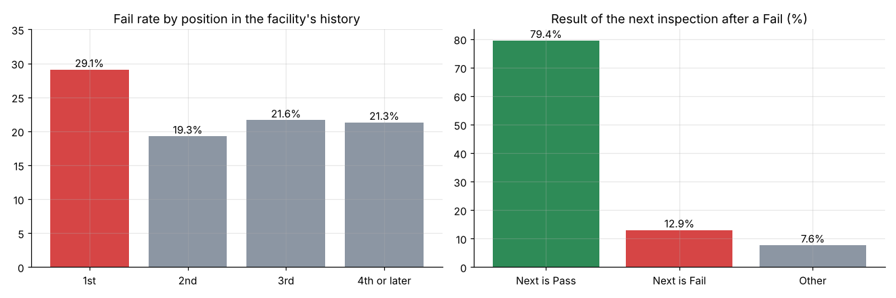
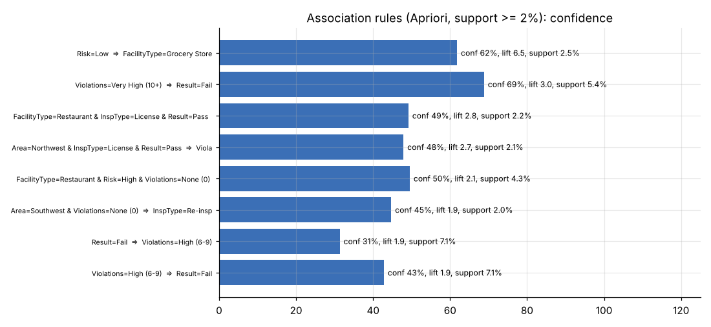
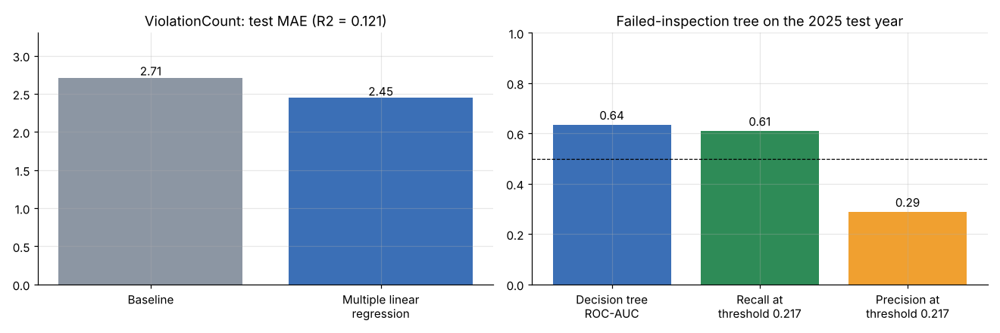

# Ten Analytical Findings

Every finding follows **Question > Analysis > Evidence > Interpretation > Recommendation** and contains the measure, the dimensions or filters, and a chart. All numbers come from SQL on the PostgreSQL warehouse (`sql/06_analytical_queries.sql`) or from the mining notebooks 07-09. Findings 1-8 answer mandatory questions 1-8, finding 9 answers question 9 (association rules) and finding 10 question 10 (prediction).

## Finding 1: Inspection volume grew 12% in four years and has no stable seasonal peak

**Question.** How many inspections are completed per month and per year?

**Analysis.** Measure: InspectionCount. Dimensions: DimDate (Year, Month). Filter: completed inspections 2022-2025. SQL: Q1a and Q1b.

**Evidence.**

Yearly totals: 2022: 14,281, 2023: 15,412, 2024: 15,992, 2025: 16,052. Busiest months: October 2024 (1,641), April 2025 (1,624), April 2024 (1,611). Quietest months: February 2022 (917), January 2022 (941), July 2023 (1,003).

**Interpretation.** The yearly volume rose from 14,281 to 16,052 (+12.4%). The busiest and quietest months differ from year to year, so there is no month that is busy every year; two of the three quietest months are January and February 2022.

**Recommendation.** Plan the inspector capacity on a steady workload of about 1,300 to 1,650 inspections per month instead of a fixed seasonal peak, and review the capacity every quarter against the actual volume.

## Finding 2: Restaurants receive seven of every ten inspections

**Question.** Which facility types receive the most inspections?

**Analysis.** Measure: InspectionCount and its share. Dimension: DimFacility (Facility Type). SQL: Q2.

**Evidence.**

| facility_type | inspections | % of all |
|---|---|---|
| Restaurant | 42908 | 69.5 |
| Grocery Store | 5857 | 9.49 |
| School | 4472 | 7.24 |
| Children's Services Facility | 2404 | 3.89 |
| Daycare Above And Under 2 Years | 1003 | 1.62 |
| Bakery | 847 | 1.37 |
| Long Term Care | 713 | 1.15 |
| Daycare (2 - 6 Years) | 409 | 0.66 |

**Interpretation.** Restaurants alone have 42,908 inspections (69.5%). The top 8 facility types cover 94.9% of all inspections; the other types are many small groups.

**Recommendation.** Direct the main training and outreach effort at restaurants because they carry the volume, but track the rarer types (such as liquor stores and retail) by their failure rate (finding 7 and 4) and not only by their volume.

## Finding 3: The fail rate fell from 24.9% to 21.1% while passes rose

**Question.** How do the pass, conditional-pass and fail rates change over time?

**Analysis.** Measures: PassRate, ConditionalPassRate, FailureRate. Dimension: DimDate (Year). SQL: Q3.

**Evidence.**

| year | inspections | pass % | conditional % | fail % |
|---|---|---|---|---|
| 2022.0 | 14281.0 | 57.59 | 17.53 | 24.88 |
| 2023.0 | 15412.0 | 59.84 | 15.27 | 24.88 |
| 2024.0 | 15992.0 | 61.94 | 16.29 | 21.77 |
| 2025.0 | 16052.0 | 64.66 | 14.21 | 21.13 |

**Interpretation.** The fail rate was 24.88% in 2022 and 24.88% in 2023, then dropped to 21.77% in 2024 and 21.13% in 2025. The pass rate rose from 57.6% to 64.7% and the conditional-pass rate fell from 17.5% to 14.2%. The data cannot show whether this is better compliance or a change in inspection practice.

**Recommendation.** Investigate what changed in 2024 (inspector practice, re-inspection rules or compliance programmes) before claiming an improvement, and report the fail rate every month together with the number of inspections.

## Finding 4: The risk category does not change how often an inspection fails, but high-risk places record more violations

**Question.** How do the results compare across the risk categories?

**Analysis.** Measures: PassRate, ConditionalPassRate, FailureRate, AverageViolations. Dimension: DimFacility (Risk Group). SQL: Q4.

**Evidence.**

| risk | inspections | pass % | conditional % | fail % | avg violations |
|---|---|---|---|---|---|
| High | 50275 | 61.05 | 15.85 | 23.1 | 3.9 |
| Medium | 8818 | 61.02 | 16.36 | 22.61 | 3.39 |
| Low | 2642 | 62.83 | 12.45 | 24.72 | 2.7 |

**Interpretation.** The fail rate is 23.1% for high, 22.6% for medium and 24.7% for low risk, so the risk category does not separate failing from passing. The average violation count does fall from 3.90 (high) to 2.70 (low). The risk category describes the hazard of the business and its inspection frequency, not the chance of a fail on a given visit.

**Recommendation.** Keep the risk category for scheduling, but do not use it alone to decide where failures are likely; combine it with inspection type and inspection history (findings 5, 8 and 10).

## Finding 5: Complaint inspections fail most often; re-inspections fail least

**Question.** Which inspection types are associated with higher failure rates?

**Analysis.** Measures: InspectionCount, FailCount, FailureRate. Dimension: DimInspectionType (types with at least 100 inspections). SQL: Q5.

**Evidence.**

| inspection_type | inspections | fails | fail % |
|---|---|---|---|
| Complaint | 6626 | 2493 | 37.62 |
| License | 8102 | 2086 | 25.75 |
| Canvass | 30875 | 7706 | 24.96 |
| Recent Inspection | 131 | 23 | 17.56 |
| Complaint Re-Inspection | 3046 | 437 | 14.35 |
| Short Form Complaint | 1417 | 197 | 13.9 |
| Canvass Re-Inspection | 9185 | 1092 | 11.89 |
| License Re-Inspection | 2234 | 190 | 8.5 |

**Interpretation.** Full *Complaint* inspections fail 37.6% of the time, about 1.5 times the routine canvass rate (25.0%); licence inspections are at 25.8%. *Short Form Complaint* inspections fail only 13.9%, so grouping all complaints together hides a big difference. Re-inspections fail least (canvass re-inspection 11.9%), which shows that most businesses correct their problems.

**Recommendation.** Triage complaint inspections first because they are the most likely to find a failure, and keep the re-inspection step for every failure (see finding 8).

## Finding 6: Failing inspections cite three times the violations of passing ones, and the most common violations are about premises and cleanliness

**Question.** How many violations are recorded, and which violation patterns are the most common?

**Analysis.** Measures: AverageViolations, high-violation inspections (6 or more), citation share per rule number. Dimensions: DimResult (Result Group); rule numbers parsed from the violation text in staging (the star schema keeps only the count). SQL: Q6a and Q6b.

**Evidence.**

| result_group | inspections | average | median | max | 6+ violations |
|---|---|---|---|---|---|
| Fail | 13944 | 6.94 | 6.0 | 40 | 7668 |
| Conditional Pass | 9507 | 5.16 | 4.0 | 25 | 3591 |
| Pass | 37734 | 2.25 | 2.0 | 23 | 3740 |

Most cited rules:

| rule | inspections | % of inspections |
|---|---|---|
| 55. Physical Facilities Installed, Maintained & Clean | 41492 | 67.21 |
| 47. Food & Non-Food Contact Surfaces Cleanable, Properly | 19862 | 32.17 |
| 49. Non-Food/Food Contact Surfaces Clean | 16271 | 26.36 |
| 10. Adequate Handwashing Sinks Properly Supplied And Acc | 13964 | 22.62 |
| 51. Plumbing Installed; Proper Backflow Devices | 13060 | 21.15 |
| 38. Insects, Rodents, & Animals Not Present | 12537 | 20.31 |
| 56. Adequate Ventilation & Lighting; Designated Areas Us | 11783 | 19.09 |
| 58. Allergen Training As Required | 8601 | 13.93 |
| 53. Toilet Facilities: Properly Constructed, Supplied, & | 8220 | 13.31 |
| 57. All Food Employees Have Food Handler Training | 7266 | 11.77 |

**Interpretation.** A failed inspection records 6.94 violations on average (median 6), a conditional pass 5.16 and a pass 2.25. The most cited rule is rule 55 (67% of all inspections) and the next ones are about food-contact surfaces, handwashing sinks, plumbing and pests. The leading violations are about upkeep of the premises and cleanliness, not about food temperature.

**Recommendation.** Build the pre-inspection guidance and the owner training around the five most cited rules, because each of them appears in about a fifth to two thirds of all inspections.

## Finding 7: The ZIP codes with the highest failure rates are mostly not the ones with the most failures

**Question.** Which geographic areas have high failure counts and which have high failure rates?

**Analysis.** Measures: FailCount and FailureRate. Dimension: DimLocation (area group and ZIP; ZIPs with at least 200 inspections for the rate). SQL: Q7a, Q7b and Q7c.

**Evidence.**

Area groups:

| area | inspections | fails | fail % |
|---|---|---|---|
| Southeast | 7963 | 2127 | 26.71 |
| Southwest | 18028 | 4428 | 24.56 |
| Northwest | 32608 | 7110 | 21.8 |
| Unknown | 232 | 45 | 19.4 |
| Northeast | 2906 | 550 | 18.93 |

**Interpretation.** By area group the Southeast has the highest fail rate (26.7%) and the Northeast the lowest (18.9%). By ZIP, the highest rates are in 60617, 60620, 60628, 60619 (up to 37.5%), while the ZIPs with the most failures are 60614, 60608, 60617. Only 60617 appears in both lists. Volume and rate point to different places, so raw totals would send inspectors to the wrong areas.

**Recommendation.** Use the failure rate to choose areas for targeted outreach (ZIP 60617, 60620, 60628, 60619, 60636) and the failure count to size the inspector capacity (ZIP 60614, 60608, 60617).

## Finding 8: Follow-up works: after a failed inspection the next visit passes 79% of the time, on average 13 days later

**Question.** What happens at repeat inspections of the same establishment?

**Analysis.** Measures: FailureRate by inspection sequence number and by the outcome of the next inspection. Dimensions: DimFacility (licensed facilities only, because only the licence number identifies a facility reliably), DimDate (order of inspections; window functions). SQL: Q8a and Q8b.

**Evidence.**

| inspection_number | inspections | fail % |
|---|---|---|
| 1st | 17001 | 29.07 |
| 2nd | 12875 | 19.26 |
| 3rd | 10098 | 21.63 |
| 4th or later | 21578 | 21.29 |

After a failed inspection (13,966 cases with a later inspection): next inspection is a pass 79.4%, a fail 12.9%, average 13 days later.

**Interpretation.** The first inspection of a facility in the data fails 29.1% of the time, against 19.3% to 21.6% for later ones. The history starts in January 2022, so the first inspection in the data is not always the first ever. Most failures are corrected quickly: 79% of the next inspections pass, and only 13% fail again.

**Recommendation.** Keep a short re-inspection cycle (about two weeks) after every failure, and put the 13% of facilities that fail again on an escalation list.

## Finding 9: Ten or more violations mean a 69% chance of failing; follow-up and licence visits are the cleanest

**Question.** Which combinations of facility, risk, inspection type and result characteristics occur together?

**Analysis.** Method: Apriori and FP-Growth on 61,185 inspections, 7 categorical items each (facility type, risk, inspection type group, result, violation band, area, season); support >= 2%, confidence >= 30%, lift >= 1.3; definitional and redundant rules removed. Source: notebook 08.

**Evidence.**

| Rule | support | confidence | lift |
|---|---|---|---|
| Risk=Low  =>  FacilityType=Grocery Store | 0.025 | 0.618 | 6.516 |
| Violations=Very High (10+)  =>  Result=Fail | 0.054 | 0.688 | 3.019 |
| FacilityType=Restaurant & InspType=License & Result=Pass  =>  Violations=None (0) | 0.022 | 0.492 | 2.779 |
| Area=Northwest & InspType=License & Result=Pass  =>  Violations=None (0) | 0.021 | 0.479 | 2.707 |
| FacilityType=Restaurant & Risk=High & Violations=None (0)  =>  InspType=Re-inspection | 0.043 | 0.495 | 2.095 |
| Area=Southwest & Violations=None (0)  =>  InspType=Re-inspection | 0.02 | 0.447 | 1.892 |

(The notebook lists 14 rules with an interpretation each.)

**Interpretation.** Failing becomes much more likely as the violation count grows (43% at 6-9 violations, 69% at 10 or more, against 23% overall). Zero-violation inspections are concentrated in re-inspections and passed licence inspections, which agrees with finding 8. Low-risk inspections are mostly of grocery stores (62%, lift 6.5). No selected rule involves the season.

**Recommendation.** Treat 10 or more violations as an automatic trigger for an early re-inspection, use the clean-licence pattern to fast-track new licences, and plan low-risk routes around grocery stores.

## Finding 10: Violation counts and failures are only weakly predictable from what is known before the visit

**Question.** Can the number of violations be predicted and can a failed inspection be classified in advance?

**Analysis.** Methods: multiple linear regression for ViolationCount (notebook 07) and a pruned DecisionTreeClassifier for FailedInspection (notebook 09); both trained on 2022-2024 and tested on 2025; predictors known before the visit only; prior-history features from strictly earlier inspections.

**Evidence.**

| Model | Result on 2025 |
|---|---|
| Baseline (training mean) | MAE 2.71, RMSE 3.51 |
| Multiple linear regression | MAE 2.45, RMSE 3.28, R2 0.121 |
| Decision tree, threshold 0.5 | AUC 0.635, recall 0.04, precision 0.38 |
| Decision tree, threshold 0.217 | recall 0.61, precision 0.29, accuracy 0.60 |

Most important tree features: prior inspection result Fail (29%), inspection type Complaint (15%), prior violation count (13%), days since prior inspection (10%).

**Interpretation.** The regression lowers the error only from 2.71 to 2.45 violations (R2 0.12). The tree has an AUC of 0.64: with the threshold tuned on the validation year it finds 61% of the failures but only 29% of its alarms are real failures. What decides an inspection is mostly what the inspector finds on the day, which is not in the data.

**Recommendation.** Use the models only to rank inspections for attention (previous fail, complaint inspections after a long gap, location), together with inspector judgement, and add richer data (staff training, equipment, complaint details) before relying on a prediction.
